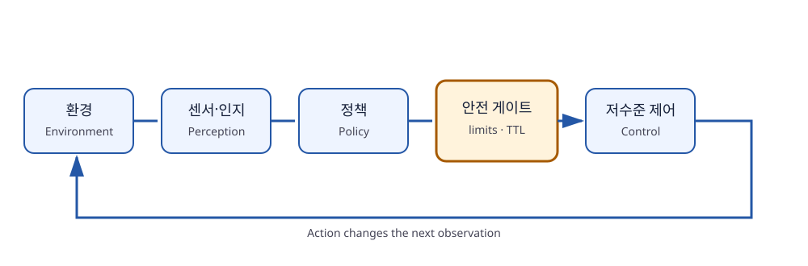
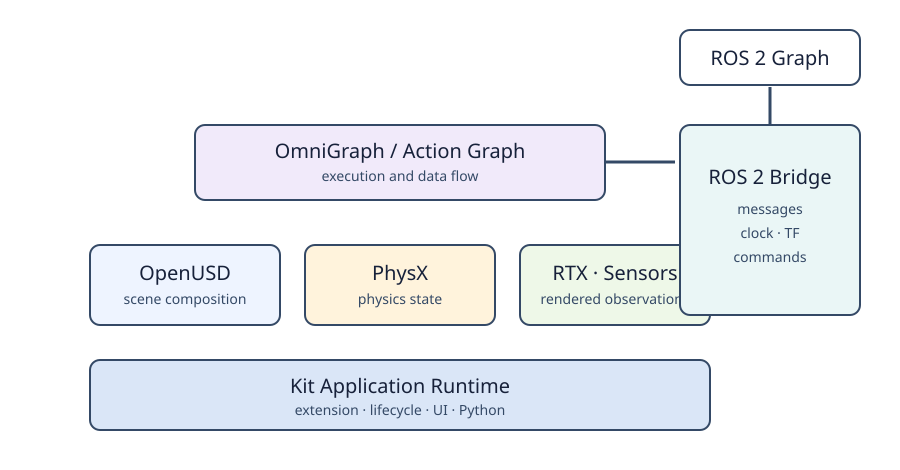
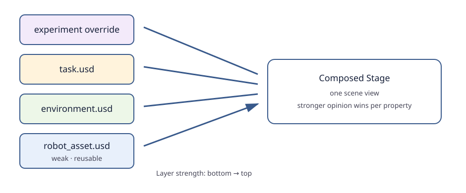
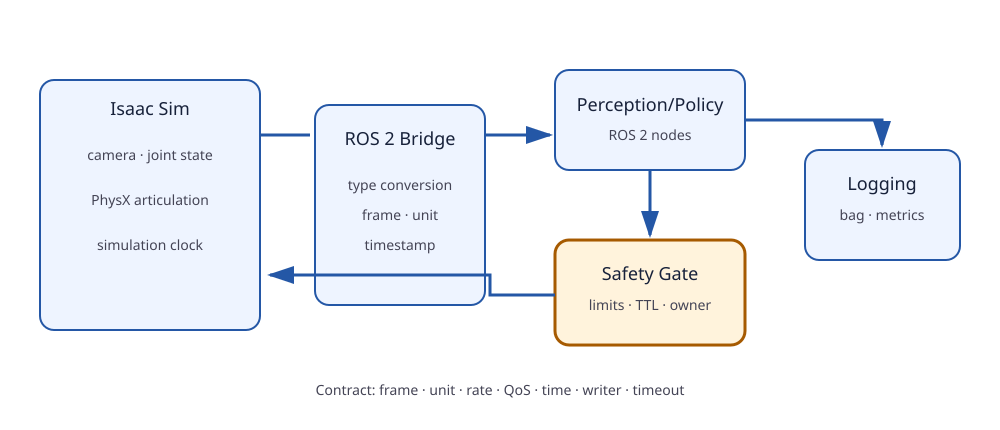

# 제1장 Physical AI와 Isaac Sim·OpenUSD·ROS 2 기반

## 장 개요

Physical AI는 인공지능 모델이 텍스트나 화면 안에서 답을 생성하는 데 그치지 않고, 센서로 물리 세계를 관측하고 모터를 통해 그 세계를 바꾸는 시스템을 다룬다. 로봇 제어에서는 모델의 정확도만큼 **시간**, **좌표계**, **동역학**, **통신 품질**, **안전 경계**가 중요하다. 같은 신경망이라도 관측이 200 ms 늦거나 관절 명령의 단위가 뒤바뀌면 전혀 다른 기계가 된다.

이 장은 이후 장의 공통 언어를 만든다. 먼저 규칙 기반 제어와 학습 정책을 비교하고, 인지-정책-행동(Perception-Policy-Action) 루프를 확률적 의사결정 문제로 해석한다. 이어 NVIDIA Isaac Sim을 구성하는 Kit, OpenUSD, PhysX, 렌더링 계층을 살펴본다. OpenUSD의 Stage, Layer, Prim, Attribute, Relationship과 합성(composition)을 코드로 다룬 뒤, ROS 2 Jazzy의 그래프와 DDS 기반 통신을 연결한다. 마지막에는 시뮬레이터와 제어기를 잇는 브리지 설계와 실패 격리 원칙을 정리한다.



**그림 1-1.** 관측, 추론, 안전 필터, 액추에이터, 환경이 닫힌 루프를 이룬다. 정책 출력은 곧바로 모터 명령이 아니라 안전 계층을 통과해야 한다.

## 학습 목표

이 장을 마치면 다음을 수행할 수 있다.

1. 규칙 기반 제어와 학습 기반 정책의 장단점을 작업 분포와 실패 모드 관점에서 비교한다.
2. Physical AI 제어 주기를 지연 시간 예산(latency budget)이 포함된 폐루프로 설계한다.
3. Isaac Sim의 런타임 구성 요소와 각 구성 요소가 담당하는 책임을 설명한다.
4. OpenUSD Stage를 생성하고 Prim, Attribute, Relationship 및 Layer 합성을 코드로 조작한다.
5. ROS 2의 Node, Topic, Service, Action을 사용 목적에 맞게 선택한다.
6. QoS 정책이 카메라·관절 상태·명령 스트림에 미치는 영향을 추론한다.
7. 시뮬레이터-ROS 2 브리지에서 시간, 좌표계, 단위, 소유권을 명시한다.

## 선수 지식과 준비물

- Python 3의 클래스, 예외, NumPy 배열
- C++17의 클래스, 람다, 스마트 포인터
- 선형대수의 벡터·행렬 기초
- 프로세스와 스레드, TCP/UDP의 기본 개념
- Ubuntu 24.04 LTS, ROS 2 Jazzy Jalisco
- NVIDIA Isaac Sim은 선택 사항이다. OpenUSD 예제는 `usd-core` 또는 Isaac Sim Python 환경에서 실행할 수 있다.

> **버전 주의**: 이 책의 ROS 예제는 Jazzy를 기준으로 한다. Isaac Sim Python API와 확장 이름은 제품 릴리스에 따라 이동할 수 있다. 특정 API 이름보다 Stage, Simulation Context, ROS graph, clock ownership이라는 설계 개념을 우선해서 익힌다.

## 1.1 Physical AI의 문제 정의

### 1.1.1 정보 처리에서 물리적 상호작용으로

일반적인 소프트웨어 함수는 같은 입력에 같은 출력을 내도록 설계할 수 있다. 로봇의 입력은 그렇지 않다. 카메라 노출, 조명, 마찰, 기어 백래시(backlash), 통신 지연, 물체의 미세한 위치가 매 주기 달라진다. 로봇은 부분 관측(partial observation) 아래에서 행동하고, 그 행동이 다음 관측 자체를 바꾼다.

이를 부분 관측 마르코프 의사결정 과정(Partially Observable Markov Decision Process, POMDP)으로 쓰면 다음과 같다.

\[
\mathcal{M}=\langle \mathcal{S},\mathcal{A},T,R,\mathcal{O},O,\gamma\rangle
\]

- \(s_t\in\mathcal{S}\): 물체 자세, 관절 상태, 마찰처럼 실제 세계의 상태
- \(o_t\in\mathcal{O}\): 카메라 이미지, 엔코더, 언어 명령 등 관측
- \(a_t\in\mathcal{A}\): 관절 위치·속도·토크 명령
- \(T(s_{t+1}|s_t,a_t)\): 행동 뒤 상태가 변하는 동역학
- \(R(s_t,a_t)\): 성공, 시간, 에너지, 충돌을 반영하는 보상
- \(O(o_t|s_t)\): 상태가 센서 관측으로 나타나는 과정

정책(policy) \(\pi(a_t|h_t)\)는 현재 관측 하나만이 아니라 관측과 행동의 이력 \(h_t\)를 사용할 수 있다. Vision-Language-Action(VLA) 모델은 영상과 언어를 조건으로 연속 또는 이산화된 행동을 출력하는 학습 정책의 한 종류다. 그러나 VLA도 센서 드라이버, 좌표 변환, 제어 주기, 안전 제한을 대신하지 않는다.

::: {.learning-aid}
**이해 도움말 — 상태(state)와 관측(observation)을 분리해서 생각하기**

서랍 속 물체의 정확한 자세는 **상태**지만, 로봇이 실제로 받는 것은 카메라 영상과 엔코더 값이라는 **관측**이다. 한 장의 영상에서 가려진 면은 보이지 않으므로 관측만으로 상태를 완전히 알 수 없다. 이때 이전 관측과 행동의 이력 \(h_t\)는 “방금 어느 방향으로 밀었는가” 같은 단서를 보충한다. POMDP는 수식을 암기하기보다 **세계에는 실제 상태가 있고, 정책에는 제한된 관측만 들어온다**는 구분부터 잡으면 이해하기 쉽다.
:::

### 1.1.2 규칙 기반 제어와 학습 기반 정책

| 관점 | 규칙·모델 기반 | 학습 기반 정책 |
|---|---|---|
| 지식 표현 | 상태기계, 기구학, 경로계획, 제어법칙 | 데이터로 학습한 파라미터 |
| 강점 | 해석 가능, 경계조건 명시, 검증 용이 | 복잡한 시각 특징과 다양한 작업 분포 처리 |
| 약점 | 예외 규칙 증가, 비정형 인식에 취약 | 분포 밖 입력, 설명 곤란, 데이터 편향 |
| 적합 영역 | 안전 제한, 충돌 회피, 정밀 제어 | 인식, 파지 후보, 행동 시퀀스 제안 |
| 실패 대응 | 조건 위반과 상태 전이 추적 | 신뢰도·데이터·관측 분포 분석 필요 |

현업 시스템은 둘 중 하나를 고르는 대신 계층화한다. 학습 정책이 목표 자세나 짧은 행동 청크를 제안하고, 모델 기반 제어기가 추종하며, 독립 안전 계층이 속도·작업공간·충돌 제한을 강제한다. 학습 정책이 실패해도 안전 제한은 유지되어야 한다.

### 1.1.3 인지-정책-행동 루프

한 주기의 이상적인 데이터 흐름은 다음과 같다.

1. **감지(Sensing)**: 카메라, 엔코더, 힘 센서가 타임스탬프가 있는 원시 데이터를 생성한다.
2. **인지(Perception)**: 보정·필터링·특징 추출로 정책 입력을 만든다.
3. **정책(Policy)**: 목표 또는 행동 청크를 추론한다.
4. **안전 필터(Safety filter)**: 관절 한계, 속도, 작업공간, 오래된 명령을 검사한다.
5. **저수준 제어(Control)**: 보간, PID/임피던스 제어, 모터 프로토콜 변환을 수행한다.
6. **행동과 피드백(Action & feedback)**: 물리 상태가 바뀌고 다음 관측이 들어온다.

주기 \(T\)는 구성 요소 시간의 합과 대기 시간으로 결정된다.

\[
T_{loop}=T_{sensor}+T_{transport}+T_{pre}+T_{infer}+T_{safety}+T_{actuator}+T_{wait}
\]

20 Hz 정책 루프의 주기 예산은 50 ms다. 추론이 평균 35 ms여도 최악 지연이 80 ms이면 주기를 놓친다. 따라서 평균뿐 아니라 p95/p99 지연, 센서 데이터의 나이(age), 명령 만료 시간(time-to-live)을 기록해야 한다.

### 1.1.4 책임의 분리

좋은 로봇 소프트웨어는 다음 네 가지 책임을 섞지 않는다.

- **세계 모델**: 좌표 프레임, 장면, 로봇 상태
- **의사결정**: 무엇을 할 것인가
- **제어**: 목표를 어떤 주기로 추종할 것인가
- **안전**: 어떤 행동을 절대 허용하지 않을 것인가

예제 `code/physical_ai_loop.py`는 이 분리를 최소한의 코드로 보여 준다. 정책은 목표를 제안하고 `SafetyGate`가 범위와 명령 나이를 검사한다. 실제 로봇에서는 소프트웨어 제한과 별도로 하드웨어 비상 정지와 전류 제한이 필요하다.

## 1.2 NVIDIA Isaac Sim 런타임 이해

### 1.2.1 구성 요소의 역할

Isaac Sim은 하나의 물리 엔진이 아니라 여러 계층이 결합된 애플리케이션이다.

- **Kit 애플리케이션 런타임**: 확장(extension), UI, 명령, Python 환경의 생명주기를 관리한다.
- **OpenUSD**: 장면의 구조, 속성, 참조, 변형을 표현한다.
- **PhysX**: 강체, 관절, 접촉, 충돌을 시간에 따라 적분한다.
- **RTX 렌더러와 센서 모델**: 카메라 관측과 합성 데이터를 생성한다.
- **OmniGraph/Action Graph**: 데이터 흐름과 실행 노드를 연결한다.
- **ROS 2 Bridge**: ROS 메시지와 시뮬레이터의 상태·명령을 변환한다.



**그림 1-2.** USD는 장면의 정적·구성적 표현을, PhysX는 시간에 따른 상태 변화를, ROS 2 Bridge는 외부 시스템과의 메시지 교환을 담당한다.

### 1.2.2 Stage와 시뮬레이션 상태를 구분하라

Stage에 `translate = (0, 0, 1)`을 작성하는 것은 장면 기술을 바꾸는 일이다. 반면 물리 스텝 뒤 강체가 낙하해 현재 자세가 달라지는 것은 런타임 상태 변화다. 두 경로를 무분별하게 섞으면 물리 엔진이 계산한 값을 매 프레임 덮어쓰거나, 저장한 USD가 예상과 달라진다.

다음 질문으로 소유권을 정한다.

- 초기 자세는 어느 Layer가 작성하는가?
- 시뮬레이션 중 관절 명령은 ROS와 그래프 중 누가 소유하는가?
- 물리 결과를 USD에 저장할 것인가, 별도 로그로 남길 것인가?
- Reset 시 어떤 값이 초기화되는가?

### 1.2.3 확장 기반 실행과 독립 실행

GUI에서의 작업은 탐색과 디버깅에 유리하다. 반복 가능한 데이터 생성이나 자동 실험은 독립 실행(standalone) Python이 적합하다. 일반적인 순서는 애플리케이션 생성, 필요한 확장 활성화, Stage 준비, 물리 초기화, 반복 스텝, 종료다.

```python
# 개념적 생명주기 예시: 릴리스별 import 경로를 공식 문서에서 확인한다.
simulation_app = SimulationApp({"headless": True})
try:
    # USD/Isaac 모듈은 앱 생성 후 import하는 버전이 많다.
    prepare_stage()
    reset_world()
    while simulation_app.is_running():
        step_world(render=False)
finally:
    simulation_app.close()
```

앱 생성 전에 렌더러 의존 모듈을 import하거나, 종료 시 `close()`를 호출하지 않으면 플러그인 초기화·정리 문제를 만들 수 있다. 이 책의 예제 `code/create_usd_scene.py`는 Isaac Sim 생명주기와 독립적으로 OpenUSD 데이터 모델만 연습하도록 구성했다.

## 1.3 OpenUSD 데이터 모델

### 1.3.1 Stage, Layer, Prim

**Layer**는 USD 의견(opinion)을 저장하는 단위다. 파일일 수도 있고 메모리 안의 익명 Layer일 수도 있다. **Stage**는 여러 Layer와 composition arc를 합성해 애플리케이션이 보는 하나의 장면을 제공한다. **Prim**은 `/World/Robot/arm_link`처럼 경로를 갖는 장면 객체다.

파일 시스템 비유는 유용하지만 완전하지 않다. Prim은 단순 폴더가 아니라 타입, 속성, 관계, 메타데이터, 자식 Prim을 가진다. 여러 Layer가 같은 Prim 경로에 서로 다른 의견을 낼 수 있으며, Stage는 합성 규칙으로 최종 값을 결정한다.

```text
Stage
└── /World                         (Xform Prim)
    ├── /World/Worktable           (Cube Prim)
    ├── /World/Robot               (Reference로 가져온 Prim)
    │   └── /World/Robot/Tool
    └── /World/Target              (Sphere Prim)
```

Prim 경로는 절대 경로로 명시하면 `/`로 시작한다. 이름 변경은 코드·관계·센서 설정에 영향을 줄 수 있으므로 장면 경로를 공개 API처럼 관리한다.

### 1.3.2 Attribute와 Relationship

**Attribute**는 시간 샘플을 가질 수 있는 값이다. 위치, 색, 질량처럼 수치나 토큰을 저장한다. **Relationship**은 다른 Prim 또는 Property 경로를 가리킨다. 센서가 어떤 링크에 부착되었는지, 재질이 어떤 대상과 연결되는지처럼 값 복사보다 참조가 자연스러운 경우에 쓴다.

```python
prim = stage.GetPrimAtPath("/World/Target")
purpose = prim.CreateAttribute("robotics:purpose", Sdf.ValueTypeNames.Token)
purpose.Set("pick_target")

rel = prim.CreateRelationship("robotics:observedBy")
rel.SetTargets([Sdf.Path("/World/Camera")])
```

사용자 정의 namespace `robotics:`는 표준 스키마와 충돌을 피하고 의미를 묶는다. 다만 팀 프로젝트에서는 임의 Attribute를 늘리기 전에 Typed/API Schema로 만들 필요가 있는지 검토한다.

### 1.3.3 변환과 XformOp

`UsdGeom.Xformable`은 변환 연산(XformOp)의 순서를 명시한다. 단일 4×4 행렬, translate/orient/scale의 조합 등 여러 표현이 가능하다. 단순히 속성 이름만 찾아 값을 바꾸면 기존 `xformOpOrder`와 충돌할 수 있다.

쿼터니언 순서도 주의한다. USD의 `Gf.Quatd(real, imaginary)`는 실수부 \(w\)를 먼저 받는 반면, ROS 메시지 `geometry_msgs/Quaternion` 필드는 `x, y, z, w` 순서다. 배열을 그대로 복사하지 말고 이름 있는 필드로 변환한다.

### 1.3.4 비파괴 합성

OpenUSD의 핵심은 원본 자산을 수정하지 않고 의견을 겹치는 것이다.

- **SubLayer**: Layer 스택에 다른 Layer를 포함한다. 환경, 조명, 작업 설정을 계층화할 때 유용하다.
- **Reference**: 특정 Prim 아래에 외부 자산을 가져온다. 한 로봇 자산을 여러 장면에 재사용한다.
- **Payload**: Reference와 비슷하지만 필요할 때 적재해 대형 장면의 작업 집합을 줄인다.
- **Inherit**: 클래스 Prim의 의견을 상속한다.
- **VariantSet**: 같은 자산의 그리퍼, 재질, 상세도 같은 선택지를 제공한다.
- **Specialize**: 기반 정의를 특수화한다.

강한 Layer의 override가 약한 Layer의 값을 가릴 수 있다. “파일에는 값이 맞는데 Stage에서 다르게 보인다”면 먼저 Prim Stack과 Layer Stack을 조사한다. 값을 반복해서 덮어써 증상을 숨기지 않는다.



**그림 1-3.** 로봇 자산, 작업 환경, 실험별 override를 분리하면 원본 자산을 보존하면서 여러 실험을 재현할 수 있다.

### 1.3.5 예제 장면 생성

`code/create_usd_scene.py`는 다음을 수행한다.

1. 메모리 또는 파일 Stage를 생성한다.
2. `/World`를 default prim으로 지정한다.
3. 바닥, 작업대, 목표 물체, 카메라 Prim을 만든다.
4. 사용자 Attribute와 Relationship을 작성한다.
5. 별도 session Layer에서 목표 색을 override한다.

**예상 출력 예시**

```text
stage: physical_ai_scene.usda
default prim: /World
target purpose: pick_target
observed by: [/World/Camera]
composed display color: [(0.9, 0.2, 0.1)]
```

생성된 USDA를 텍스트 편집기로 열어 계층과 값이 어떻게 기록되는지 확인한다. 바이너리 USDC는 배포에 유리하지만 학습 단계에서는 USDA가 디버깅하기 쉽다.

## 1.4 ROS 2 Jazzy 통신 모델

### 1.4.1 ROS 그래프와 Node

ROS 2 그래프는 실행 중인 Node와 그 사이의 인터페이스를 나타낸다. Node는 일반적으로 하나의 논리적 책임을 갖는다. 카메라 드라이버, 상태 추정, 정책 추론, 안전 필터를 하나의 거대한 Node로 묶으면 장애 격리와 주기 측정이 어려워진다.

Node는 서로 다른 프로세스·호스트에 있을 수도 있고 component로 같은 프로세스에 합성될 수도 있다. 프로세스를 나누면 장애 격리는 좋아지지만 직렬화와 스케줄링 비용이 늘 수 있다. 초기에는 책임 경계를 올바르게 나누고, 측정 후 필요한 경로만 최적화한다.

### 1.4.2 Topic, Service, Action 선택

| 프리미티브 | 의미 | 로봇 예 | 피해야 할 사용 |
|---|---|---|---|
| Topic | 지속적인 비동기 데이터 스트림 | 카메라, JointState, 속도 명령 | 한 번의 요청에 반드시 한 번 응답해야 하는 설정 |
| Service | 짧은 요청-응답 RPC | 캘리브레이션 상태 조회, gripper reset | 수 초 이상 걸리거나 진행률·취소가 필요한 작업 |
| Action | 장시간 Goal, Feedback, Result, Cancel | Pick-and-place, 경로 추종 | 100 Hz 연속 센서 스트림 |

Action은 내부적으로 여러 Topic과 Service를 사용하지만, 사용자는 Goal의 상태와 취소 의미를 명시적인 인터페이스로 다룬다. “시작” Service와 “상태” Topic을 임의로 조합하는 것보다 장기 작업에는 Action이 일관적이다.

::: {.learning-check}
**잠깐 점검 — 어떤 ROS 2 인터페이스를 고를까?**

1. 30 fps 카메라 영상은 Topic, Service, Action 중 무엇이 적절한가?
2. 20초 동안 진행되며 진행률 표시와 취소가 필요한 Pick-and-place는 무엇이 적절한가?

**확인 포인트:** 지속 데이터 스트림인 카메라는 **Topic**, 목표·피드백·결과·취소가 필요한 장기 작업은 **Action**이 적절하다.
:::

### 1.4.3 DDS와 RMW

ROS 2 클라이언트 라이브러리 `rclpy`와 `rclcpp` 아래에는 ROS middleware interface(RMW)가 있다. RMW 구현은 DDS 또는 다른 전송 계층과 ROS 타입·발견·통신을 연결한다. 애플리케이션은 보통 동일한 ROS API를 사용하지만, 발견 방식, 설정, 성능 특성은 구현에 따라 달라질 수 있다.

DDS의 데이터 중심 publish/subscribe는 중앙 브로커 없이 참가자를 발견하고, Topic 단위의 QoS를 협상한다. 이는 네트워크 설정이 필요 없다는 뜻이 아니다. 멀티캐스트가 차단된 네트워크, 컨테이너, VPN에서는 발견이 실패할 수 있다.

### 1.4.4 QoS는 인터페이스 계약이다

중요 QoS 정책은 다음과 같다.

- **Reliability**: `RELIABLE`은 전달 재시도를, `BEST_EFFORT`는 최신성 우선 전달을 뜻한다.
- **Durability**: `TRANSIENT_LOCAL`은 늦게 참여한 구독자에게 보관 표본을 제공할 수 있다.
- **History/Depth**: 큐에 보관할 표본 수를 제한한다.
- **Deadline**: 표본이 기대 주기 안에 도착해야 한다는 계약을 표현한다.
- **Liveliness**: 발행자가 살아 있음을 판단한다.
- **Lifespan**: 오래된 표본의 유효 기간을 제한한다.

카메라 미리보기는 손실된 과거 프레임을 재전송하느라 현재 프레임이 늦어지는 것보다 `BEST_EFFORT`, 작은 depth가 나을 수 있다. 반대로 낮은 빈도의 설정 변경은 `RELIABLE`과 `TRANSIENT_LOCAL`이 적절할 수 있다. 발행자와 구독자의 QoS가 호환되지 않으면 그래프에 이름이 보여도 데이터가 흐르지 않는다.

### 1.4.5 시간의 두 종류

ROS Node는 시스템 시간과 시뮬레이션 시간을 구분한다. `/clock`을 사용하고 `use_sim_time=true`이면 시뮬레이터가 시간의 권위자(authority)가 된다. 시뮬레이션을 일시정지하거나 reset하면 시간도 멈추거나 되돌아갈 수 있다.

- 메시지 헤더는 측정 시각을 기록한다.
- 처리 완료 시각을 헤더에 넣지 않는다.
- `steady_clock`은 타임아웃 측정에, ROS clock은 데이터 정렬에 구분해 사용한다.
- reset 뒤 이전 epoch의 버퍼를 비운다.

## 1.5 Isaac Sim-ROS 2 브리지 설계

### 1.5.1 경계에서 명시해야 할 네 가지

1. **좌표 프레임**: `world`, `base_link`, `tool0`, 카메라 optical frame 사이의 TF 관계
2. **단위**: radian/degree, metre/millimetre, N/N·m
3. **시간**: 시뮬레이션 clock과 메시지 timestamp의 소유자
4. **명령 소유권**: 같은 관절을 그래프, ROS controller, GUI가 동시에 쓰지 않도록 단일 writer 지정



**그림 1-4.** 관측 경로와 명령 경로를 분리하고 안전 게이트를 시뮬레이터 밖의 독립 Node로 두면 실물 전환 시 같은 계약을 유지하기 쉽다.

### 1.5.2 권장 인터페이스

- `/joint_states` (`sensor_msgs/msg/JointState`): 관절 위치·속도·힘
- `/tf`, `/tf_static`: 좌표 프레임 관계
- 카메라 영상과 `CameraInfo`: 영상과 내부 파라미터
- `/clock`: 시뮬레이션 시간
- 제어 명령: controller가 요구하는 trajectory 또는 명시적 target message
- 작업 수준: 자체 Action 또는 표준 controller Action

JointState의 `name`과 각 배열은 인덱스가 대응한다. 빈 velocity를 허용하는지, 모든 관절을 매번 포함하는지 계약을 명시한다. 이름 순서를 고정된 하드코딩 인덱스로 가정하지 말고 map을 구성한다.

### 1.5.3 단계별 통합 전략

1. 시뮬레이터를 정지한 상태에서 Stage 경로와 관절 이름을 확인한다.
2. `/clock`, `/joint_states`, `/tf`처럼 읽기 전용 관측 경로를 먼저 연결한다.
3. 단일 관절을 낮은 속도로 명령하고 부호와 단위를 확인한다.
4. 명령 만료 watchdog과 범위 제한을 활성화한다.
5. reset, pause, bridge 재시작, 구독자 지연을 의도적으로 발생시킨다.
6. 정상 경로보다 실패 뒤 복구가 결정적인지 확인한다.

## 1.6 구현 예제 안내

### 1.6.1 순수 Python 폐루프

`code/physical_ai_loop.py`는 외부 로봇 프레임워크 없이 1차원 관절을 제어한다.

```bash
python3 code/physical_ai_loop.py
```

**예상 출력 예시**

```text
step=00 q=+0.000 proposed=+0.700 safe=+0.700 age_ms=0.0
step=05 q=+0.331 proposed=+0.700 safe=+0.700 age_ms=0.0
step=10 q=+0.505 proposed=+0.700 safe=+0.700 age_ms=0.0
step=15 q=+0.597 proposed=+0.700 safe=+0.700 age_ms=0.0
watchdog: stale command rejected
```

핵심은 수치 결과가 아니라 정책과 안전 필터의 독립성이다.

### 1.6.2 ROS 2 Python 상태 발행기

`code/ros2_jazzy/physical_ai_demo/physical_ai_demo/joint_state_source.py`는 가상의 관절 상태를 발행한다. 센서형 QoS와 명시적 timestamp를 사용한다.

```bash
cd code/ros2_jazzy/physical_ai_demo
colcon build --symlink-install
source install/setup.bash
ros2 run physical_ai_demo joint_state_source
```

다른 터미널:

```bash
ros2 topic echo /demo/joint_states
ros2 topic hz /demo/joint_states
```

**예상 출력 예시**

```text
average rate: 49.9
name: [joint_1]
position: [0.31]
```

### 1.6.3 ROS 2 C++ 안전 게이트

`code/ros2_jazzy/safety_gate_cpp/`는 목표 JointState를 구독해 관절 한계와 메시지 나이를 검사한 뒤 안전한 명령을 발행한다. 예제는 교육용이며, 실물의 인증된 안전 장치를 대체하지 않는다.

장 루트에서 두 패키지를 함께 빌드한다.

```bash
cd code/ros2_jazzy
source /opt/ros/jazzy/setup.bash
colcon build --symlink-install --packages-select physical_ai_demo safety_gate_cpp
source install/setup.bash
```

터미널 A에서 게이트, 터미널 B에서 현재 timestamp가 있는 교육용 명령 발생기, 터미널 C에서 안전 명령을 실행한다.

```bash
# 터미널 A
ros2 run safety_gate_cpp safety_gate

# 터미널 B
ros2 run physical_ai_demo proposed_command_source

# 터미널 C
ros2 topic echo /demo/safe_command
```

**예상 출력 예시**

```text
name: [joint_1]
position: [0.8]
```

`proposed_command_source`의 목표를 1.5 rad로 바꾸면 기본 상한 1.0 rad로 clamp된다. timestamp를 0으로 바꾸면 게이트가 stale/future command로 거부해야 한다.

## 1.7 단계별 실습

상세 절차와 제출물은 다음 파일에 있다.

- `[SIM]` [실습 1-1: 제어 주기와 지연 예산 설계](#lab-1-1)
- `[SIM]` [실습 1-2: OpenUSD 장면과 override 생성](#lab-1-2)
- `[SIM]` [실습 1-3: Topic/Service/Action 및 QoS 관찰](#lab-1-3)
- `[SIM→HW] [SAFETY]` [실습 1-4: 시뮬레이터-ROS 브리지 인터페이스 명세](#lab-1-4)

실습은 먼저 시뮬레이션 또는 가상 데이터로 수행한다. 실물 로봇에 적용하기 전 작업 공간을 비우고, 속도·토크를 최소로 제한하며, 물리적 비상 정지와 전원 차단 담당자를 정한다.

## 1.8 트러블슈팅

| 증상 | 가능 원인 | 진단 | 해결 방향 |
|---|---|---|---|
| Topic 이름은 보이나 데이터 없음 | QoS 비호환 | `ros2 topic info -v` | reliability/durability 계약 맞춤 |
| 다른 PC의 Node가 보이지 않음 | 도메인 ID, 방화벽, 멀티캐스트 | 동일 호스트와 네트워크를 분리 점검 | `ROS_DOMAIN_ID`와 DDS discovery 설정 확인 |
| 시뮬레이션 pause 중 timeout 폭주 | ROS clock과 steady clock 혼용 | clock source 로그 | 데이터 시간과 watchdog 시간 분리 |
| USD 파일 값과 화면 값이 다름 | 강한 Layer override | Layer/Prim stack 확인 | 의견이 작성된 Layer 수정 또는 mute |
| 물체가 매 프레임 원위치 | USD transform writer와 physics 동시 소유 | writer 목록과 graph 확인 | 단일 writer 원칙 적용 |
| 관절이 반대로 움직임 | 축/부호/단위 불일치 | 한 관절 저속 시험 | 이름 기반 mapping과 단위 변환 명시 |
| 카메라가 느려짐 | reliable 재전송, queue 누적 | topic delay와 queue 측정 | sensor QoS, 작은 depth, 소비율 확보 |
| bridge 재시작 후 명령 급변 | 오래된 명령 재사용 | timestamp/sequence 확인 | lifespan, watchdog, reset 시 버퍼 비움 |

## 1.9 요약

- Physical AI는 관측-정책-안전-제어-환경이 닫힌 시간 의존 시스템이다.
- 학습 정책은 모델 기반 제어와 독립 안전 계층을 보완하며, 이를 대체하지 않는다.
- Isaac Sim에서 OpenUSD는 장면 구성, PhysX는 물리 상태 변화, ROS 2 Bridge는 외부 메시지 변환을 담당한다.
- Stage는 여러 Layer의 의견을 합성한 뷰이며, Prim은 경로 기반 장면 객체다.
- ROS 2 Topic, Service, Action은 각각 스트림, 짧은 RPC, 취소 가능한 장기 작업에 사용한다.
- QoS, timestamp, frame, unit, command ownership은 브리지의 핵심 계약이다.
- 정상 동작뿐 아니라 pause, reset, 지연, 재시작 뒤의 결정적 복구를 설계해야 한다.

## 1.10 확인문제

1. POMDP에서 상태와 관측을 구분해야 하는 로봇 예를 두 가지 제시하라.
2. 20 Hz 루프에서 카메라 8 ms, 전송 3 ms, 전처리 5 ms, 추론 26 ms, 안전 필터 2 ms가 걸린다. 남은 예산과 위험 요인을 계산하라.
3. 학습 정책의 출력이 관절 토크일 때 위치 목표 출력보다 안전 검증이 어려운 이유를 설명하라.
4. Stage와 Layer를 Git working tree와 commit에 비유할 때 맞는 점과 틀린 점을 각각 쓰라.
5. Reference와 SubLayer를 각각 선택할 장면 구성 사례를 제시하라.
6. `geometry_msgs/Quaternion`과 `Gf.Quatd` 사이 변환에서 발생할 수 있는 오류를 설명하라.
7. 카메라 Topic에 `RELIABLE`, depth 100을 사용했을 때 느린 구독자가 만드는 현상을 예측하라.
8. Service보다 Action이 적합한 로봇 작업 두 가지와 그 이유를 쓰라.
9. 시뮬레이션 reset 뒤 동기화 버퍼를 비워야 하는 이유를 시간축 관점에서 설명하라.
10. bridge의 단일 writer 원칙이 깨졌을 때 관찰 가능한 증상을 세 가지 제시하라.

정답 및 평가 기준은 [제1장 확인문제 해설 및 평가 기준](#chapter-1-solutions)에 있다.

## 1.11 프로젝트 과제

### 과제 A: Physical AI 인터페이스 설계서

SO-101이 테이블의 색상 블록을 집어 트레이에 놓는 시스템을 설계한다. 다음을 포함한 4~6쪽 설계서를 작성하라.

- Node와 Topic/Service/Action 목록
- 각 메시지의 frame, unit, rate, QoS, owner
- 50 ms 정책 주기의 latency budget
- timeout, stale command, camera dropout 처리
- 실물과 시뮬레이터에서 동일하게 유지할 계약

### 과제 B: 비파괴 USD 작업 셀

로봇 자산을 수정하지 않고 `environment`, `task`, `experiment_override` Layer를 분리한다. 두 종류의 테이블 재질과 세 종류의 목표 위치를 variant 또는 override로 표현하고, Stage의 최종 합성 값을 출력한다.

### 평가 기준

| 항목 | 배점 |
|---|---:|
| 인터페이스 의미와 책임 경계 | 25 |
| 시간·좌표·단위의 명시 | 20 |
| QoS와 실패 처리 | 20 |
| USD 합성 구조 | 20 |
| 코드 가독성·문서·출처 | 15 |

## 1.12 실습·평가·참고자료

이 절 아래에 장별 참고문헌, 단계별 실습, 확인문제 해설과 평가 기준을 한데 모았다.

### 1.12.1 참고문헌

1. ROS 2 Documentation, [Nodes](https://docs.ros.org/en/jazzy/Concepts/Basic/About-Nodes.html), [Topics](https://docs.ros.org/en/jazzy/Concepts/Basic/About-Topics.html), [Services](https://docs.ros.org/en/jazzy/Concepts/Basic/About-Services.html), [Actions](https://docs.ros.org/en/jazzy/Concepts/Basic/About-Actions.html), Jazzy.
2. ROS 2 Design, [ROS on DDS](https://design.ros2.org/articles/ros_on_dds.html) 및 [Clock and Time](https://design.ros2.org/articles/clock_and_time.html).
3. ROS 2 Documentation, [Quality of Service settings](https://docs.ros.org/en/jazzy/Concepts/Intermediate/About-Quality-of-Service-Settings.html), Jazzy.
4. OpenUSD, [Introduction to USD](https://openusd.org/release/intro.html), [Glossary](https://openusd.org/release/glossary.html), [USD API](https://openusd.org/release/api/index.html).
5. Pixar Animation Studios, [Universal Scene Description](https://graphics.pixar.com/usd/release/index.html).
6. NVIDIA, [Isaac Sim Documentation](https://docs.isaacsim.omniverse.nvidia.com/latest/index.html), [ROS 2 Tutorials](https://docs.isaacsim.omniverse.nvidia.com/latest/ros2_tutorials/index.html).
7. NVIDIA, [Omniverse Kit Documentation](https://docs.omniverse.nvidia.com/kit/docs/kit-manual/latest/index.html).
8. Kober, J., Bagnell, J. A., Peters, J., [Reinforcement Learning in Robotics: A Survey](https://doi.org/10.1177/0278364913495721), IJRR, 2013.
9. Levine, S. et al., [End-to-End Training of Deep Visuomotor Policies](https://doi.org/10.5555/3045118.3045225), JMLR, 2016.
10. Brohan, A. et al., [RT-2: Vision-Language-Action Models Transfer Web Knowledge to Robotic Control](https://arxiv.org/abs/2307.15818), 2023.

