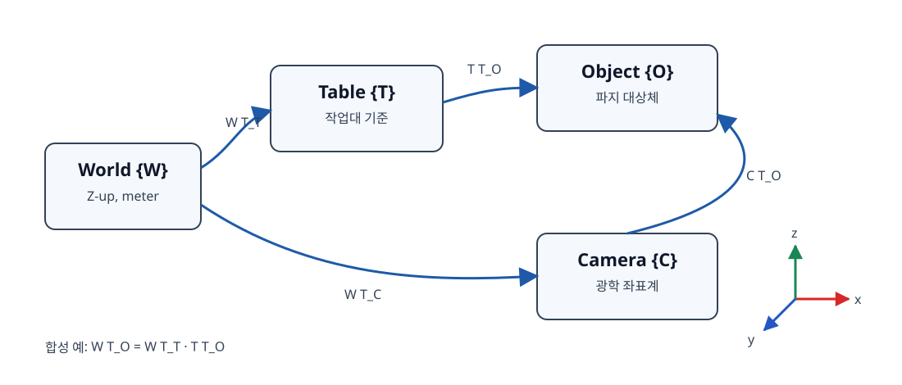
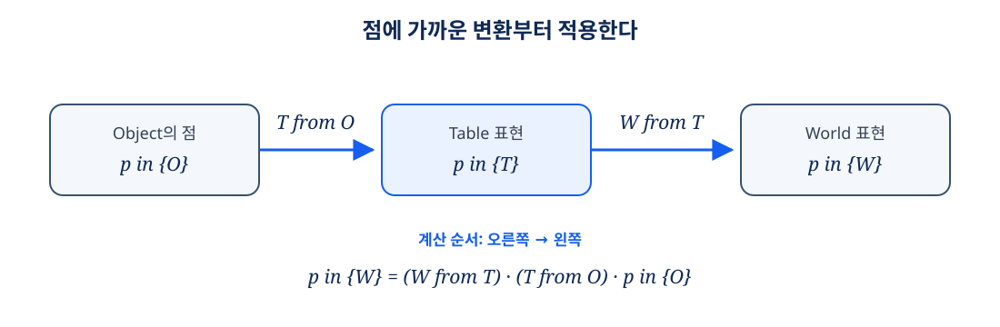
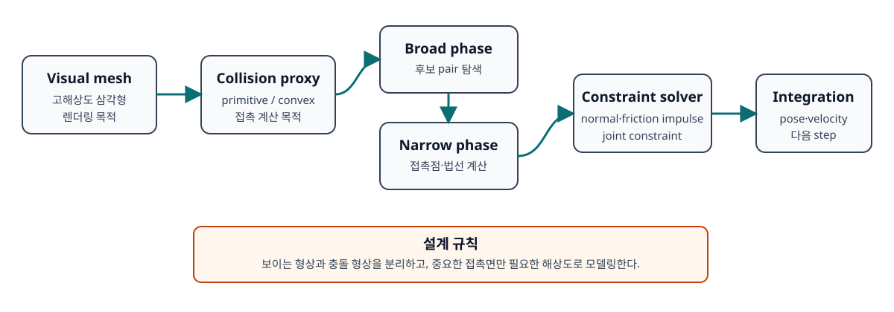
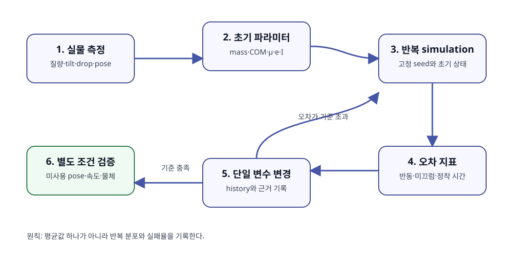

# 제2장 Isaac Sim 환경 구축과 PhysX 강체 물리 시뮬레이션

## 장 개요

로봇 정책이 시뮬레이터에서 성공했다는 사실만으로 실물에서도 성공한다고 말할 수는 없다. 시뮬레이터가 계산한 접촉, 질량, 마찰, 카메라 영상이 실제 장비와 충분히 닮아 있어야 학습된 정책의 행동이 현실로 이어진다. 이 장에서는 NVIDIA Isaac Sim의 장면을 단순한 3D 그림이 아니라 **측정 가능하고 반복 가능한 물리 실험 장치**로 구축한다.

먼저 작업대, 트레이, 파지 대상체를 서로 다른 좌표계에 배치하고 4×4 동차 변환 행렬(homogeneous transformation matrix)과 쿼터니언(quaternion)을 이용해 pose를 계산한다. 이어서 PhysX의 강체(rigid body), 충돌 형상(collision shape), 연속 충돌 검출(continuous collision detection, CCD), 마찰과 반발, 질량과 관성 텐서(inertia tensor)를 다룬다. 마지막으로 물리 기반 렌더링(physically based rendering, PBR)과 조명을 설정하고, 물리 파라미터를 실측값에 맞추는 체계적인 튜닝 절차를 설계한다.

이 장의 핵심 관점은 다음 한 문장으로 요약된다.

> 보이는 메시(render mesh), 충돌을 계산하는 메시(collision mesh), 질량을 대표하는 모델(mass model)은 서로 다른 공학적 역할을 가진다.



**그림 2-1.** 월드, 작업대, 카메라, 대상체 좌표계의 변환 체인. 화살표는 부모 좌표계에서 자식 좌표계 pose를 표현하는 변환을 뜻한다.

## 학습 목표

이 장을 마치면 학습자는 다음을 수행할 수 있다.

1. Isaac Sim의 Stage와 PhysicsScene을 구성하고 GUI 및 Standalone Python 개발 방식을 선택할 수 있다.
2. 로컬 좌표계와 월드 좌표계 사이의 4×4 동차 변환을 계산하고, 좌표계 방향을 명시할 수 있다.
3. Euler angle과 quaternion의 장단점 및 convention 차이를 설명할 수 있다.
4. static collider, dynamic rigid body, kinematic body를 용도에 맞게 구분할 수 있다.
5. primitive, convex hull, convex decomposition, triangle mesh 충돌 근사의 비용과 정확도를 비교할 수 있다.
6. discrete collision detection에서 tunneling이 발생하는 이유를 설명하고 CCD 적용 범위를 결정할 수 있다.
7. 마찰, 반발, 질량, 무게중심, 관성 텐서를 측정 또는 계산해 시뮬레이터 초기값으로 사용할 수 있다.
8. 렌더 재질과 물리 재질을 분리해 관리하고, 조명 및 PBR 파라미터를 재현 가능한 형태로 기록할 수 있다.
9. 관찰 가능한 지표를 기준으로 물리 파라미터를 한 번에 하나씩 튜닝할 수 있다.

## 선수 지식과 준비물

### 선수 지식

- Python과 NumPy의 배열 연산
- 벡터, 행렬 곱, 전치행렬, 역행렬
- 고전역학의 힘, 질량, 속도, 운동에너지
- 제1장의 USD Stage, Prim, Attribute 개념

### 기준 환경

- Ubuntu 24.04 LTS
- NVIDIA RTX GPU와 호환 드라이버
- NVIDIA Isaac Sim 최신 안정 릴리스
- Python 3.12(범용 수학 예제), Isaac Sim 내장 Python(시뮬레이터 예제)

Isaac Sim 공식 요구사항은 Ubuntu 22.04와 24.04를 지원 대상으로 명시하고, 복잡한 장면에는 충분한 RAM과 VRAM이 필요하다고 안내한다. 정확한 GPU/드라이버 요구사항은 릴리스마다 달라지므로 설치 직전에 [Isaac Sim Requirements](https://docs.isaacsim.omniverse.nvidia.com/latest/installation/requirements.html)를 확인한다. 이 책의 코드는 특정 GPU 성능을 보장하지 않으며 출력은 예시이다.

### 안전 메모

이 장은 주로 시뮬레이션을 다루지만 결과를 실물 로봇에 옮길 때는 별도 안전 검증이 필요하다. 물체 질량, 마찰, 토크 한계가 잘못되면 시뮬레이션에서 안전했던 궤적도 실물에서 미끄러짐이나 충돌을 일으킨다. 실물 적용 전에는 속도와 토크를 낮추고, 작업 공간을 비우며, 비상 정지 장치를 손이 닿는 위치에 둔다.

## 2.1 Isaac Sim 작업 환경 이해하기

### 2.1.1 Stage, simulation, rendering은 같은 것이 아니다

Isaac Sim 장면을 구성할 때 세 층을 구분하면 문제를 빠르게 진단할 수 있다.

- **USD Stage**: Prim과 Attribute로 저장되는 장면 명세다. 파일로 저장할 수 있는 선언적 상태이다.
- **Physics simulation**: Stage의 물리 schema를 읽어 PhysX가 시간에 따른 상태를 계산한다.
- **Rendering**: Stage의 geometry, material, light, camera를 읽어 픽셀을 생성한다.

Stage에 큐브가 보인다고 해서 그 큐브가 중력의 영향을 받는 것은 아니다. USD Prim에는 물리 기능이 기본으로 활성화되지 않으며, rigid body와 collision API를 별도로 적용해야 한다. 반대로 viewport에서 숨긴 충돌 형상도 collision API가 유지되면 물리 계산에 참여할 수 있다. 이 분리는 [Isaac Sim Physics Simulation Fundamentals](https://docs.isaacsim.omniverse.nvidia.com/latest/physics/simulation_fundamentals.html)의 기본 원칙이다.

### 2.1.2 GUI, Script Editor, Standalone Python

Isaac Sim은 여러 개발 방식을 제공한다. 공식 [Development Methods](https://docs.isaacsim.omniverse.nvidia.com/latest/introduction/workflows.html)는 GUI/Extension과 Standalone Python의 차이를 설명한다.

| 방식 | 적합한 작업 | 시간 제어 | 주요 위험 |
|---|---|---:|---|
| GUI | 첫 장면 구성, 속성 탐색, 육안 디버깅 | Play 버튼 중심 | 수작업 변경이 기록되지 않으면 재현하기 어렵다 |
| Script Editor | 실행 중 Stage 수정, 짧은 실험 | 비동기 실행 고려 | physics/render step과 callback 순서를 놓치기 쉽다 |
| Standalone Python | 반복 실험, 데이터 생성, headless 실행 | 코드가 step을 직접 제어 | 앱 초기화 전에 Omniverse 모듈을 import하면 실패한다 |

Standalone 스크립트에서는 `SimulationApp`을 가장 먼저 생성한 뒤 `pxr`, `omni` 모듈을 import한다. `code/create_physx_scene.py`가 이 패턴을 사용한다. API는 릴리스에 따라 모듈 경로가 바뀔 수 있으므로, 책의 예제를 그대로 복사하기 전에 설치된 릴리스의 [SimulationApp API](https://docs.isaacsim.omniverse.nvidia.com/latest/py/source/extensions/isaacsim.simulation_app/docs/index.html)와 release notes를 확인한다.

### 2.1.3 재현 가능한 Stage 규칙

팀 프로젝트에서는 다음 규칙을 권장한다.

1. `/World/PhysicsScene`, `/World/Robot`, `/World/Environment`, `/World/Objects`, `/World/Sensors`, `/World/Lights`, `/World/Materials`처럼 역할별 namespace를 정한다.
2. Stage의 up axis와 meters-per-unit을 명시한다. 이 책은 Z-up, 1 unit = 1 m를 사용한다.
3. asset 파일은 reference로 연결하고 실험별 변경은 별도 layer에 override한다.
4. 랜덤화 seed, physics step, render step, solver 설정을 실험 메타데이터에 기록한다.
5. 시각 재질과 물리 재질의 Prim 경로를 분리한다.

## 2.2 좌표계와 4×4 동차 변환

### 2.2.1 pose의 의미부터 고정한다

3차원 pose는 위치(position)와 방향(orientation)의 쌍이다. 회전행렬 \({}^{A}R_B\)는 B 좌표계의 벡터를 A 좌표계에서 표현하도록 바꾸고, 변위 \({}^{A}t_B\)는 A 원점에서 본 B 원점 위치다. 두 값을 합치면 다음 동차 변환을 얻는다.

\[
{}^{A}T_B =
\begin{bmatrix}
{}^{A}R_B & {}^{A}t_B \\
0\;0\;0 & 1
\end{bmatrix}
\]

B 좌표계 점 \({}^{B}p\)를 동차 좌표 \([x,y,z,1]^T\)로 만들면 A 좌표계 표현은 다음과 같다.

\[
{}^{A}p = {}^{A}T_B\,{}^{B}p
\]

변환 체인의 곱셈 순서는 오른쪽부터 적용된다.

\[
{}^{W}T_O = {}^{W}T_T {}^{T}T_O
\]

여기서 W는 world, T는 table, O는 object 좌표계다. `code/transforms.py`의 `Transform.compose()`가 이 계산을 구현한다.

역변환은 일반 4×4 역행렬을 구하지 않고 회전행렬의 정규 직교 성질을 이용해 안정적으로 계산한다.

\[
({}^{A}T_B)^{-1} = {}^{B}T_A =
\begin{bmatrix}
R^T & -R^Tt \\
0 & 1
\end{bmatrix}
\]

::: {.learning-aid}
**이해 도움말 — 변환 이름을 문장처럼 읽기**

\({}^{A}T_B\)를 “B에서 A로 좌표를 표현하는 변환”이라고 읽는다. 점 \({}^{B}p\) 오른쪽에 가장 가까운 변환부터 적용되므로 \({}^{W}T_T\,{}^{T}T_O\,{}^{O}p\)는 “Object의 점을 Table로, 다시 World로” 옮긴다. 첨자를 지워도 되는지 확인하려면 인접한 \(T\)와 \({}^{T}\), \(O\)와 \({}^{O}\)가 연결되는지 본다. 코드 변수도 `world_from_table`처럼 같은 방향으로 읽히게 만들면 역변환 실수를 줄일 수 있다.



**그림 2-2.** 점에 가까운 변환부터 적용하고, 인접 프레임 이름이 이어지는지 확인한다.
:::

### 2.2.2 active rotation과 passive rotation

같은 행렬이 두 문맥에서 사용되기 때문에 혼동이 생긴다.

- **Active rotation**: 한 좌표계 안에서 물체 또는 벡터를 회전한다.
- **Passive rotation**: 같은 물리 벡터를 다른 좌표계 성분으로 다시 표현한다.

두 연산은 서로 전치 관계다. API 문서가 `rotate vector`, `transform pose`, `express in frame` 중 어떤 의미를 쓰는지 확인해야 한다. 코드 리뷰에서는 변수명을 `world_from_camera`, `camera_from_object`처럼 읽을 수 있게 정한다. `T_wc`처럼 짧은 이름만 쓰면 첨자의 방향을 팀원이 다르게 해석할 수 있다.

### 2.2.3 Euler angle의 convention

Euler angle은 roll, pitch, yaw 세 값으로 방향을 설명해 사람이 이해하기 쉽다. 그러나 다음 정보를 함께 기록하지 않으면 값만으로 회전을 재현할 수 없다.

- 축 순서: XYZ, ZYX 등
- intrinsic 회전인지 extrinsic 회전인지
- right-handed/left-handed 좌표계
- radian/degree 단위

이 장의 예제는 오른손 좌표계에서 고정 world 축에 대한 extrinsic Z-Y-X 합성, 즉 \(R=R_z(yaw)R_y(pitch)R_x(roll)\)을 사용한다. pitch가 ±90° 근처가 되면 서로 다른 두 회전축이 정렬되어 자유도 하나를 구분할 수 없게 된다. 이것이 짐벌 락(gimbal lock)이다. 실제 물체가 자유도를 잃는 것이 아니라 Euler 파라미터화가 특이해지는 것이다.

### 2.2.4 quaternion과 순서 문제

단위 쿼터니언은 네 성분으로 3차원 회전을 표현한다.

\[
q = (x,y,z,w), \qquad x^2+y^2+z^2+w^2=1
\]

쿼터니언은 Euler angle처럼 특정 자세에서 자유도를 잃지 않고, spherical linear interpolation(SLERP)을 사용할 수 있다. 그러나 다음 함정이 있다.

1. 라이브러리마다 `(x,y,z,w)`와 `(w,x,y,z)` 순서가 다르다.
2. \(q\)와 \(-q\)는 같은 회전을 나타낸다.
3. 수치 적분 후 norm이 1에서 벗어날 수 있어 정규화가 필요하다.
4. 두 쿼터니언의 선형 보간은 일정 각속도 회전을 보장하지 않는다.

`code/transforms.py`는 외부 인터페이스를 `(x,y,z,w)`로 고정하고 입력을 정규화한다. 실제 Isaac Sim/ROS/OpenCV 경계에서는 각 API의 순서를 어댑터 함수 하나로 격리하는 것이 좋다.

## 2.3 강체 역학과 시뮬레이션 시간

### 2.3.1 rigid, static, kinematic

강체는 변형을 무시하고 질량 중심의 병진 운동과 회전 운동만 계산하는 모델이다. 일반적인 actor 유형은 다음과 같다.

- **Static collider**: 작업대, 벽처럼 움직이지 않는 환경이다. 질량 상태를 적분하지 않는다.
- **Dynamic rigid body**: 중력, 힘, 토크, 접촉 충격량의 영향을 받아 움직인다.
- **Kinematic body**: 사용자가 pose를 지정해 움직이며, 다른 물체에 영향을 줄 수 있지만 일반적인 힘 적분으로 움직이지 않는다.

동적 물체를 매 frame 강제로 teleport하면 접촉 solver가 현실적인 힘을 계산하기 어렵다. 목표 pose를 따라가야 하는 장치는 joint drive, force/torque 또는 kinematic target 중 목적에 맞는 방법을 선택한다.

### 2.3.2 이산 시간 적분

시뮬레이터는 연속 시간 방정식을 step 크기 \(\Delta t\)로 나눠 계산한다. 가장 단순화한 병진 운동은 다음과 같다.

\[
v_{k+1}=v_k + \Delta t\,M^{-1}f_k, \qquad
x_{k+1}=x_k + \Delta t\,v_{k+1}
\]

step이 작을수록 빠른 접촉을 포착하기 쉽지만 계산량이 증가한다. render rate와 physics rate는 같을 필요가 없다. 예를 들어 physics를 120 Hz, render를 30 Hz로 두면 render frame 하나 동안 네 번 물리를 계산한다. 학습 데이터에는 physics timestamp와 sensor timestamp를 따로 기록해야 한다.

### 2.3.3 solver iteration과 안정성

접촉과 joint는 이상적으로 정확한 힘을 직접 구하기보다 제한된 반복 횟수 안에서 constraint를 만족하도록 푼다. 관절이 많은 로봇, 질량비가 큰 물체, 작은 timestep에서 지나치게 큰 stiffness는 solver를 어렵게 만든다. 무조건 iteration을 높이기 전에 다음을 확인한다.

- 충돌 geometry가 지나치게 복잡하지 않은가?
- mass ratio가 비현실적으로 크지 않은가?
- contact offset이 장면 scale과 맞는가?
- 매 frame pose를 순간 이동시키고 있지 않은가?
- controller gain이 timestep에 비해 너무 큰가?

PhysX의 [Rigid Body Dynamics](https://nvidia-omniverse.github.io/PhysX/physx/5.4.0/docs/RigidBodyDynamics.html)는 mass property, force/torque, friction, solver 설정을 설명한다.

::: {.learning-check}
**잠깐 점검 — 더 정밀하게 계산하면 항상 해결될까?**

1. 빠른 물체가 얇은 벽을 통과할 때 먼저 줄여 볼 값은 physics step \(\Delta t\)인가, render frame 간격인가?
2. 물체가 접촉 순간 폭발하듯 튈 때 solver iteration만 높이기 전에 확인할 항목 하나를 고르라.

**확인 포인트:** 충돌 판정은 physics step마다 일어나므로 먼저 \(\Delta t\)와 CCD를 검토한다. 불안정 접촉은 비현실적인 질량비, 과도한 stiffness/controller gain, 복잡한 collision geometry, 순간이동 중 하나가 원인일 수 있다.
:::

## 2.4 충돌 형상 설계



**그림 2-3.** visual mesh와 collision proxy를 분리하고 broad phase, narrow phase, solver를 거쳐 상태를 갱신하는 흐름.

### 2.4.1 visual mesh와 collision mesh

visual mesh는 픽셀 품질을 위해 세밀한 곡면과 작은 부품을 포함한다. collision mesh는 접촉 계산을 위해 단순하고 닫힌 형상을 선호한다. visual mesh를 그대로 충돌에 사용하면 triangle 수뿐 아니라 접촉점과 friction patch 수가 증가해 solver 비용과 jitter가 커질 수 있다.

### 2.4.2 collision approximation 선택

| 근사 | 장점 | 단점 | 권장 대상 |
|---|---|---|---|
| Box/Sphere/Capsule | 매우 빠르고 안정적 | 형상 오차가 큼 | 작업대, 손잡이, 단순 물체 |
| Convex hull | 안정적이고 동적 물체에 적합 | 오목한 홈을 메움 | 블록, 병, 단순 공구 |
| Convex decomposition | 오목한 형상을 여러 convex part로 근사 | cooking 시간과 part 수 비용 | 그리퍼, 트레이, 복잡한 동적 소품 |
| Triangle mesh | 원형상에 가까움 | 접촉 비용과 안정성 부담 | 주로 정적 환경 |

PhysX geometry의 종류와 cooking 요구사항은 [PhysX Geometry](https://nvidia-omniverse.github.io/PhysX/physx/5.4.1/docs/Geometry.html)에 정리되어 있다. 동적 강체는 가능한 한 primitive 또는 convex 계열을 사용하고, 정적 환경에만 triangle mesh를 제한적으로 사용한다.

### 2.4.3 convex decomposition 튜닝

V-HACD 계열 분해는 오목한 메시를 여러 convex hull로 바꾼다. hull 수를 늘리면 원형상에 가까워지지만 항상 좋은 것은 아니다. 다음 지표를 함께 본다.

- 파지에 중요한 홈이나 테두리가 보존되는가?
- hull 수와 hull당 vertex 수가 예산 이내인가?
- 접촉 시 jitter가 줄었는가?
- 한 physics step의 평균/상위 99% 시간이 허용 범위인가?

중요한 접촉면은 별도 primitive collider로 직접 모델링하는 편이 자동 분해보다 예측 가능하다. 예를 들어 그리퍼 고무 패드는 얇은 box collider, 손가락 본체는 capsule/box 조합으로 만든다.

### 2.4.4 broad phase와 narrow phase

충돌 검사는 보통 두 단계로 생각할 수 있다.

1. **Broad phase**: AABB 등 싼 표현으로 충돌 가능성이 있는 pair를 찾는다.
2. **Narrow phase**: 실제 geometry를 사용해 접촉점, 법선, penetration을 계산한다.

scene에 collider가 많으면 broad phase pair 수가 증가한다. 로봇 링크끼리 절대 접촉할 필요가 없는 조합은 collision filtering으로 제외한다. 하지만 실제 self-collision 가능성이 있는 pair까지 제거하면 안전성이 과대평가된다.

## 2.5 Tunneling과 CCD

### 2.5.1 왜 얇은 물체를 통과하는가

이산 충돌 검출(discrete collision detection)은 각 step의 위치에서 겹침을 검사한다. 반지름 \(r\)인 작은 물체가 한 step 동안 \(v\Delta t\)만큼 이동하고 그 거리가 물체 두께보다 크면, 이전 pose와 다음 pose 모두에서 충돌하지 않은 채 장애물을 건너뛸 수 있다. 이것이 tunneling이다.

다음 조건은 위험 신호다.

\[
v\Delta t > \alpha d_{min}
\]

여기서 \(d_{min}\)은 가장 얇은 충돌 형상의 특성 길이, \(\alpha\)는 보수 계수다. 이 식은 PhysX 내부 판정식이 아니라 설계자가 CCD 필요성을 판단하기 위한 휴리스틱이다.

### 2.5.2 CCD 적용 전략

PhysX/Omniverse는 sweep 기반 CCD와 speculative CCD를 제공한다. 공식 [Omniverse PhysX Rigid Bodies](https://nvidia-omniverse.github.io/PhysX/ovphysx/latest/simulation_setup/rigid_bodies.html)는 sweep 기반 방식이 선형 이동 경로를 검사하고, speculative 방식이 motion에 따라 contact offset을 조정한다고 설명한다. sweep 기반 CCD는 scene과 body 양쪽에서 활성화해야 한다. speculative 방식은 빠른 각운동에도 유용하지만 ghost contact 가능성을 평가해야 한다.

권장 순서는 다음과 같다.

1. 실제 scale과 physics timestep을 먼저 확인한다.
2. collider가 지나치게 얇다면 물리적으로 허용되는 범위에서 두께를 조정한다.
3. 고속 또는 얇은 **필요한 body에만** CCD를 켠다.
4. 같은 initial state와 seed로 penetration rate와 step time을 비교한다.
5. CCD를 켰다고 collision filter나 contact offset 문제를 감추지 않는다.

CCD는 무료가 아니다. 빠른 body가 많을수록 검사 비용이 커지고 일부 경로는 CPU에서 처리된다. 또한 sweep 기반 CCD는 주로 선형 운동을 고려하므로 빠르게 회전하는 긴 물체에는 speculative CCD 또는 작은 timestep이 더 적합할 수 있다.

## 2.6 물리 재질과 접촉 역학

### 2.6.1 Coulomb friction의 단순 모델

접촉면의 법선력 크기를 \(N\)이라 할 때 단순 Coulomb 모델은 다음과 같다.

\[
\|F_t\| \le \mu_s N \quad \text{(정지)}, \qquad
\|F_t\| = \mu_d N \quad \text{(미끄러짐)}
\]

\(\mu_s\)는 정마찰계수(static friction), \(\mu_d\)는 동마찰계수(dynamic friction)다. PhysX는 개별 점 하나가 아니라 contact patch와 friction anchor를 사용해 충격량 기반으로 제약을 푼다. 따라서 교과서 식은 방향과 규모를 이해하는 모델이며 solver의 정확한 내부 결과와 같다고 가정하면 안 된다.

마찰계수는 재질 pair의 속성이다. 고무-플라스틱, 고무-금속은 서로 다른 값을 갖는다. 두 material의 값을 결합하는 combine mode도 결과에 영향을 준다. 프로젝트에서 `rubber_mu=0.9`처럼 단일 숫자만 기록하지 말고 두 표면, 측정 방법, 습도/오염 상태를 기록한다.

### 2.6.2 기울기 실험으로 정마찰 추정

물체가 경사면에서 막 미끄러지기 시작하는 각도를 \(\theta_c\)라 하면 단순 모델에서

\[
\mu_s \approx \tan\theta_c
\]

이다. `code/contact_estimator.py`가 이 계산을 수행한다. 최소 5회 반복해 평균과 분산을 기록하고, 표면을 닦은 조건과 그대로 둔 조건을 구분한다. 실제 그리퍼에는 압력 분포, 패드 변형, 곡면 접촉이 추가되므로 이 값은 초기값이지 정답이 아니다.

### 2.6.3 반발계수

충돌 법선 방향 상대속도를 기준으로 반발계수(coefficient of restitution) \(e\)를 단순화하면

\[
e = -\frac{v_{after}}{v_{before}}
\]

이다. 공기 저항과 회전을 무시한 낙하 실험에서는 \(e\approx\sqrt{h_r/h_d}\)로 추정할 수 있다. pick-and-place 대상체는 보통 큰 bounce가 필요하지 않으므로 낮은 값을 시작점으로 삼되, 임의의 범위를 정답처럼 고정하지 않는다. 바닥 재질과 대상체 재질을 실제 조합으로 측정한다.

### 2.6.4 physics material과 render material

- **Physics material**: friction, restitution, density 등 접촉 계산에 사용된다.
- **Render material**: base color, roughness, metallic, normal 등 픽셀 생성에 사용된다.

둘은 서로 독립적이다. 반짝이는 금속처럼 보이게 만들었다고 마찰이 자동으로 낮아지지 않는다. Isaac Sim의 material API 중 일부는 experimental로 표시되어 있어 변경될 수 있다. 안정성이 중요한 asset pipeline에서는 `UsdPhysics.MaterialAPI`와 명시적인 binding을 사용하고, high-level wrapper를 쓸 때는 설치 버전 문서를 확인한다.

## 2.7 질량, 무게중심, 관성 텐서

### 2.7.1 질량만 맞추면 충분하지 않다

동적 강체의 상태 응답에는 다음 세 속성이 모두 필요하다.

- 질량 \(m\)
- 무게중심/질량중심(center of mass, COM) 위치
- COM 기준 관성 텐서 \(I\)

병진 운동은 \(F=ma\), 회전 운동은 단순한 주축 조건에서 \(\tau=I\alpha\)로 설명된다. 질량이 같아도 질량이 중심에 모였는지 바깥에 퍼졌는지에 따라 각가속도가 다르다. COM이 실제보다 높으면 물체가 쉽게 넘어지고, 낮으면 지나치게 안정적으로 보인다.

### 2.7.2 직육면체 관성

질량 \(m\), 변 길이 \(a,b,c\)인 균일 직육면체의 중심/주축 기준 관성은 다음과 같다.

\[
I_{xx}=\frac{m}{12}(b^2+c^2),\quad
I_{yy}=\frac{m}{12}(a^2+c^2),\quad
I_{zz}=\frac{m}{12}(a^2+b^2)
\]

`code/inertia_properties.py`는 이 식과 평행축 정리를 구현한다.

\[
I_P = I_C + m(\|d\|^2E-dd^T)
\]

여기서 \(d\)는 COM에서 새 기준점까지의 벡터다. CAD가 제공하는 관성 텐서의 단위와 좌표축이 USD asset과 같은지 반드시 확인한다. mm 기반 CAD 관성값을 m 기반 Stage에 그대로 넣으면 큰 오차가 난다.

### 2.7.3 density와 mass authoring

geometry와 density로 mass/inertia를 자동 계산하면 asset 수정에 따라 값이 함께 바뀌어 편리하다. 그러나 빈 용기, 내부 배터리, 비균질 물체는 균일 density 가정과 맞지 않는다. 이때는 실측 mass, COM, inertia를 명시한다. PhysX 문서는 mass와 inertia를 별개 속성으로 다루므로 mass만 바꾸고 inertia를 그대로 두지 않도록 한다. [PxRigidBody API](https://nvidia-omniverse.github.io/PhysX/physx/5.4.0/_api_build/class_px_rigid_body.html)도 mass 설정만으로 inertia가 갱신되지 않는 경우를 명시한다.

## 2.8 PBR 재질과 조명

### 2.8.1 물리 기반 렌더링의 목적

PBR은 광원, 표면 재질, 카메라의 관계를 일관된 에너지 모델로 계산해 다양한 조명에서도 그럴듯한 영상을 만든다. 로봇 데이터 생성에서는 단순히 아름다운 이미지를 만드는 것이 아니라 다음을 재현하는 것이 목표다.

- 대상체와 배경의 명암 대비
- specular highlight와 반사
- 카메라 노출과 white balance 변화
- 그림자 경계와 occlusion
- 표면 거칠기와 작은 형상 변화

### 2.8.2 핵심 파라미터

- **Base color/albedo**: 조명 효과를 제외한 표면 색의 근사
- **Roughness**: 미세 표면 법선 분포의 폭; 높을수록 highlight가 넓고 흐리다
- **Metallic**: 금속/비금속 workflow를 구분하는 파라미터
- **Normal map**: geometry를 늘리지 않고 미세 법선 변화를 표현

roughness와 friction은 이름이 비슷한 직관을 주지만 서로 다른 모델의 변수다. 시각적으로 거친 표면이 항상 높은 물리 마찰을 갖는 것은 아니다.

### 2.8.3 Dome, distant, area light

- **Dome light**: HDR 환경맵 또는 전방위 배경광을 제공한다.
- **Distant light**: 태양처럼 먼 방향광을 근사한다.
- **Rect/Disk/Sphere light**: 가까운 면광원/점광원에 가까운 효과를 낸다.

실험에서 광원 종류, intensity, color temperature, pose를 기록한다. 카메라 auto exposure를 켜면 조명 변화가 픽셀 변화로 직접 나타나지 않을 수 있으므로 데이터 생성 목적에 따라 exposure를 고정하거나 메타데이터에 기록한다.

## 2.9 물리 파라미터 튜닝 절차



**그림 2-4.** 실측, 단일 파라미터 변경, 반복 실험, 오차 평가를 분리한 튜닝 루프.

### 2.9.1 관찰량부터 정의한다

파라미터를 바꾸기 전에 비교할 관찰량(observable)을 정한다.

| 현상 | 관찰량 예 | 우선 점검 파라미터 |
|---|---|---|
| 낙하 | 충돌 시각, 최대 반동 높이, 정착 시간 | scale, gravity, restitution, timestep |
| 미끄러짐 | 임계 경사각, 정지 거리 | friction pair, combine mode |
| 넘어짐 | 임계 외력, 각속도 | COM, inertia, contact geometry |
| 파지 | slip rate, 필요한 finger force | finger/object friction, pad geometry, mass |
| 고속 관통 | penetration count, 최소 거리 | timestep, collider thickness, CCD |

### 2.9.2 한 번에 하나씩 바꾼다

재현 가능한 초기 상태와 random seed를 고정한 뒤 한 파라미터만 바꾼다. grid search를 하더라도 실험 ID와 전체 configuration을 저장한다. 손으로 GUI 값을 바꾼 뒤 기억에 의존하지 않는다.

### 2.9.3 권장 체크리스트

1. Stage 단위와 geometry scale을 확인한다.
2. collision proxy를 시각화해 gap/penetration을 확인한다.
3. mass와 COM을 실측값에 맞춘다.
4. inertia를 계산하거나 CAD 값으로 입력한다.
5. restitution을 낙하 실험으로 맞춘다.
6. friction을 tilt/pull 실험으로 맞춘다.
7. physics timestep과 solver 설정을 조정한다.
8. 필요 body에만 CCD를 적용한다.
9. 여러 초기 pose와 속도에서 검증한다.
10. 평균뿐 아니라 실패율과 worst case를 기록한다.

## 2.10 단계별 통합 실습

### 실습 A: 변환 체인 검증

1. `code/transforms.py`를 실행한다.
2. 출력된 `world_from_object`의 translation을 손 계산과 비교한다.
3. `world_from_object.inverse().compose(world_from_object)`가 identity에 가까운지 확인하는 코드를 추가한다.
4. pitch를 89°, 90°, 91°로 바꾸고 rotation matrix와 quaternion을 비교한다.
5. quaternion 순서를 `(w,x,y,z)`로 잘못 전달했을 때 결과가 어떻게 달라지는지 기록한다.

상세 활동지는 [실습 2-A: 좌표 변환 체인과 쿼터니언](#lab-2-a)을 사용한다.

### 실습 B: 충돌 형상과 CCD 비교

1. 얇은 platform과 작은 고속 cube를 만든다.
2. CCD를 끈 상태에서 초기 높이와 속도를 바꾸며 tunneling 횟수를 센다.
3. physics timestep을 절반으로 줄이고 다시 측정한다.
4. sweep CCD, speculative CCD를 각각 적용한다.
5. penetration rate와 frame time을 표로 비교한다.

상세 활동지는 [실습 2-B: 충돌 근사와 CCD 비용-효과 분석](#lab-2-b)을 사용한다.

### 실습 C: 마찰과 반발 보정

1. 실제 재질 pair의 임계 경사각을 반복 측정한다.
2. `code/contact_estimator.py`로 초기 friction과 restitution을 구한다.
3. Isaac Sim physics material에 값을 입력한다.
4. 동일한 tilt/drop scenario를 실행해 오차를 측정한다.
5. 평균 오차뿐 아니라 trial별 분산을 기록한다.

상세 활동지는 [실습 2-C: 마찰·반발·질량 파라미터 보정](#lab-2-c)을 사용한다.

## 2.11 예상 출력 예시

아래 값은 코드와 환경에 대한 **예상 출력 예시**다. 부동소수점 연산, 라이브러리 버전, solver 설정에 따라 실제 결과가 달라도 된다.

`python3 code/transforms.py`

```text
world_from_object =
[[ 0.8529 -0.5     0.1504  0.9665]
 [ 0.4924  0.866   0.0868  0.0116]
 [-0.1736  0.      0.9848  0.79  ]
 [ 0.      0.      0.      1.    ]]
quaternion xyzw = [-0.0226  0.0842  0.2578  0.9623]
round-trip max error = 1.11e-16
```

`python3 code/inertia_properties.py`

```text
COM inertia [kg m^2]:
 [[0.0004929 0.        0.       ]
  [0.        0.0006067 0.       ]
  [0.        0.        0.0002596]]
grasp-point inertia [kg m^2]:
 [[0.0017529 0.        0.       ]
  [0.        0.0018667 0.       ]
  [0.        0.        0.0002596]]
kinetic energy: 0.008213 J
```

`python3 code/contact_estimator.py`

```text
estimated static friction: 0.625
estimated restitution: 0.100
minimum normal force per finger (SF=2): 3.923 N
```

## 2.12 트러블슈팅

### 물체가 바닥을 통과한다

- 바닥과 물체에 collision API가 모두 적용됐는가?
- dynamic body가 visual mesh parent와 다른 Prim에 있지는 않은가?
- Stage scale과 collider thickness가 올바른가?
- 빠른 물체라면 timestep을 줄이거나 CCD를 적용했는가?
- collision filtering이 pair를 제외하지 않았는가?

### 물체가 폭발하듯 튄다

- 초기 pose에서 collider가 깊게 겹쳐 있지 않은가?
- mass ratio, restitution, contact offset이 비현실적이지 않은가?
- 매 frame pose를 강제로 덮어쓰고 있지 않은가?
- controller stiffness와 timestep 조합이 지나치게 크지 않은가?

### 그리퍼 안의 물체가 계속 미끄러진다

- physics material이 visual material과 혼동되지 않았는가?
- 그리퍼 pad와 object 양쪽 material 및 combine mode를 확인했는가?
- finger normal force가 물체 중량과 가속도에 충분한가?
- collision proxy가 visual pad보다 안쪽/바깥쪽으로 어긋나지 않았는가?
- 실물의 패드 변형을 rigid contact 하나로 과도하게 단순화하지 않았는가?

### 동일한 설정인데 실행마다 결과가 다르다

- GPU/CPU pipeline, thread scheduling, solver 설정이 같은가?
- 초기 조건을 physics step 경계에서 적용했는가?
- random seed와 asset version을 기록했는가?
- 결과가 chaotic contact에 민감하다면 평균뿐 아니라 분포로 비교했는가?

### 색은 맞는데 합성 영상이 실물과 다르다

- base color만 맞추고 roughness/normal/exposure를 무시하지 않았는가?
- light 크기와 방향 때문에 그림자 경계가 다른가?
- 카메라 intrinsics, tone mapping, white balance가 같은가?
- HDRI에 학습 label과 상관된 배경 정보가 들어가 있지 않은가?

## 2.13 요약

- USD Stage, physics simulation, rendering은 서로 연결되지만 동일한 계층이 아니다.
- 변환은 `parent_from_child` 의미와 좌표축, 단위, quaternion 순서를 함께 기록해야 한다.
- Euler angle은 사람이 읽기 쉽지만 convention과 singularity가 있고, quaternion은 정규화와 성분 순서 관리가 필요하다.
- visual mesh와 collision proxy를 분리하면 성능과 접촉 안정성을 함께 개선할 수 있다.
- CCD는 tunneling에 효과적이지만 모든 body에 무조건 켜는 기능이 아니다.
- friction과 restitution은 재질 pair 및 측정 조건에 의존하며, 단순 식은 초기값 산정 도구다.
- mass, COM, inertia를 함께 맞춰야 병진과 회전 응답을 재현할 수 있다.
- PBR 속성과 physics material 속성은 독립적이다.
- 튜닝은 관찰량 정의, 단일 변수 변경, 반복 측정, 오차 평가의 순서로 수행한다.

## 2.14 확인문제

1. Stage에서 보이는 mesh가 중력으로 떨어지지 않는 이유를 세 계층 관점에서 설명하라.
2. \({}^{W}T_C\)와 \({}^{C}T_O\)가 있을 때 \({}^{W}T_O\)를 쓰고 곱셈 순서를 설명하라.
3. `Rz(yaw) Ry(pitch) Rx(roll)`과 `Rx Ry Rz`가 다른 이유를 예로 설명하라.
4. \(q\)와 \(-q\)가 같은 회전을 나타내는 성질이 interpolation 구현에 주는 영향을 설명하라.
5. triangle mesh collider를 동적 그리퍼 링크에 그대로 쓰는 것의 단점을 세 가지 쓰라.
6. physics rate 60 Hz에서 속도 3 m/s인 물체가 한 step 동안 이동하는 거리를 계산하라.
7. sweep CCD와 speculative CCD의 차이를 설명하고 빠르게 회전하는 긴 막대에 적합한 대안을 논하라.
8. 정마찰계수가 0.5이고 물체 질량이 0.4 kg일 때, 정지 상태를 유지하기 위한 평행 그리퍼 손가락당 최소 법선력을 단순 모델로 구하라. 안전계수 2를 적용하라.
9. 질량만 변경하고 관성을 그대로 둘 때 회전 응답에 어떤 불일치가 생기는가?
10. roughness를 높였는데 friction이 변하지 않는 이유를 설명하라.

추가 연습문제와 해설 지침은 [제2장 연습문제 및 해설 지침](#chapter-2-problem-set)에 있다.

## 2.15 프로젝트 과제

### 과제 1: 작업 셀 디지털 트윈

작업대, 트레이, cube/cylinder, 두 개의 광원을 포함한 Stage를 만든다. 다음 산출물을 제출한다.

- Stage hierarchy와 layer 구성 설명
- world/table/object 좌표계 변환표
- visual/collision mesh 분리 근거
- mass/COM/inertia 값과 산출 방법
- physics/render material 표
- 10초 simulation의 frame time과 penetration 관찰 결과

### 과제 2: CCD 비용-효과 분석

물체 크기, 속도, timestep을 독립 변수로 정하고 CCD off/on 실험을 수행한다. tunneling rate, 평균 step time, 99th percentile step time을 비교해 어떤 조건에서 CCD를 적용할지 정책을 작성한다.

### 과제 3: 실측 기반 material calibration

서로 다른 두 재질 pair에 대해 tilt test와 drop test를 수행한다. 실측 분포를 바탕으로 simulation parameter를 정하고, 시뮬레이션/실물 오차가 남는 원인을 rigid Coulomb model의 한계와 연결해 분석한다.

## 2.16 실습·평가·참고자료

이 절 아래에 장별 참고문헌, 단계별 실습, 연습문제와 해설 지침을 한데 모았다.

### 2.16.1 참고문헌

1. NVIDIA, [Isaac Sim Requirements](https://docs.isaacsim.omniverse.nvidia.com/latest/installation/requirements.html), 최신 문서.
2. NVIDIA, [Isaac Sim Development Methods](https://docs.isaacsim.omniverse.nvidia.com/latest/introduction/workflows.html), 최신 문서.
3. NVIDIA, [Physics Simulation Fundamentals](https://docs.isaacsim.omniverse.nvidia.com/latest/physics/simulation_fundamentals.html), 최신 문서.
4. NVIDIA, [Scene Setup Snippets and Examples](https://docs.isaacsim.omniverse.nvidia.com/latest/python_scripting/environment_setup.html), 최신 문서.
5. NVIDIA PhysX, [Rigid Body Dynamics](https://nvidia-omniverse.github.io/PhysX/physx/5.4.0/docs/RigidBodyDynamics.html), PhysX 5.4 documentation.
6. NVIDIA PhysX, [Geometry](https://nvidia-omniverse.github.io/PhysX/physx/5.4.1/docs/Geometry.html), PhysX 5.4.1 documentation.
7. NVIDIA Omniverse PhysX, [Rigid Bodies](https://nvidia-omniverse.github.io/PhysX/ovphysx/latest/simulation_setup/rigid_bodies.html), 최신 문서.
8. NVIDIA PhysX, [Advanced Collision Detection](https://nvidia-omniverse.github.io/PhysX/physx/5.1.2/docs/AdvancedCollisionDetection.html), PhysX 5.1.2 documentation.
9. OpenUSD, [UsdGeomXformable Class Reference](https://openusd.org/release/api/class_usd_geom_xformable.html), 최신 API 문서.
10. David H. Eberly, *3D Game Engine Design*, 2nd ed., Morgan Kaufmann, 2006.
11. Roy Featherstone, *Rigid Body Dynamics Algorithms*, Springer, 2008.

