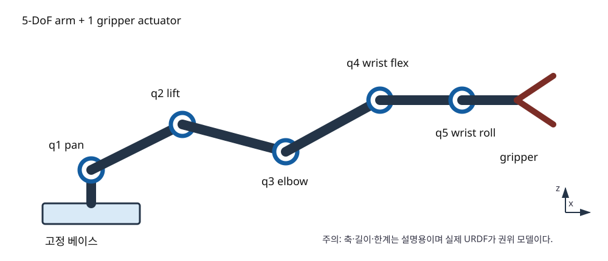
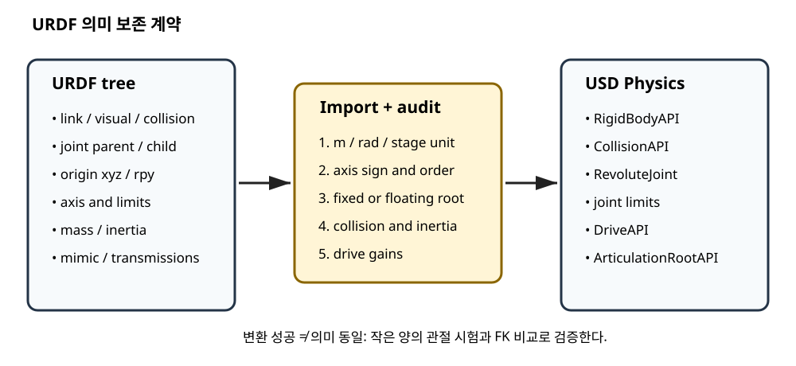
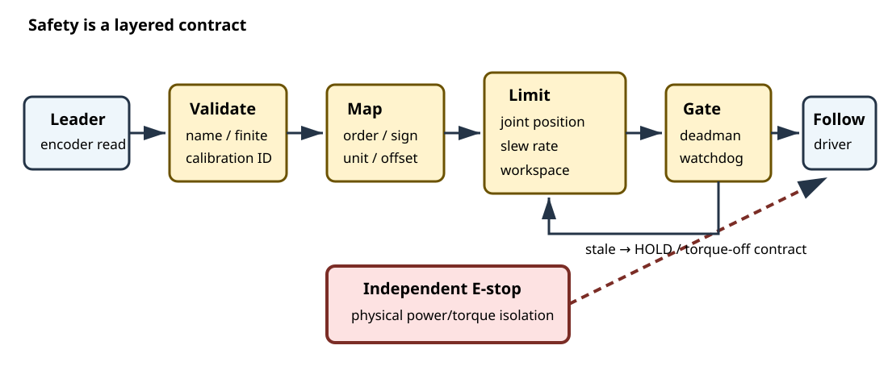
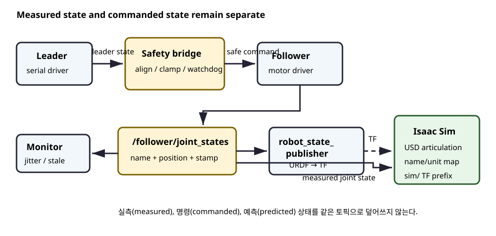

# 제3장 SO-101 기구학과 ROS 2 기반 하드웨어 텔레오퍼레이션

## 장 개요

로봇팔 제어 소프트웨어는 세 가지 세계를 동시에 다룬다. 첫째는 링크와 관절로 구성된 기하학 모델, 둘째는 엔코더와 버스 서보가 있는 실제 장비, 셋째는 메시지와 시간으로 표현되는 분산 소프트웨어다. 어느 한쪽의 좌표축, 단위, 관절 순서가 어긋나도 가상 로봇은 그럴듯하게 움직이면서 실물은 반대 방향으로 돌 수 있다.

이 장에서는 SO-101을 사례로 기구학 사슬(kinematic chain)을 모델링하고, 순기구학(Forward Kinematics, FK)과 감쇠 최소제곱 역기구학(Damped Least Squares Inverse Kinematics, DLS IK)을 구현한다. 이어 Leader 암의 관절 상태를 Follower 암의 안전한 명령으로 변환하고, ROS 2 Jazzy의 `sensor_msgs/msg/JointState`를 이용해 실물과 시뮬레이터를 연결한다.

SO-101은 자세를 만드는 5개의 팔 관절과 그리퍼 구동기 1개를 가진다. 따라서 모터는 6개지만, 그리퍼를 제외한 팔은 5-DoF이다. 3차원 위치 3개와 방향 3개를 동시에 임의로 지정하려면 일반적으로 6개의 독립 자유도가 필요하므로, SO-101의 역기구학은 위치 우선 또는 방향의 일부만 추종하는 식으로 과업 우선순위(task priority)를 정해야 한다. LeRobot의 공식 Isaac Teleop 설명도 SO-101을 5-DoF 팔로 다루며 방향 오차 가중치를 낮추는 위치 우선 IK를 사용한다.[Hugging Face, 2026]



*그림 3-1*은 교육용 개념도다. 정확한 축, 링크 오프셋, 한계는 사용 중인 URDF와 캘리브레이션 파일에서 읽어야 한다.

## 학습 목표

이 장을 마치면 학습자는 다음을 수행할 수 있다.

1. URDF의 `link`, `joint`, `origin`, `axis`, `limit`를 기구학 트리로 해석한다.
2. URDF 모델을 USD 물리 관절(articulation)로 옮길 때 보존해야 하는 정보를 설명한다.
3. 동차변환행렬과 DH(Denavit-Hartenberg) 파라미터로 순기구학을 계산한다.
4. 자코비안(Jacobian)과 DLS를 사용해 특이점 근처에서도 제한된 관절 증분을 계산한다.
5. Leader/Follower 캘리브레이션, 관절 순서, 부호, 단위를 일관되게 관리한다.
6. ROS 2 `JointState` 토픽을 이용해 실물과 시뮬레이터를 동기화한다.
7. 관절 제한, 속도 제한, 워치독(watchdog), 데드맨 스위치(dead-man switch), 비상 정지를 계층적으로 설계한다.

## 선수 지식과 준비물

### 선수 지식

- Python, NumPy 및 C++17 기초
- 4×4 동차변환행렬과 회전행렬
- ROS 2 노드, 토픽, QoS(Quality of Service)의 기본 개념
- Linux 직렬 장치와 사용자 권한의 기본 개념

### 기준 환경

- Ubuntu 24.04 LTS
- ROS 2 Jazzy Jalisco
- Python 3.12, NumPy
- C++17, `rclcpp`, `sensor_msgs`
- LeRobot 최신 안정 릴리스: CLI와 설정 필드는 릴리스에 따라 바뀔 수 있으므로 실행 전 공식 SO-101 문서를 확인한다.
- 선택: SO-101 Leader/Follower, 각 암의 전원 공급 장치와 USB 직렬 어댑터
- 선택: NVIDIA Isaac Sim과 SO-101 URDF/USD 자산

### 실물 실습 전 안전 원칙

> **위험:** 텔레오퍼레이션 코드는 사람의 손동작을 즉시 모터 명령으로 바꾼다. 잘못된 관절 부호, 첫 프레임의 큰 점프, 통신 지연은 충돌과 끼임을 일으킬 수 있다.

실물 전원을 넣기 전에 다음을 확인한다.

1. 암을 단단한 작업대에 고정하고 예상 작업 공간에서 사람, 케이블, 공구를 치운다.
2. 모터와 전원 공급 장치의 정격 전압이 일치하는지 확인한다. 변형별 정격이 다를 수 있다.
3. 하드웨어 전원 차단 수단을 조작자의 손이 닿는 곳에 둔다. 소프트웨어의 `Ctrl+C`는 비상 정지가 아니다.
4. 최초 시험은 토크 비활성 또는 저속·무부하 조건에서 수행한다.
5. 관절별 소프트 리밋(software limit)을 실제 기계 한계보다 안쪽에 둔다.
6. Leader와 Follower의 첫 자세가 크게 다르면 즉시 미러링하지 말고 제한된 속도로 정렬한다.
7. 명령 스트림이 끊기면 현재 자세 유지 또는 토크 해제 중 장비에 맞는 안전 상태로 전이한다.

## 3.1 SO-101 기구학 모델

### 3.1.1 링크, 관절, 구동기의 구분

URDF(Unified Robot Description Format)는 로봇을 링크(link)와 관절(joint)의 트리로 표현한다. SO-101의 일반적인 의미론적 관절 순서는 다음과 같다.

| 순서 | 의미 | 대표 이름 | 역할 |
|---:|---|---|---|
| 1 | 베이스 회전 | `shoulder_pan` | 작업 공간의 방위각 변경 |
| 2 | 어깨 굽힘 | `shoulder_lift` | 팔의 높이와 반경 변경 |
| 3 | 팔꿈치 굽힘 | `elbow_flex` | 도달 거리 변경 |
| 4 | 손목 피치 | `wrist_flex` | 그리퍼 접근 각도 변경 |
| 5 | 손목 롤 | `wrist_roll` | 그리퍼 축 주위 회전 |
| 6 | 그리퍼 | `gripper` | 손가락 개폐, 팔의 pose DoF에는 미포함 |

이름은 LeRobot/URDF 버전에 따라 다를 수 있다. 이름을 정수 인덱스로 암묵적으로 치환하지 말고, 항상 메시지의 `name` 배열을 기준으로 재정렬한다. `JointState`의 `position[i]`, `velocity[i]`, `effort[i]`는 같은 인덱스의 `name[i]`에 대응하며, 각 배열은 비어 있을 수 있다. 타임스탬프는 모든 관절 값이 획득된 시각 또는 가능한 한 가까운 시각을 나타내야 한다.[ROS 2 `JointState` 명세]

### 3.1.2 URDF에서 읽어야 할 정보

회전 관절의 핵심 URDF 요소는 다음과 같다.

```xml
<joint name="elbow_flex" type="revolute">
  <parent link="upper_arm"/>
  <child link="forearm"/>
  <origin xyz="0 0 0.115" rpy="0 0 0"/>
  <axis xyz="0 1 0"/>
  <limit lower="-1.6" upper="1.6" effort="..." velocity="..."/>
</joint>
```

- `origin`은 부모 링크에서 관절 프레임으로 가는 고정 변환이다.
- `axis`는 관절 프레임에서 표현된 회전축이다.
- `lower`, `upper`는 radian 단위의 위치 한계다.
- `velocity`와 `effort`는 허용 가능한 변화율과 힘/토크 한계를 표현한다.

공식 SO-ARM100 저장소는 새로운 캘리브레이션 모델에서 관절 가상 영점(virtual zero)을 범위 중앙에 두며, 과거 모델은 팔을 수평으로 편 자세를 영점으로 사용한다. 서로 다른 영점 규약의 URDF와 캘리브레이션 JSON을 섞으면 같은 숫자가 다른 실제 자세를 의미한다.[TheRobotStudio, 2026]

### 3.1.3 URDF에서 USD Articulation으로

OpenUSD의 `UsdPhysicsArticulationRootAPI`는 여러 강체와 관절을 축약 좌표(reduced coordinate) 관절계로 묶는다. 회전 관절은 축, 상·하한, 위치/속도 드라이브의 강성(stiffness)과 감쇠(damping)를 가진다. URDF를 Isaac Sim으로 가져올 때 다음을 검토한다.

1. **단위:** URDF 길이는 관례상 m, 각도는 radian이다. USD 스테이지의 `metersPerUnit`, 회전 관절 한계의 단위와 임포터 변환을 확인한다.
2. **축과 부호:** 화면에서 회전 방향만 보고 맞다고 판단하지 말고, 작은 양의 관절 명령으로 축을 검증한다.
3. **루트:** 고정 베이스인지 부유 베이스(floating base)인지 명시한다.
4. **질량과 관성:** 시각 메시만 있는 링크에 임의의 물리 질량이 생성되지 않았는지 확인한다.
5. **충돌 형상:** 시각 메시와 충돌 메시를 분리한다. 복잡한 삼각 메시를 동적 충돌체로 그대로 쓰지 않는다.
6. **드라이브:** 너무 큰 stiffness는 수치적으로 불안정하거나 실물보다 과도하게 단단한 응답을 만든다.
7. **Mimic/그리퍼:** 단일 구동기로 양쪽 손가락을 묶는 관계가 임포트 후 유지되는지 확인한다.

USD Physics 명세는 관절계 루트, 관절, 강체 목록으로 articulation을 구성하며 회전 관절 한계와 드라이브를 명시한다.[OpenUSD, 2026]



## 3.2 순기구학

### 3.2.1 동차변환 체인

관절 벡터를 $q=[q_1,\ldots,q_n]^T$라 하자. 베이스 프레임 $\{0\}$에서 엔드이펙터 프레임 $\{E\}$까지의 변환은

$$
{}^{0}T_E(q) = {}^{0}T_1(q_1){}^{1}T_2(q_2)\cdots{}^{n-1}T_E(q_n)
$$

이다. 변환행렬은

$$
T=\begin{bmatrix}R & p\\0&1\end{bmatrix},
$$

여기서 $R\in SO(3)$는 회전, $p\in\mathbb{R}^3$는 위치다. 행렬 곱은 교환법칙이 성립하지 않으므로 관절 순서가 곧 모델이다.

### 3.2.2 표준 DH 표현

표준 DH 파라미터 $(a_i,\alpha_i,d_i,\theta_i)$의 한 링크 변환은

$$
A_i = R_z(\theta_i)T_z(d_i)T_x(a_i)R_x(\alpha_i)
$$

이며, 회전 관절에서는 $\theta_i=q_i+\theta_{0,i}$가 된다. DH는 계산과 교육에 편리하지만, URDF의 임의 축·오프셋을 변환하는 과정에서 실수가 생길 수 있다. 실무에서는 다음 두 모델을 나란히 둔다.

- **권위 모델(authoritative model):** 버전을 고정한 URDF와 캘리브레이션 파일
- **계산 모델(computational model):** DH 또는 Product of Exponentials로 정리한 코드

무작위 관절 자세 여러 개에서 두 모델의 엔드이펙터 위치와 회전을 비교해야 한다. 이 장의 `code/fk_dls_ik.py`는 알고리즘 학습용 5축 DH 예제이며, 실제 SO-101 치수를 주장하지 않는다.

### 3.2.3 기하 자코비안

베이스 좌표계에서 관절 $i$의 회전축을 $z_{i-1}$, 관절 원점을 $o_{i-1}$, 엔드이펙터 원점을 $o_E$라 하면 회전 관절의 자코비안 열은

$$
J_{v,i}=z_{i-1}\times(o_E-o_{i-1}),\qquad J_{\omega,i}=z_{i-1}.
$$

따라서

$$
\begin{bmatrix}v_E\\\omega_E\end{bmatrix}=J(q)\dot q.
$$

5축 팔의 전체 pose 자코비안은 $6\times5$다. 모든 6차원 twist를 독립적으로 만들 수 없으므로 위치만 사용하는 $3\times5$ 자코비안이나 방향 오차에 낮은 가중치를 둔 가중 자코비안을 선택한다.

## 3.3 DLS 역기구학

### 3.3.1 선형화와 감쇠

현재 pose에서 작은 관절 변화 $\Delta q$에 대한 작업 공간 변화는

$$
\Delta x\approx J(q)\Delta q
$$

이다. 단순 의사역행렬은 특이값이 0에 가까울 때 큰 관절 변화를 만들 수 있다. DLS는

$$
\min_{\Delta q}\;\|J\Delta q-e\|^2+\lambda^2\|\Delta q\|^2
$$

를 풀어 다음 갱신을 얻는다.

$$
\Delta q=J^T(JJ^T+\lambda^2I)^{-1}e.
$$

$\lambda$가 커지면 관절 변화는 작아지지만 목표 추종 오차가 늘어난다. Wampler는 자코비안 기반 IK가 특이점에서 겪는 문제를 DLS 문제로 재정식화해 모든 자세에서 유용한 보정량을 얻는 방법을 제시했다.[Wampler, 1986]

::: {.learning-aid}
**이해 도움말 — DLS의 감쇠는 ‘브레이크’에 가깝다**

특이점 근처에서는 엔드이펙터를 아주 조금 움직이기 위해 일부 관절을 매우 크게 움직여야 한다. 이때 $\lambda$는 관절 증분이 폭주하지 않도록 제동을 건다. $\lambda$가 작으면 목표를 더 적극적으로 추종하지만 노이즈와 모델 오차에도 민감하고, 크면 움직임은 안정적이지만 목표에 덜 정확하게 접근한다. 따라서 $\lambda$는 “정확도 설정값”이 아니라 **추종 오차와 관절 움직임 사이의 절충(trade-off)**이다.
:::

### 3.3.2 반복 알고리즘

1. 현재 $q_k$에서 FK로 $x_k$를 구한다.
2. 오차 $e_k=x^*-x_k$를 계산한다.
3. $J(q_k)$와 DLS 증분 $\Delta q$를 구한다.
4. $\|\Delta q\|_\infty$를 한 스텝 최대값으로 제한한다.
5. $q_{k+1}=\operatorname{clip}(q_k+\Delta q,q_{min},q_{max})$로 관절 한계를 적용한다.
6. 허용 오차, 최대 반복 수, 진전 부족(stagnation)을 검사한다.

`np.linalg.inv`로 역행렬을 직접 만들지 말고 `np.linalg.solve`를 사용한다. 목표가 작업 공간 밖이면 “가장 가까운 자세”가 성공처럼 보일 수 있으므로 수렴 여부와 최종 오차를 함께 반환한다.

### 3.3.3 5-DoF 과업 설계

SO-101에 6차원 pose 오차를 같은 가중치로 강제하면 서로 양립할 수 없는 목표 때문에 진동할 수 있다. 다음 전략을 선택할 수 있다.

- 위치 3차원만 정확히 추종하고 손목 각도는 별도 명령한다.
- $W=\operatorname{diag}(1,1,1,w_r,w_r,w_r)$에서 $0<w_r\ll1$로 방향을 부드럽게 추종한다.
- 주 과업으로 위치를 풀고 영공간(null space) 또는 남는 자유도에서 관절 중앙화 비용을 최적화한다.
- 접근 방향 1~2개 축만 제약하고 축 주위 롤은 자유롭게 둔다.

## 3.4 Leader-Follower 캘리브레이션

### 3.4.1 데이터 경로

Leader-Follower 제어는 단순 복사처럼 보이지만 실제 경로는 다음과 같다.

$$
q_F^{cmd}=\operatorname{Safe}\left(S\,f_C(r_L)+b\right).
$$

- $r_L$: Leader의 원시 엔코더 값
- $f_C$: 캘리브레이션 $C$에 따른 정규화 또는 각도 변환
- $S$: 관절 순서와 방향을 나타내는 부호/순열 변환
- $b$: 기구 조립과 영점 차이를 보정하는 오프셋
- `Safe`: 위치·속도·작업 공간·통신 상태 제한

12-bit 엔코더라면 한 회전을 4096 카운트로 표현할 수 있지만, 실제 유효 범위와 래핑 방식은 서보 설정에 의존한다. “2048이 항상 0 rad”처럼 하드코딩하지 않는다.

### 3.4.2 LeRobot 캘리브레이션 절차

공식 SO-101 안내의 핵심은 Leader와 Follower가 같은 물리 자세일 때 같은 의미의 위치 값을 갖도록 각각 캘리브레이션하는 것이다. 중앙 자세를 기록한 뒤 모든 관절을 전체 안전 범위로 움직여 범위를 수집한다.[Hugging Face SO-101]

```bash
# 포트 이름은 예시다. 한 번에 한 장치만 연결해 식별한다.
lerobot-find-port

lerobot-setup-motors \
  --robot.type=so101_follower \
  --robot.port=/dev/ttyACM0

lerobot-calibrate \
  --robot.type=so101_follower \
  --robot.port=/dev/ttyACM0 \
  --robot.id=lab_follower_01

lerobot-calibrate \
  --teleop.type=so101_leader \
  --teleop.port=/dev/ttyACM1 \
  --teleop.id=lab_leader_01
```

`id`는 캘리브레이션 파일을 찾는 키이므로 이후 명령에서도 동일하게 사용한다. 캘리브레이션 중에는 기계 스토퍼를 세게 누르지 말고 관절을 안전 범위 안에서 천천히 훑는다.

### 3.4.3 그리퍼 표현의 함정

공식 SO-101 시뮬레이션 설명에서 LeRobot 그리퍼는 0을 완전 닫힘, 100을 완전 열림으로 나타낸다. 그러나 이 매핑이 URDF/MJCF에 그대로 반영되지 않을 수 있다.[TheRobotStudio SO-101 Simulation]

따라서 다음 세 값을 구분한다.

- 원시 서보 tick
- LeRobot 정규화 값(예: 0~100)
- URDF의 회전 또는 선형 관절 위치(rad 또는 m)

그리퍼 변환은 일반 팔 관절의 radian 배열에 섞지 말고 명시적인 함수와 단위로 관리한다.

### 3.4.4 첫 프레임 정렬

Leader가 접힌 상태이고 Follower가 펼쳐진 상태에서 1:1 복사를 시작하면 첫 명령 한 번으로 큰 이동이 발생한다. 안전한 시작 절차는 다음과 같다.

1. 두 암의 현재 상태를 읽는다.
2. 관절 이름, 개수, 유한값, 캘리브레이션 ID를 검증한다.
3. Follower를 Leader의 첫 자세로 제한 속도 보간(slew)한다.
4. 정렬 오차가 임계값 아래일 때만 실시간 미러링을 연다.
5. 데드맨 입력이 놓이면 마지막 명령이 아니라 측정된 현재 자세를 유지한다.

LeRobot의 공식 Isaac Teleop 예제도 기본적으로 Follower를 Leader의 첫 자세까지 일정 시간에 걸쳐 정렬하고, 입력 스트림이 오래되면 측정 자세를 유지하는 계약을 둔다.[Hugging Face Isaac Teleop]

::: {.learning-check}
**잠깐 점검 — Leader 값을 곧바로 복사해도 될까?**

1. 두 로봇의 관절 이름은 같지만 한 관절의 회전 방향이 반대라면 어느 변환을 확인해야 하는가?
2. Leader 메시지가 제한 시간보다 오래되었다면 Follower는 마지막 명령을 계속 실행해야 하는가?

**확인 포인트:** 첫 질문은 부호·순열 변환 $S$와 영점 오프셋 $b$를 확인해야 한다. 두 번째는 아니다. 워치독(watchdog)이 오래된 명령을 거부하고 측정 자세 유지 또는 정지 상태로 전환해야 한다.
:::

## 3.5 안전한 텔레오퍼레이션 루프



### 3.5.1 안전 계층

안전은 하나의 `if` 문이 아니라 독립적인 방어층으로 구성한다.

| 계층 | 검사 | 실패 시 동작 |
|---|---|---|
| 입력 무결성 | 이름, 길이, NaN/Inf, 타임스탬프 | 프레임 폐기 |
| 캘리브레이션 | 장치 ID, 버전, 관절 순서 | 제어 시작 거부 |
| 위치 제한 | 관절별 soft limit | clamp 및 경고 |
| 속도 제한 | 프레임 간 최대 변화 | slew-rate 제한 |
| 통신 워치독 | 마지막 유효 명령의 나이 | hold 또는 torque off |
| 데드맨 스위치 | 조작자 지속 입력 | hold |
| 독립 하드웨어 | 전원 차단/E-stop | 모터 전력 차단 |

`code/safe_teleop_core.py`는 하드웨어와 분리된 순수 Python 예제다. `JointSafetyFilter`가 이름 기반 재정렬, 위치 clamp, 속도 제한, timeout을 적용한다. `--dry-run`과 같은 단계 없이 실물 송신 함수를 연결하지 않는다.

### 3.5.2 주기와 지연

목표 제어 주기가 50 Hz라면 한 주기는 20 ms다. 전체 지연은 대략

$$
T_{loop}=T_{read}+T_{map}+T_{safety}+T_{write}+T_{sleep}
$$

이다. 평균뿐 아니라 최악 지연과 jitter를 기록해야 한다. 다음 원칙을 적용한다.

- 단조 시계(monotonic clock)로 timeout을 판단한다.
- 수신 메시지의 ROS time과 로컬 수신 시각을 모두 기록한다.
- 늦은 명령을 한꺼번에 재생하지 않고 가장 최신 유효 상태만 사용한다.
- 통신 실패 후 자동 재개하지 말고 재정렬/재승인을 요구한다.

## 3.6 ROS 2 JointState 브리지

### 3.6.1 토픽 계약

이 장의 예제 토픽은 다음과 같다.

| 토픽 | 타입 | 발행자 | 구독자 | 의미 |
|---|---|---|---|---|
| `/leader/joint_states` | `sensor_msgs/msg/JointState` | Leader 드라이버 | 안전 브리지 | 측정 관절 상태 |
| `/follower/joint_command` | `sensor_msgs/msg/JointState` | 안전 브리지 | 교육용 드라이버 어댑터 | 제한된 목표 위치 |
| `/follower/joint_states` | `sensor_msgs/msg/JointState` | Follower 드라이버 | 시각화/Isaac Sim | 실측 상태 |

표준 `JointState`는 상태 표현이다. 실제 제어기에서는 `trajectory_msgs/msg/JointTrajectory`, `control_msgs/action/FollowJointTrajectory`, `ros2_control` command interface 또는 장치 전용 API가 더 적절할 수 있다. 여기서 명령 토픽에 `JointState`를 쓰는 것은 메시지 정렬과 안전 필터를 학습하기 위한 교육용 계약이며, 생산 시스템의 표준 명령 인터페이스라고 주장하지 않는다.

### 3.6.2 QoS 선택

관절 상태는 최신 값이 중요하므로 작은 큐 깊이와 best-effort를 고려할 수 있다. 반면 명령 손실이 위험한 시스템은 reliable을 선택하되 지연 증가와 backpressure를 측정한다. 시뮬레이터, DDS 구현, 네트워크에 따라 결과가 다르므로 QoS를 하드코딩된 정답이 아니라 인터페이스 계약으로 문서화한다.

`code/ros2_ws/src/so101_training_bridge/`는 두 노드를 제공한다.

- `safe_joint_bridge.py`: Leader 상태를 이름으로 재정렬하고 위치·속도·timeout을 제한해 교육용 명령 토픽으로 발행
- `joint_state_monitor.cpp`: Follower 상태의 관절 누락, 비유한 값, 오래된 타임스탬프를 감시

### 3.6.3 robot_state_publisher와 TF

`robot_state_publisher`는 URDF와 `joint_states`를 사용해 링크 TF를 발행한다. 실물과 시뮬레이터가 같은 TF 트리에 동시에 같은 프레임 이름을 발행하면 충돌하므로 접두사를 둔다.

- 실물: `real/base_link`, `real/gripper_frame_link`
- 시뮬레이터: `sim/base_link`, `sim/gripper_frame_link`

또는 서로 다른 ROS domain/namespace를 사용하고 브리지에서 필요한 토픽만 연결한다. 정적 카메라 외부 파라미터와 동적 관절 TF를 중복 발행하지 않는다.

### 3.6.4 Isaac Sim 미러링

실물 측정값을 가상 articulation에 적용하는 기본 흐름은 다음과 같다.

1. `/follower/joint_states`를 구독한다.
2. 이름 배열을 USD articulation의 DoF 이름으로 매핑한다.
3. radian/degree와 그리퍼 단위를 변환한다.
4. 시뮬레이션 시간에 맞춰 최신 상태를 적용한다.
5. 측정값을 시각화할 때는 물리 드라이브 목표와 순간 상태 설정의 차이를 구분한다.

센서 기반 디지털 트윈은 “완벽한 동시성”이 아니라 타임스탬프가 있는 두 상태의 정렬 문제다. 네트워크 지연을 숨기기 위해 미래를 추정하면 모니터링 화면은 부드러워지지만 실제 측정과 달라질 수 있으므로 추정 상태를 별도 색상/프레임으로 표시한다.



## 3.7 단계별 실습

### [SIM] 실습 1: FK와 DLS IK

상세 지시서는 [실습 3-1: FK와 DLS IK](#lab-3-1)에 있다.

```bash
cd book/03_so101_kinematics_teleop
python3 -m venv .venv
source .venv/bin/activate
python -m pip install numpy
python code/fk_dls_ik.py
```

**예상 출력 예시**

```text
target position [m] : [0.2200 0.0600 0.1800]
converged           : True
iterations          : 7
position error [m]  : 0.000640
solution [deg]      : [ 15.3  10.6  63.0 -43.3   0.0]
```

수치는 NumPy 버전, 초기 자세, 교육용 파라미터에 따라 달라질 수 있다.

### [SIM] [SAFETY] 실습 2: 안전 필터 dry-run

상세 지시서는 [실습 3-2: Leader-Follower 안전 필터](#lab-3-2)에 있다.

```bash
python code/safe_teleop_core.py
```

**예상 출력 예시**

```text
frame=0 status=ALIGNING command=[0.01, -0.01, 0.01, -0.01, 0.02, 2.00]
frame=1 status=ALIGNING command=[0.02, -0.02, 0.02, -0.03, 0.04, 4.00]
frame=2 status=ALIGNING command=[0.03, -0.03, 0.04, -0.04, 0.06, 6.00]
frame=3 status=ALIGNING command=[0.04, -0.04, 0.05, -0.06, 0.08, 8.00]
watchdog status=HOLD reason=leader stream stale
```

### [SIM→HW] [SAFETY] 실습 3: ROS 2 브리지

상세 지시서는 [실습 3-3: ROS 2 JointState 안전 브리지](#lab-3-3)에 있다.

```bash
cd code/ros2_ws
source /opt/ros/jazzy/setup.bash
colcon build --symlink-install
source install/setup.bash
ros2 run so101_training_bridge safe_joint_bridge
```

다른 터미널에서 교육용 Leader 상태를 한 번 발행한다.

```bash
ros2 topic pub --once /leader/joint_states sensor_msgs/msg/JointState \
"{header: {frame_id: 'leader'}, name: ['shoulder_pan','shoulder_lift','elbow_flex','wrist_flex','wrist_roll','gripper'], position: [0.1,-0.2,0.4,-0.1,0.0,50.0]}"
```

**예상 출력 예시**

```text
[INFO] [safe_joint_bridge]: accepted first complete frame; entering TRACKING
[WARN] [safe_joint_bridge]: input timeout; publishing stopped and HOLD requested
```

## 3.8 트러블슈팅

| 증상 | 가능한 원인 | 진단 | 조치 |
|---|---|---|---|
| 한 관절만 반대로 움직임 | `axis` 또는 캘리브레이션 부호 불일치 | 작은 양의 명령, 시뮬레이션/실물 비교 | 매핑 행렬의 해당 부호 수정, 재검증 |
| 시작 순간 크게 튐 | 첫 자세 불일치 | 시작 직전 Leader/Follower 차이 출력 | 제한 속도 정렬 단계 추가 |
| 그리퍼가 반대로 작동 | 0/100 극성 또는 URDF 매핑 혼동 | 명령 단위를 분리해 로그 | 명시적 변환 함수 사용 |
| IK가 특이점에서 진동 | 감쇠 부족, 방향 과제 과구속 | 최소 특이값과 스텝 크기 기록 | $\lambda$ 증가, 위치 우선, step clamp |
| IK가 수렴하지 않음 | 목표가 작업 공간 밖 | 최종 오차와 joint clamp 횟수 확인 | 목표 투영, 실패 상태 반환 |
| `JointState`가 뒤섞임 | 배열 인덱스를 이름 없이 복사 | `name` 배열 비교 | 사전 기반 이름 재정렬 |
| 주기적 timeout | USB/전원/케이블 또는 너무 짧은 timeout | 모터 LED, 포트 로그, 주기 히스토그램 | 배선/전원 확인 후 timeout 재설계 |
| RViz 형상이 튐 | 중복 TF 또는 오래된 stamp | `ros2 run tf2_tools view_frames` | namespace/frame prefix 분리 |
| Isaac Sim 관절이 과도하게 튐 | drive stiffness/damping 또는 단위 오류 | 한 관절씩 저속 시험 | 단위/한계 확인, gain 하향 |

통신 timeout을 무조건 재시도로 덮지 않는다. 공식 LeRobot 안내도 SO 계열 timeout에서 먼저 데이지 체인 LED, 케이블, 전원 변형을 확인하도록 안내한다. 물리 문제를 빠른 재전송으로 악화시키지 않는다.

## 3.9 요약

- SO-101은 5개 팔 관절과 1개 그리퍼 구동기로 이해해야 하며, 5-DoF IK의 과업 우선순위가 필요하다.
- URDF의 링크, 관절축, 원점, 한계와 캘리브레이션 영점은 하나의 버전 계약이다.
- FK는 순서가 있는 변환 체인이고, 자코비안은 관절 속도와 엔드이펙터 twist를 연결한다.
- DLS는 특이점 근처에서 관절 폭주를 줄이지만 정확도와 움직임 크기의 절충을 만든다.
- Leader-Follower 제어에는 이름 매핑, 단위 변환, 첫 자세 정렬, 위치·속도 제한, 워치독, 데드맨, 독립 전원 차단이 필요하다.
- `JointState`는 이름 기반 상태 계약이며 실제 명령 인터페이스는 `ros2_control` 또는 장치 드라이버에 맞게 선택한다.
- 디지털 트윈은 지연 없는 복제가 아니라 타임스탬프와 좌표 프레임이 명시된 상태 정합 시스템이다.

## 3.10 확인문제

1. SO-101의 모터 수가 6인데 팔 pose 자유도를 5라고 하는 이유는 무엇인가?
2. URDF의 `origin`과 `axis`는 각각 어느 프레임에서 어떤 의미를 갖는가?
3. $6\times5$ 자코비안으로 임의의 6차원 pose 속도를 만들 수 없는 이유를 rank로 설명하라.
4. DLS의 $\lambda$를 크게 했을 때 장점과 비용은 무엇인가?
5. Leader와 Follower의 첫 자세를 즉시 복사하면 왜 위험한가?
6. `JointState.position`을 배열 인덱스로만 복사하면 안 되는 이유는 무엇인가?
7. ROS time 대신 monotonic clock으로 워치독을 판단해야 하는 이유를 설명하라.
8. 소프트웨어 비상 정지만으로 충분하지 않은 이유는 무엇인가?
9. LeRobot의 그리퍼 0~100과 URDF 관절 값 사이에 어떤 변환 계층이 필요한가?
10. 디지털 트윈 화면을 부드럽게 만들기 위한 예측 상태가 실제 측정과 혼동되지 않게 하는 방법을 제안하라.

해설은 [제3장 확인문제 해설](#chapter-3-solutions)에 있다.

## 3.11 프로젝트 과제

### 과제: 안전한 SO-101 Digital Twin Bridge

다음 기능을 가진 ROS 2 패키지를 설계한다.

- Leader/Follower/Sim의 관절 이름을 명시적인 설정 파일로 매핑
- 위치, 속도, timeout 제한
- 첫 자세 정렬 상태 머신: `DISCONNECTED → ALIGNING → TRACKING → HOLD → FAULT`
- 실측 상태와 예측 상태를 분리한 토픽/프레임
- 장비 없이 사용할 수 있는 fake Leader/Follower 노드
- 10분 운전에서 주기, jitter, timeout 횟수를 요약한 보고서
- E-stop 이후 자동 재개 금지와 수동 재승인 절차

평가 기준은 [안전한 SO-101 Digital Twin Bridge 프로젝트 평가 기준](#chapter-3-project-rubric)에 있다.

## 3.12 실습·평가·참고자료

이 절 아래에 장별 참고문헌, 단계별 실습, 확인문제 해설과 프로젝트 평가 기준을 한데 모았다.

### 3.12.1 참고문헌

1. Hugging Face, [SO-101 공식 안내](https://huggingface.co/docs/lerobot/en/so101), 캘리브레이션 및 텔레오퍼레이션, 2026년 접근.
2. Hugging Face, [Isaac Teleop for SO-101](https://huggingface.co/docs/lerobot/main/isaac_teleop), 5-DoF IK, 시작 정렬, stale stream hold, 2026년 접근.
3. Hugging Face, [LeRobot SO-101 Isaac Teleop source](https://github.com/huggingface/lerobot/tree/main/examples/isaac_teleop_to_so101), 2026년 접근.
4. TheRobotStudio, [SO-ARM100/SO-101](https://github.com/TheRobotStudio/SO-ARM100), 하드웨어와 시뮬레이션 자산, 2026년 접근.
5. TheRobotStudio, [SO-101 URDF and MuJoCo Description](https://github.com/TheRobotStudio/SO-ARM100/tree/main/Simulation/SO101), 영점 규약과 그리퍼 표현, 2026년 접근.
6. ROS 2, [`sensor_msgs/msg/JointState` 명세](https://docs.ros.org/en/jazzy/p/sensor_msgs/msg/JointState.html), Jazzy.
7. ROS 2, [`robot_state_publisher` 문서](https://docs.ros.org/en/jazzy/p/robot_state_publisher/), Jazzy.
8. OpenUSD, [USD Physics Schema](https://openusd.org/release/api/usd_physics_page_front.html), articulation 및 joint schema, 2026년 접근.
9. NVIDIA, [Isaac Sim URDF Importer](https://docs.isaacsim.omniverse.nvidia.com/latest/importer_exporter/import_urdf.html), 2026년 접근.
10. J. Denavit and R. S. Hartenberg, “A Kinematic Notation for Lower-Pair Mechanisms Based on Matrices,” *Journal of Applied Mechanics*, 22(2), 1955, [DOI:10.1115/1.4011045](https://doi.org/10.1115/1.4011045).
11. C. W. Wampler II, “Manipulator Inverse Kinematic Solutions Based on Vector Formulations and Damped Least-Squares Methods,” *IEEE Transactions on Systems, Man, and Cybernetics*, 16(1), 1986, [DOI:10.1109/TSMC.1986.289285](https://doi.org/10.1109/TSMC.1986.289285).
12. K. M. Lynch and F. C. Park, [Modern Robotics: Mechanics, Planning, and Control](https://modernrobotics.northwestern.edu/), Cambridge University Press, 2017.

