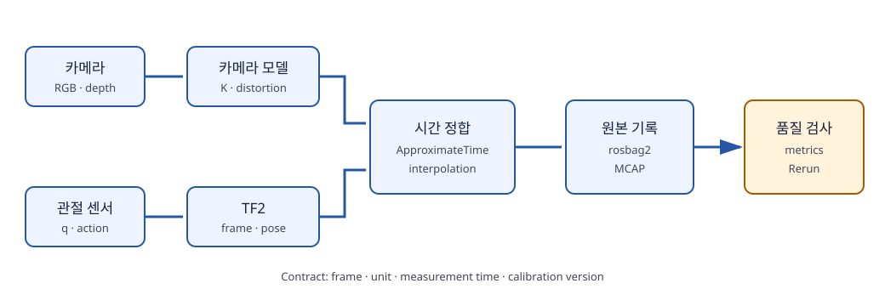
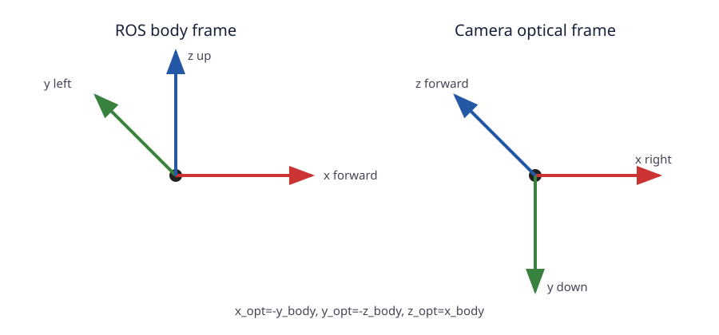
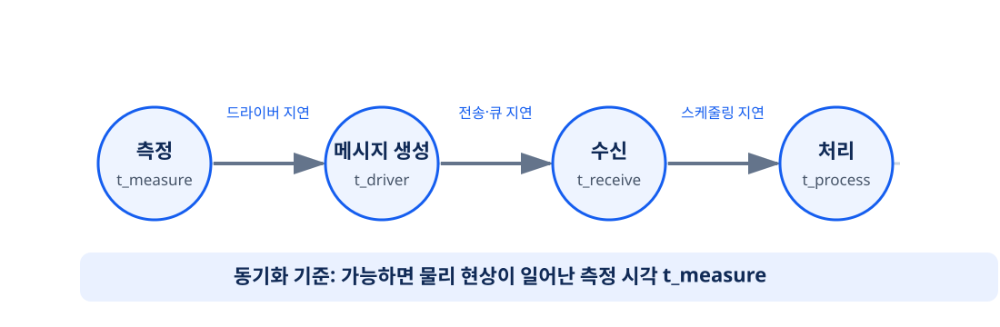
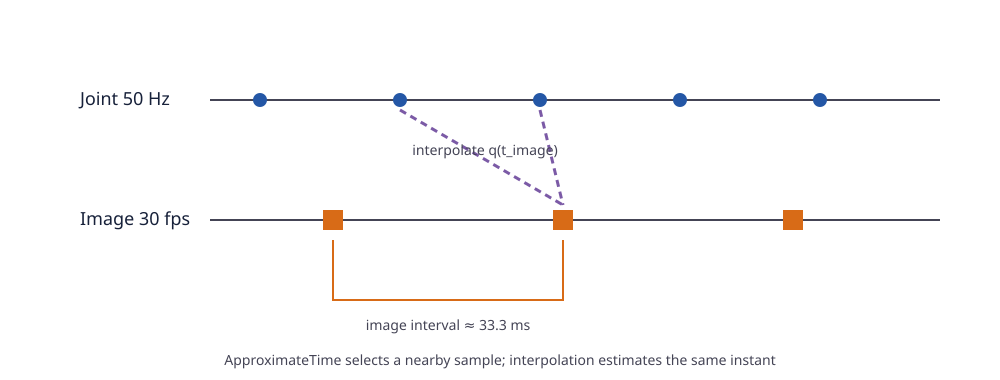
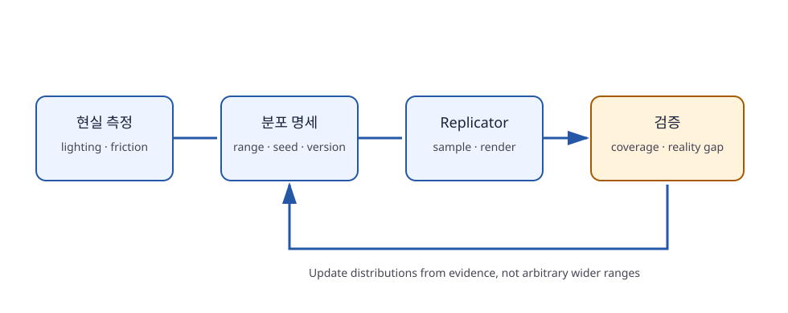

# 제4장 멀티모달 센서 정합과 데이터 파이프라인

## 장 개요

로봇 학습 데이터는 이미지, 관절 상태, 행동 명령, 언어 지시를 한 행에 모았다고 해서 자동으로 올바른 데이터가 되지 않는다. 이미지의 픽셀이 어느 3차원 광선을 뜻하는지, 관절 상태가 어느 시각의 것인지, 카메라가 어느 링크에 붙어 있는지, 시뮬레이션과 실물의 축 정의가 어떻게 다른지를 설명할 수 있어야 한다. 이 장에서는 **공간 정합(spatial alignment)**과 **시간 정합(temporal alignment)**을 하나의 데이터 계약으로 설계한다.

먼저 핀홀 카메라 모델과 내부·외부 파라미터를 유도한다. OpenUSD/Isaac Sim, ROS 2, OpenCV 사이의 좌표 프레임을 명시적으로 변환하고 TF2 트리를 구성한다. 50~100 Hz 관절 스트림과 30 fps 영상의 타임스탬프를 `message_filters`로 근사 동기화하고, 정책 학습용 기준 시각에 관절 상태를 보간한다. 이어 `rosbag2`와 MCAP으로 원본 메시지를 보존하고, Omniverse Replicator로 도메인 랜덤화(domain randomization)를 수행하며, Rerun으로 프레임 드롭·타임스탬프 역전·관절 이상치를 시각적으로 점검한다.



**그림 4-1.** 카메라 기하, TF2, 타임스탬프, 보간, 기록, 무결성 검사를 분리하면 어느 단계에서 오차가 생겼는지 추적할 수 있다.

## 학습 목표

이 장을 마치면 다음을 수행할 수 있다.

1. 핀홀 카메라의 내부 파라미터 행렬 \(K\)와 외부 변환 \([R|t]\)를 구분한다.
2. 3차원 점을 이미지 평면에 투영하고 깊이로부터 카메라 좌표 점을 복원한다.
3. OpenUSD/Isaac Sim, ROS 2, OpenCV의 축과 쿼터니언 규약 차이를 변환 행렬로 처리한다.
4. `world`, `base_link`, `tool0`, `camera_link`, `camera_optical_frame` TF2 트리를 설계한다.
5. `ApproximateTimeSynchronizer`의 queue와 slop을 센서 주기에 맞게 선택한다.
6. 서로 다른 주기의 시계열을 기준 시각에 보간하고 데이터 누출을 방지한다.
7. rosbag2/MCAP 기록과 재생을 수집 파이프라인의 원본 증거로 활용한다.
8. Replicator 랜덤화 분포를 정의하고 Rerun으로 에피소드 무결성을 검사한다.

## 선수 지식과 준비물

- 3차원 벡터, 행렬 곱, 동차 변환 행렬
- Python 3.12, NumPy, C++17
- Ubuntu 24.04 LTS, ROS 2 Jazzy Jalisco
- 선택: OpenCV, `message_filters`, `tf2_ros`, `rosbag2_storage_mcap`, Rerun SDK, Isaac Sim

> **데이터 보존 원칙**: 동기화·보간된 학습 데이터만 저장하지 않는다. 가능한 경우 원본 메시지와 원본 타임스탬프를 rosbag2에 보존하고, 파생 데이터가 어떤 코드·파라미터로 만들어졌는지 기록한다.

## 4.1 핀홀 카메라와 좌표 프레임

### 4.1.1 투영 모델

카메라 좌표의 점 \(\mathbf{P}_c=(X_c,Y_c,Z_c)^T\)에서 \(Z_c>0\)라 하자. 왜곡이 없는 핀홀 카메라에서 정규화 좌표는

\[
x_n=\frac{X_c}{Z_c},\qquad y_n=\frac{Y_c}{Z_c}
\]

이고, 픽셀 좌표는

\[
\begin{bmatrix}u\\v\\1\end{bmatrix}
=
\underbrace{\begin{bmatrix}
f_x&s&c_x\\0&f_y&c_y\\0&0&1
\end{bmatrix}}_{K}
\begin{bmatrix}x_n\\y_n\\1\end{bmatrix}
\]

이다. \(f_x,f_y\)는 픽셀 단위 초점거리, \((c_x,c_y)\)는 주점(principal point), \(s\)는 skew다. 현대 카메라에서는 보통 \(s=0\)으로 모델링한다.

월드 점 \(\mathbf{P}_w\)를 카메라로 옮기는 외부 파라미터가 \({}^{c}T_w\)라면

\[
\tilde{\mathbf{P}}_c = {}^{c}T_w\tilde{\mathbf{P}}_w,
\qquad {}^{c}T_w=
\begin{bmatrix}{}^{c}R_w&{}^{c}\mathbf{t}_w\\0&1\end{bmatrix}
\]

이다. 표기 \({}^{a}T_b\)는 “프레임 \(b\)의 좌표를 프레임 \(a\)로 표현한다”는 뜻으로 이 책 전체에서 사용한다.

내부 파라미터는 카메라 내부 광학·센서 특성을, 외부 파라미터는 카메라가 로봇/세계 어디에 놓였는지를 나타낸다. 해상도나 crop을 바꾸면 \(K\)도 함께 변할 수 있지만, 카메라가 움직였다고 \(K\)가 바뀌는 것은 아니다.

::: {.learning-aid}
**이해 도움말 — 내부 파라미터와 외부 파라미터를 구분하는 질문**

“이 카메라가 픽셀을 어떤 광선으로 해석하는가?”에 답하는 것이 내부 파라미터(intrinsic parameter) $K$이고, “그 광선이 로봇이나 월드에서 어느 방향을 향하는가?”에 답하는 것이 외부 파라미터(extrinsic parameter) $[R|t]$다. 렌즈·해상도·crop이 바뀌면 먼저 $K$를 의심하고, 카메라 마운트를 다시 조립했거나 충격을 받았다면 $[R|t]$를 다시 측정한다.
:::

### 4.1.2 렌즈 왜곡

실물 렌즈는 핀홀 모델에서 벗어난다. OpenCV의 일반적인 모델은 방사 왜곡 \(k_1,k_2,k_3\)과 접선 왜곡 \(p_1,p_2\)를 사용한다. 정규화 좌표에서 \(r^2=x^2+y^2\)라 할 때 대표적인 형태는

\[
x_d=x(1+k_1r^2+k_2r^4+k_3r^6)+2p_1xy+p_2(r^2+2x^2)
\]

\[
y_d=y(1+k_1r^2+k_2r^4+k_3r^6)+p_1(r^2+2y^2)+2p_2xy
\]

이다. 정확한 모델과 계수 순서는 사용하는 OpenCV calibration model을 기록한다. 시뮬레이터가 왜곡 없는 영상을 생성해도, 실물 전환 시 동일한 전처리를 만들기 위해 시뮬레이션 영상에 보정 전 왜곡을 합성하거나 실물 영상을 rectify할 수 있다.

### 4.1.3 역투영과 깊이의 의미

픽셀 \((u,v)\)와 optical-axis depth \(Z_c\)가 주어지면

\[
\mathbf{P}_c=Z_c K^{-1}\begin{bmatrix}u\\v\\1\end{bmatrix}
\]

로 복원한다. 그러나 센서의 depth가 광축 방향 \(Z_c\)인지, 카메라 중심에서 점까지의 Euclidean range인지 확인해야 한다. 둘은 화면 가장자리에서 다르다.

`code/camera_geometry.py`는 투영, 역투영, 좌표 변환을 NumPy로 구현한다. 행렬의 방향과 depth 정의를 함수 이름과 docstring에 명시했다.

### 4.1.4 캘리브레이션 품질

캘리브레이션의 단일 RMS reprojection error만 보고 품질을 판단하지 않는다.

- 패턴이 화면 전체와 다양한 자세를 덮는가?
- 학습과 검증 이미지가 분리되어 있는가?
- 잔차가 특정 모서리나 방향에 편향되는가?
- 초점·노출·해상도가 운영 조건과 같은가?
- 외부 파라미터는 카메라 마운트 재조립 뒤 다시 측정했는가?

Eye-in-hand 카메라는 `base_link -> tool0 -> camera_link` 체인에 있고, eye-to-hand 카메라는 보통 `world` 또는 `base_link`에 고정된다. 두 경우의 외부 파라미터가 업데이트되는 방식이 다르다.

## 4.2 Isaac Sim/USD, ROS 2, OpenCV 좌표 변환

### 4.2.1 축 이름을 추측하지 않는다

ROS REP 103의 로봇 몸체 관례는 x-forward, y-left, z-up이다. ROS optical frame은 z-forward, x-right, y-down을 사용하며 OpenCV의 카메라 좌표 관례와 맞는다. OpenUSD Stage는 up axis를 메타데이터로 갖고, 카메라와 자산의 로컬 축 의미는 schema와 importer 설정을 함께 확인해야 한다. Isaac Sim 장면이 흔히 Z-up이라고 해서 모든 USD 파일이 Z-up인 것은 아니다.

ROS body frame 벡터를 optical frame으로 바꾸는 한 가지 회전은 다음과 같다.

\[
{}^{opt}R_{body}=
\begin{bmatrix}
0&-1&0\\
0&0&-1\\
1&0&0
\end{bmatrix}
\]

즉 \(x_{opt}=-y_{body}\), \(y_{opt}=-z_{body}\), \(z_{opt}=x_{body}\)다. 코드에서 축을 swap하는 세 줄로 숨기지 말고 이름 있는 행렬로 표현한다.

### 4.2.2 동차 변환의 방향

두 변환을 합성할 때 오른쪽 변환이 먼저 적용된다.

\[
{}^{world}T_{camera}={}^{world}T_{base}\,{}^{base}T_{tool}\,{}^{tool}T_{camera}
\]

월드 점을 카메라 좌표로 만들려면 이 행렬을 그대로 곱하는 것이 아니라 역변환 \({}^{camera}T_{world}=({}^{world}T_{camera})^{-1}\)을 사용한다. 코드 리뷰에서 변수 이름 `camera_pose`만으로는 방향을 알 수 없으므로 `T_world_camera`처럼 source와 target을 모두 쓴다.

### 4.2.3 쿼터니언과 행렬

ROS `geometry_msgs/Quaternion` 필드는 `(x, y, z, w)`다. 다른 라이브러리는 `(w, x, y, z)`를 생성자 순서로 사용한다. 쿼터니언 \(q\)와 \(-q\)는 같은 회전을 뜻하므로, 시계열 비교나 SLERP 전에 내적이 음수면 한쪽 부호를 뒤집어 최단 경로를 택한다.

회전 행렬은 다음 조건을 만족해야 한다.

\[
R^TR=I,\qquad \det(R)=+1
\]

축 swap을 직접 작성한 뒤 이 조건을 확인하면 reflection을 회전으로 잘못 사용한 오류를 찾을 수 있다.

### 4.2.4 프레임 계약 표

| 프레임 | 부모 | 축 의미 | 단위 | 소유자 |
|---|---|---|---|---|
| `world` | 없음 | Stage up-axis 명시 | m, rad | simulator |
| `base_link` | `world` | x forward, y left, z up | m, rad | localization/static |
| `tool0` | `base_link` | URDF 정의 | m, rad | robot state publisher |
| `camera_link` | `tool0` | 카메라 기구 프레임 | m, rad | calibration |
| `camera_optical_frame` | `camera_link` | z forward, x right, y down | m, rad | static transform |



**그림 4-2.** 기구 프레임과 optical frame을 분리하면 ROS·OpenCV 관례를 유지하면서 마운트 자세를 독립적으로 캘리브레이션할 수 있다.

## 4.3 TF2 트리 설계

### 4.3.1 트리는 하나의 부모를 갖는다

TF2는 시간에 따라 변하는 프레임 관계를 버퍼에 저장한다. 각 child frame은 한 시점에 하나의 parent를 가져야 한다. 같은 `camera_link`를 두 Node가 서로 다른 부모로 broadcast하면 트리가 흔들리거나 조회 결과가 불안정해진다.

- 고정 마운트: `StaticTransformBroadcaster`
- 관절에 따라 변함: `robot_state_publisher` 또는 동적 broadcaster
- 월드 localization: localization/SLAM Node

`code/ros2_jazzy/sensor_pipeline/sensor_pipeline/static_camera_tf.py`는 `tool0 -> camera_link -> camera_optical_frame`의 고정 변환을 방송한다. 실제 값은 캘리브레이션 결과로 교체한다.

### 4.3.2 timestamp가 있는 조회

“최신 transform”으로 모든 과거 이미지를 변환하면 움직이는 로봇에서 공간 오차가 생긴다. 이미지 header timestamp에 해당하는 transform을 조회한다.

```python
transform = tf_buffer.lookup_transform(
    "base_link",
    image.header.frame_id,
    image.header.stamp,
    timeout=Duration(seconds=0.05),
)
```

필요한 transform이 아직 버퍼에 없으면 기다리거나 해당 표본을 누락 처리한다. 미래 extrapolation 오류를 피하려고 timestamp를 0으로 바꾸면 데이터는 흐르지만 의미가 틀릴 수 있다.

### 4.3.3 TF 진단

```bash
ros2 run tf2_tools view_frames
ros2 run tf2_ros tf2_echo base_link camera_optical_frame
```

**예상 출력 예시**

```text
At time 1710000000.033
Translation: [0.083, -0.012, 0.115]
Rotation (xyzw): [0.500, -0.500, 0.500, -0.500]
```

숫자만 보지 말고 RViz의 axes와 알려진 물체의 projection으로 방향을 검증한다.

## 4.4 멀티레이트 센서 시간 정합

### 4.4.1 네 개의 시간

하나의 메시지에도 여러 시간이 존재할 수 있다.

1. 센서 노출/측정 시각
2. 드라이버가 메시지를 만든 시각
3. middleware가 수신한 시각
4. 애플리케이션이 처리한 시각

동기화에는 가능한 한 측정 시각을 header에 기록한다. 수신 시각을 대신 쓰면 네트워크 jitter가 물리적인 시간 차이처럼 섞인다. 장치 clock을 호스트 clock으로 변환했다면 offset 추정법과 불확실성을 기록한다.



**학습 도식.** 측정 시각은 물리 현상이 일어난 때를 나타내고, 나머지 시각의 차이는 드라이버·전송·처리 지연을 진단하는 단서다.

### 4.4.2 ExactTime과 ApproximateTime

서로 다른 센서는 timestamp가 정확히 같지 않으므로 `ApproximateTimeSynchronizer`가 유용하다. 알고리즘은 queue 안에서 timestamp 차이가 허용 범위(slop) 안인 조합을 찾는다. 이는 시간 여행을 보정하는 것이 아니라 가까운 메시지를 짝짓는 것이다.

30 fps 영상의 프레임 간격은 약 33.3 ms이고, 50 Hz 관절 상태는 20 ms다. 예를 들어 slop 15 ms는 가까운 상태를 찾을 가능성이 높지만, 시스템 jitter가 더 크면 pair가 사라진다. slop을 100 ms로 키우면 pair 수는 늘지만 빠른 동작에서 공간 오차가 커진다.



**그림 4-3.** 근사 동기화는 가장 가까운 이산 표본을 고르고, 보간은 이미지 시각 양쪽 관절 표본으로 같은 시각의 상태를 계산한다.

`message_filters`의 모든 Subscriber는 호환되는 QoS를 사용해야 한다. sensor-data publisher가 best-effort인데 subscriber만 reliable이면 연결되지 않을 수 있다. queue size는 최대 지연과 rate로 추정하되, 무한히 키워 오래된 데이터를 쌓지 않는다.

### 4.4.3 선형 보간

이미지 timestamp \(t\)를 사이에 두는 관절 상태 \((t_0,\mathbf{q}_0)\), \((t_1,\mathbf{q}_1)\)가 있으면

\[
\alpha=\frac{t-t_0}{t_1-t_0},\qquad
\mathbf{q}(t)=(1-\alpha)\mathbf{q}_0+\alpha\mathbf{q}_1
\]

로 보간한다. 회전 관절이 \(-\pi\)와 \(+\pi\) 경계를 지날 때는 unwrap 후 보간한다. 쿼터니언은 선형 보간보다 SLERP가 적합하다.

실시간 정책에서는 미래 표본 \(t_1\)을 기다릴 수 없으므로 보간이 지연을 추가한다. 오프라인 데이터셋 정렬에서는 양쪽 표본을 쓸 수 있지만, 학습 입력에 미래 행동이나 미래 관측이 섞이지 않도록 feature timestamp를 엄격히 관리한다.

`code/interpolate_joint_state.cpp`는 관절 timestamp를 단조 증가로 검사하고 두 표본 사이를 선형 보간하는 독립 C++17 예제다.

::: {.learning-check}
**잠깐 점검 — 가까운 표본이면 충분할까?**

1. 오프라인 데이터셋에서는 이미지 시각 양쪽의 관절 표본을 쓸 수 있지만, 실시간 제어에서 같은 보간을 사용하면 어떤 비용이 생기는가?
2. `ApproximateTime`의 slop을 크게 하면 callback 수는 늘어난다. 그런데 빠른 로봇 동작에서는 왜 데이터 품질이 나빠질 수 있는가?

**확인 포인트:** 실시간 양방향 보간은 미래 표본을 기다리는 만큼 지연(latency)을 추가한다. 큰 slop은 서로 다른 물리 시각의 영상과 관절 상태를 한 쌍으로 묶어 공간 정합 오차를 숨길 수 있다.
:::

### 4.4.4 품질 지표

에피소드마다 다음을 계산한다.

- 예상 프레임 대비 실제 프레임 수와 drop rate
- timestamp 차이 \(|t_{image}-t_{joint}|\)의 p50/p95/max
- timestamp 역전 수
- 관절별 속도·가속도·jerk의 이상치
- TF lookup 실패율
- 영상 decode 실패와 해상도 변화
- 명령과 관측의 지연 분포

단순히 “파일이 열린다”는 데이터 품질 검사가 아니다.

## 4.5 rosbag2와 MCAP 원본 기록

### 4.5.1 왜 원본 메시지를 보존하는가

동기화 정책이나 보정 파라미터는 나중에 바뀐다. 원본 메시지와 timestamp가 있으면 다시 정렬할 수 있지만, 30 fps 배열로 이미 resample한 데이터만 남으면 원래 jitter와 누락을 복원할 수 없다.

Jazzy의 `rosbag2`는 메시지 기록·재생 계층이고 storage plugin을 선택할 수 있다. MCAP은 여러 channel과 schema, index를 담을 수 있는 컨테이너이며 ROS 2 storage plugin으로 사용할 수 있다.

```bash
sudo apt install ros-jazzy-rosbag2-storage-mcap
ros2 bag record -s mcap -o episode_0001 \
  /camera/color/image_raw /camera/color/camera_info \
  /joint_states /tf /tf_static /command /clock
```

기록 후:

```bash
ros2 bag info episode_0001
ros2 bag play episode_0001 --clock
```

**예상 출력 예시**

```text
Storage id: mcap
Duration: 42.31s
/camera/color/image_raw: 1268 messages
/joint_states: 2115 messages
```

### 4.5.2 에피소드 메타데이터

bag 폴더 바깥에 다음을 함께 저장한다.

- task prompt, 성공/실패, 종료 이유
- 로봇/카메라 serial과 calibration hash
- 소프트웨어 버전과 Git revision
- QoS override와 record 명령
- 시뮬레이션 seed와 randomization 분포
- operator와 안전 이벤트

개인정보나 사람 얼굴이 포함될 수 있으면 수집 전에 보존 기간과 접근 권한을 정한다.

## 4.6 Domain Randomization

### 4.6.1 목적과 한계

도메인 랜덤화는 시뮬레이션의 렌더링·물리 파라미터를 분포에서 표본화해 정책이 특정 시뮬레이션 외형에 과적합하지 않도록 한다. 이 접근은 시뮬레이터가 정확히 현실과 같아야 한다는 요구를 완화하지만, 실제 환경이 학습 분포 밖이면 여전히 실패한다.

랜덤화 범주:

- 조명: 위치, 방향, 색온도, intensity
- 카메라: 작은 pose jitter, focal length, exposure/noise
- 외형: 배경, texture, object color/roughness
- 기하: 물체 초기 pose, 크기 허용오차
- 물리: mass, friction, restitution, actuator delay

안전과 의미를 깨는 랜덤화는 피한다. 예를 들어 색상 지시 작업에서 target 색을 바꾸면서 언어 prompt를 그대로 두면 label이 틀린다. 카메라를 벽 안으로 이동시키거나 물체 질량을 비현실적으로 뽑는 것도 유효한 다양성이 아니다.

### 4.6.2 분포를 버전 관리한다

“randomize lighting” 대신 분포를 수치로 기록한다.

```yaml
randomization_version: 3
seed: 4102
camera_translation_jitter_m: [-0.005, 0.005]
camera_rotation_jitter_deg: [-2.0, 2.0]
light_intensity: [800, 3000]
object_hue_shift_deg: [-15, 15]
static_friction: [0.6, 1.1]
```

분포는 train/validation에서 겹치되 validation seed는 분리한다. 실제 측정값이 들어오면 범위를 업데이트하고 버전을 올린다.

### 4.6.3 Replicator 실행 구조

`code/replicator_randomization.py`는 Replicator의 trigger 안에서 camera, light, object pose를 표본화하고 writer를 연결하는 예시다. Isaac Sim 릴리스에 따라 import와 API가 달라질 수 있으므로 설치된 버전의 공식 Replicator 문서와 함께 사용한다.



**그림 4-4.** 측정한 현실 범위에서 분포를 정의하고 seed와 파라미터를 메타데이터에 남겨야 합성 데이터를 재현할 수 있다.

## 4.7 Rerun 기반 무결성 검사

Rerun은 이미지, scalar, transform, point, time-series를 같은 timeline에 로그해 공간·시간 관계를 탐색하는 도구다. Rerun 자체가 데이터 품질을 보장하지는 않는다. 검사 규칙이 이상치를 계산하고, Rerun은 그것을 사람이 빠르게 해석하도록 돕는다.

`code/rerun_integrity_check.py`는 CSV joint trajectory와 이미지 경로를 읽는 대신, 의존성 없이 생성한 예시 시계열을 Rerun에 기록한다. 다음 entity를 권장한다.

- `world/camera/image`
- `robot/joints/<joint_name>/position`
- `quality/image_joint_delta_ms`
- `quality/frame_drop`
- `quality/timestamp_reversal`
- `episode/task`와 `episode/success`

`code/rerun_integrity_check.py`는 frame 184에 영상 간격 증가, frame 250에 `joint_3` spike, frame 291에 timestamp 역전을 의도적으로 주입하고 해당 품질 entity를 기록한다.

**예상 관찰 예시**

```text
frame 184: image interval 67 ms -> one probable drop
frame 250: joint_3 velocity threshold exceeded
frame 291: joint timestamp decreased by 12 ms
```

무결성 검사는 실패를 숨기지 않는다. 품질 기준을 통과하지 못한 에피소드를 삭제하기보다 quarantine 목록에 두고 원인과 재수집 여부를 기록한다.

## 4.8 구현 예제

### [SIM] 4.8.1 카메라 수학

```bash
python3 code/camera_geometry.py
```

**예상 출력 예시**

```text
pixel: [420.0, 290.0]
reconstructed camera point: [0.2, 0.1, 1.0]
round-trip error: 0.000000
det(R_opt_body): 1.000
```

### [SIM] 4.8.2 ApproximateTime ROS 2 Node

`code/ros2_jazzy/sensor_pipeline/`는 Python 패키지로 다음 console script를 제공한다.

- `synthetic_sensors`: 30 Hz Image와 50 Hz JointState를 고정된 jitter/offset과 함께 생성
- `approx_sync`: Image와 JointState를 근사 동기화하고 timestamp delta를 발행
- `static_camera_tf`: camera link와 optical frame의 고정 TF 방송

```bash
cd code/ros2_jazzy
colcon build --symlink-install --packages-select sensor_pipeline
source install/setup.bash
ros2 run sensor_pipeline synthetic_sensors
```

다른 터미널에서 동기화 Node를 실행한다.

```bash
cd book/04_sensor_data_pipeline/code/ros2_jazzy
source /opt/ros/jazzy/setup.bash
source install/setup.bash
ros2 run sensor_pipeline approx_sync --ros-args -p slop_s:=0.02
```

`synthetic_sensors`는 실물 장비 없이 slop 실험을 재현하기 위한 교육용 입력이다. `image_offset_ms`와 `jitter_ms` 파라미터로 두 stream의 timestamp 차이를 바꿀 수 있다.

### [SIM] 4.8.3 독립 C++ 보간

```bash
g++ -std=c++17 -O2 code/interpolate_joint_state.cpp -o /tmp/interpolate_joint_state
/tmp/interpolate_joint_state
```

**예상 출력 예시**

```text
t=0.033 q=[0.165, -0.066]
reversal rejected: timestamps must be strictly increasing
```

## 4.9 트러블슈팅

| 증상 | 원인 후보 | 진단 | 해결 방향 |
|---|---|---|---|
| 3D 점이 좌우 반전 | body/optical 축 혼동 | 알려진 축 점을 투영 | 명시적 회전 행렬 사용, det 검사 |
| 영상 위 overlay가 속도에 따라 밀림 | 최신 TF 사용, timestamp offset | 정지/동작 잔차 비교 | 이미지 시각 TF 조회, clock offset 보정 |
| ApproximateTime callback이 호출되지 않음 | QoS 비호환, slop 과소, header 없음 | topic info -v, stamp 출력 | QoS 통일, header 측정 시각 제공 |
| callback은 많지만 pose가 부정확 | slop 과대 | delta histogram | slop 축소 또는 보간 사용 |
| bag replay 시 TF extrapolation | `/clock`/use_sim_time 설정, `/tf_static` 누락 | bag topic 확인 | clock 재생, static TF 기록 |
| joint spike | wrap 경계, packet corruption, 잘못된 순서 | 이름 기반 재정렬과 unwrap | 범위·속도 검사, quarantine |
| 합성 데이터 성능만 개선 | 랜덤화 분포가 현실과 다름 | 실제 파라미터 측정 | 분포 보정, photometric/physics 분리 실험 |
| Rerun timeline이 겹치지 않음 | 서로 다른 time column/단위 | ns/s 변환 확인 | 공통 timeline과 명시적 단위 사용 |

## 4.10 요약

- 내부 파라미터는 광선과 픽셀의 관계, 외부 파라미터는 프레임 사이의 자세를 정의한다.
- 좌표 변환은 축 swap이 아니라 방향이 명시된 \({}^{a}T_b\)로 관리한다.
- ROS body와 optical frame은 축 관례가 다르며, USD Stage의 up axis도 조회해야 한다.
- TF2 조회는 데이터의 측정 timestamp에 수행한다.
- ApproximateTime은 가까운 표본을 짝지을 뿐이며, 큰 slop은 공간 오차를 숨길 수 있다.
- 오프라인 정렬에는 양쪽 관절 표본 보간이 가능하지만 미래 정보 누출을 방지해야 한다.
- rosbag2/MCAP 원본과 에피소드 메타데이터를 보존해야 파이프라인을 재처리할 수 있다.
- 랜덤화 분포와 seed를 버전 관리하고, Rerun으로 공간·시간 이상을 함께 조사한다.

## 4.11 확인문제

1. \(K\)의 \(f_x\)가 두 배가 될 때 같은 3D 점의 픽셀 좌표가 어떻게 변하는가?
2. optical-axis depth와 Euclidean range의 차이를 그림과 식으로 설명하라.
3. \({}^{world}T_{camera}\)가 있을 때 월드 점을 카메라로 변환하는 식을 쓰라.
4. ROS body frame의 단위 벡터 x, y, z를 optical frame으로 각각 변환하라.
5. 쿼터니언 시계열에서 \(q\)와 \(-q\)가 번갈아 저장될 때 단순 차분이 만드는 문제를 설명하라.
6. TF2에서 camera frame에 두 parent가 생기면 안 되는 이유는 무엇인가?
7. 30 fps 영상과 50 Hz 관절 상태에서 slop 5 ms와 50 ms의 trade-off를 비교하라.
8. 실시간 정책과 오프라인 데이터셋에서 보간 방식이 달라지는 이유를 설명하라.
9. rosbag2 원본을 유지하면 calibration이 바뀌었을 때 어떤 작업을 다시 할 수 있는가?
10. 색상 기반 지시 작업에서 무작위 색 변경이 label corruption을 만들 수 있는 사례를 제시하라.
11. timestamp 역전과 frame drop을 각각 검출하는 최소 알고리즘을 작성하라.
12. Rerun 시각화와 자동 품질 기준의 역할 차이를 설명하라.

해설은 [제4장 확인문제 해설 및 평가 기준](#chapter-4-solutions)에 있다.

## 4.12 프로젝트 과제

### 과제 A: 멀티모달 에피소드 정합기

카메라 30 fps, 관절 50 Hz, action 20 Hz의 synthetic stream을 만든다. 이미지 timestamp를 기준으로 관절을 보간하고, action은 해당 시각 이전의 최신 명령만 연결한다. 출력에 원본 index, timestamp delta, interpolation flag를 포함한다.

### 과제 B: 데이터 품질 리포트

에피소드별 frame drop, reversal, joint velocity outlier, TF missing, image-joint delta를 계산하고 Rerun entity로 기록한다. 실패 에피소드를 삭제하지 않고 사유가 있는 quarantine manifest를 만든다.

### 평가 기준

| 항목 | 배점 |
|---|---:|
| 좌표 프레임과 단위 정확성 | 20 |
| timestamp·동기화·보간 의미 | 25 |
| 누락·역전·이상치 처리 | 20 |
| 재현 가능한 메타데이터 | 15 |
| 시각화와 설명 | 10 |
| 코드 구조와 출처 | 10 |

## 4.13 실습·평가·참고자료

- [실습 4-1: 카메라 투영과 프레임 정합](#lab-4-1)
- [실습 4-2: TF2와 ApproximateTime](#lab-4-2)
- [실습 4-3: rosbag2/MCAP 에피소드 기록](#lab-4-3)
- [실습 4-4: Domain Randomization과 Rerun 품질 검토](#lab-4-4)
- [제4장 확인문제 해설 및 평가 기준](#chapter-4-solutions)

### 4.13.1 참고문헌

1. OpenCV, [Camera Calibration and 3D Reconstruction](https://docs.opencv.org/4.x/d9/d0c/group__calib3d.html).
2. ROS REP 103, [Standard Units of Measure and Coordinate Conventions](https://www.ros.org/reps/rep-0103.html).
3. ROS 2 Jazzy, [tf2 Tutorials](https://docs.ros.org/en/jazzy/Tutorials/Intermediate/Tf2/Tf2-Main.html).
4. ROS 2 Jazzy, [Approximate Time Synchronizer (Python)](https://docs.ros.org/en/jazzy/p/message_filters/doc/Tutorials/Approximate-Synchronizer-Python.html).
5. ROS 2 Jazzy, [Quality of Service settings](https://docs.ros.org/en/jazzy/Concepts/Intermediate/About-Quality-of-Service-Settings.html).
6. ROS 2, [rosbag2](https://github.com/ros2/rosbag2/tree/jazzy) 및 [MCAP Storage Plugin](https://github.com/ros-tooling/rosbag2_storage_mcap).
7. Foxglove, [MCAP Specification](https://mcap.dev/spec).
8. NVIDIA Isaac Sim, [Replicator Tutorials](https://docs.isaacsim.omniverse.nvidia.com/latest/replicator_tutorials/index.html).
9. NVIDIA Omniverse, [Replicator Documentation](https://docs.omniverse.nvidia.com/py/replicator/).
10. Rerun, [Python SDK](https://rerun.io/docs/getting-started/data-in/python) 및 [Time](https://rerun.io/docs/concepts/timelines).
11. Tobin, J. et al., [Domain Randomization for Transferring Deep Neural Networks from Simulation to the Real World](https://arxiv.org/abs/1703.06907), 2017.
12. Sadeghi, F., Levine, S., [CAD2RL: Real Single-Image Flight without a Single Real Image](https://arxiv.org/abs/1611.04201), 2016.
13. Horaud, R., Dornaika, F., [Hand-Eye Calibration](https://doi.org/10.1177/027836499501400301), IJRR, 1995.

