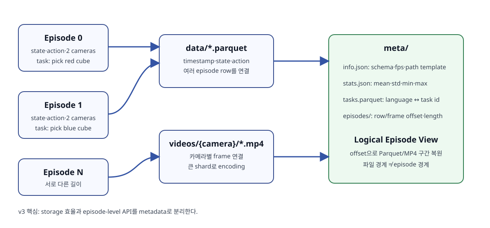
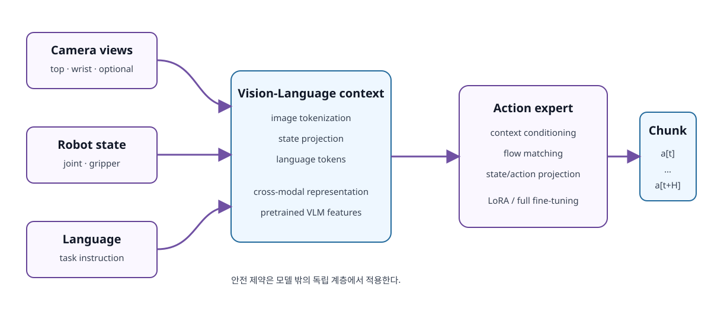
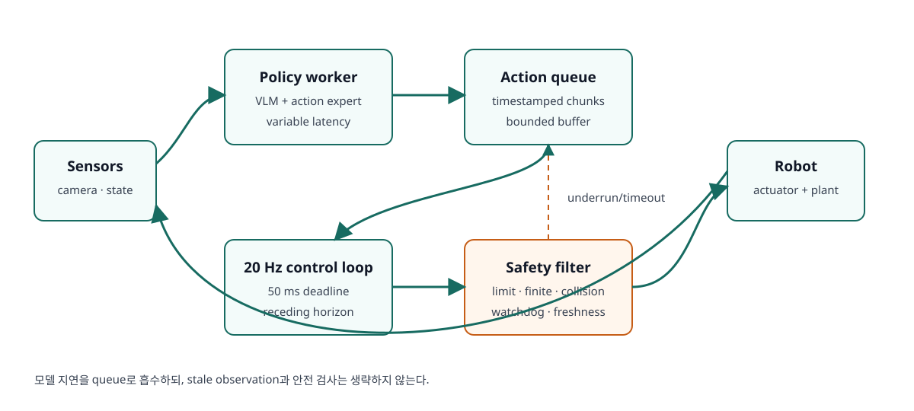

# 제5장 LeRobot Dataset과 SmolVLA 파인튜닝

## 장 개요

로봇을 사람이 직접 조작해 성공 시연(demonstration)을 모으면, 관측에서 행동으로 가는 정책(policy)을 지도학습 형태로 훈련할 수 있다. 그러나 일반 이미지 분류와 달리 로봇 행동은 한 번의 예측이 다음 관측을 바꾸고, 작은 오차가 시간에 따라 누적된다. 데이터 수집, 시계열 정렬, 정규화, 행동 표현, 실시간 추론을 하나의 시스템으로 다뤄야 하는 이유다.

이 장에서는 행동 복제(behavior cloning, BC)의 기본 목적함수와 공변량 이동(covariate shift)을 출발점으로, Action Chunking with Transformers(ACT), Diffusion Policy, Vision-Language-Action(VLA) 모델의 차이를 설명한다. 이어서 Hugging Face LeRobotDataset v3의 Parquet·MP4·메타데이터 구조를 해부하고, SmolVLA를 LoRA(Low-Rank Adaptation)로 미세조정하는 절차를 설계한다. 마지막에는 20 Hz 폐루프(closed-loop) 실행, action chunk, temporal ensembling, 비동기 추론, 안전 필터를 하나의 배포 파이프라인으로 연결한다.

이 장의 버전 기준은 **2026년 10월에 확인한 LeRobot 공식 `main` 문서와 LeRobotDataset v3 계열**이다. LeRobot의 CLI와 configuration key는 빠르게 변할 수 있으므로 실제 실습에서는 설치한 commit과 `lerobot-train --help` 출력을 원고와 함께 보관한다.



**그림 5-1.** 여러 episode가 소수의 Parquet/MP4 shard에 합쳐지고, metadata가 episode 경계를 복원하는 LeRobotDataset v3 구조.

## 학습 목표

이 장을 마치면 학습자는 다음을 수행할 수 있다.

1. behavior cloning의 목적함수와 covariate shift에 의한 오류 누적을 설명할 수 있다.
2. 단일 행동 회귀, ACT, Diffusion Policy, VLA 정책의 표현력과 계산 비용을 비교할 수 있다.
3. LeRobotDataset v3의 `data`, `videos`, `meta` 관계와 episode reconstruction 방식을 설명할 수 있다.
4. 카메라·관절·행동·언어 데이터를 일관된 feature schema로 설계할 수 있다.
5. episode 단위 train/validation/test 분할과 training-only normalization을 구현할 수 있다.
6. SmolVLA의 VLM context와 action expert, action chunk 생성을 설명할 수 있다.
7. full fine-tuning과 LoRA의 parameter/memory trade-off를 평가할 수 있다.
8. training configuration, checkpoint, dataset revision을 재현 가능한 형태로 기록할 수 있다.
9. 20 Hz 폐루프에서 chunk 실행, temporal ensembling, inference latency를 다룰 수 있다.
10. 데이터 공개 전 라이선스, 개인정보, 음성·영상·Hub 접근 권한을 점검할 수 있다.

## 선수 지식과 준비물

### 선수 지식

- PyTorch의 tensor, module, optimizer, dataloader
- Transformer의 self-attention과 cross-attention
- 확률분포, 조건부확률, 평균·표준편차
- 제4장의 센서 timestamp 정렬과 episode 수집 구조

### 기준 환경

- Ubuntu 24.04 LTS
- Python 가상환경 또는 `uv`
- CUDA 호환 NVIDIA GPU(학습 시 권장)
- Hugging Face 계정과 token(비공개 Hub 저장소를 사용할 경우)
- LeRobot repository의 고정 commit 또는 태그

설치 명령은 프로젝트의 현재 문서를 우선한다. SmolVLA 추가 의존성은 공식 문서에서 다음과 같이 안내된다.

```bash
git clone https://github.com/huggingface/lerobot.git
cd lerobot
python3 -m venv .venv
source .venv/bin/activate
pip install -e ".[smolvla,peft]"
git rev-parse HEAD
lerobot-train --help
```

마지막 두 명령의 출력을 실험 기록에 저장한다. `latest` 또는 `main`만 기록하면 같은 실험 환경을 다시 만들 수 없다.

## 5.1 모방학습과 행동 복제

### 5.1.1 demonstration dataset

시연 데이터셋 \(D\)는 관측 \(o_t\), 행동 \(a_t\), 필요하면 언어 지시 \(l\)의 시계열로 구성된다.

\[
D = \{\tau_i\}_{i=1}^{N}, \qquad
\tau_i = \{(o_t, a_t, l_i)\}_{t=0}^{T_i-1}
\]

관측은 한 장의 이미지가 아니라 여러 카메라 영상, 현재 관절 상태, 그리퍼 상태를 포함할 수 있다. 행동은 다음 joint position, joint delta, end-effector pose, velocity 중 하나다. `action`의 의미를 schema와 unit에 명시하지 않으면 같은 shape의 tensor라도 서로 호환되지 않는다.

### 5.1.2 behavior cloning 목적함수

결정론적 정책이 행동을 직접 회귀한다면 가장 단순한 loss는 다음과 같다.

\[
\mathcal{L}_{BC}(\theta) =
\mathbb{E}_{(o,a)\sim D}
\left[\|\pi_\theta(o)-a\|_1\right]
\]

L1 또는 Smooth L1은 큰 이상치에 대한 민감도가 L2보다 낮다. 하지만 loss가 낮다고 task success가 반드시 높지는 않다. 같은 관측에서 왼쪽과 오른쪽으로 우회하는 두 성공 행동이 존재하면 평균 회귀 결과는 장애물 중앙으로 향할 수 있다. 행동 분포의 다봉성(multimodality)이 중요한 이유다.

### 5.1.3 covariate shift와 복구 데이터

훈련 데이터의 관측 분포는 사람 정책 \(\pi_E\)가 만든다. 배포 중 모델 \(\pi_\theta\)가 작은 오차를 내면 훈련에서 거의 보지 못한 상태로 이동하고, 그 상태에서 더 큰 오차를 낼 수 있다.

\[
o_t \sim d_{\pi_E} \;\text{(training)}, \qquad
o_t \sim d_{\pi_\theta} \;\text{(deployment)}
\]

대응 방법은 하나가 아니다.

- 시작 pose, 물체 위치, 조명 변화를 충분히 포함한다.
- 완벽한 시연뿐 아니라 안전한 복구(recovery) 행동을 수집한다.
- 실패 직전/실패 상태를 구분해 annotation한다.
- closed-loop evaluation에서 관측된 실패 분포를 다음 수집 round에 반영한다.
- 필요하면 DAgger 계열처럼 정책 방문 상태에 expert label을 추가한다.

단, 위험 상태를 의도적으로 만들 때는 로봇 속도·토크 제한과 비상 정지 절차가 우선이다.

::: {.learning-aid}
**이해 도움말 — 왜 한 번의 작은 오차가 계속 커지는가**

행동 복제(Behavior Cloning)는 주로 전문가가 만든 “정상 경로”를 본다. 그러나 배포 중 정책이 물체를 몇 mm 빗맞히면 다음 카메라 영상은 훈련 데이터에 드물었던 장면이 된다. 정책은 낯선 장면에서 다시 오차를 내고, 그 결과는 더 낯선 다음 관측을 만든다. 이것이 공변량 이동(covariate shift)의 연쇄다. 따라서 데이터 수집 때는 성공 궤적의 개수만 늘리기보다, 살짝 어긋난 상태에서 정상 경로로 돌아오는 복구(recovery) 예시를 포함하는 것이 중요하다.
:::

## 5.2 행동 정책의 계보

### 5.2.1 단일 step 정책

단일 step 정책은 현재 관측에서 다음 action 하나를 예측한다. latency가 작고 구현이 단순하지만, 사람 시연의 고주파 jitter를 그대로 학습하거나 시간적 일관성을 잃기 쉽다. 긴 작업을 매 step 독립적으로 결정하면 예측 noise가 command noise가 된다.

### 5.2.2 ACT: action sequence를 한 번에 예측

ACT는 Action Chunking with Transformers의 약자다. Zhao 등은 저가형 양팔 로봇의 정밀 조작에서 action sequence를 생성하는 generative model을 제시했다. 한 시점에서 \(H\)개의 미래 행동을 예측하면 유효 decision horizon이 줄고, 시간적으로 연결된 동작을 모델링할 수 있다.

\[
\hat{A}_t = [\hat a_t, \hat a_{t+1}, \ldots, \hat a_{t+H-1}]
\]

ACT는 conditional VAE와 Transformer를 사용해 시연의 변동을 잠재변수로 표현한다. 배포에서는 여러 시점에 예측한 겹치는 chunk를 temporal ensemble로 합칠 수 있다. 원 논문은 [Learning Fine-Grained Bimanual Manipulation with Low-Cost Hardware](https://arxiv.org/abs/2304.13705)다.

### 5.2.3 Diffusion Policy

Diffusion Policy는 noise에서 시작해 observation에 조건부인 denoising을 반복하여 action sequence를 생성한다. 단일 평균값 대신 다봉 행동분포를 표현하기에 유리하고 receding-horizon control과 결합한다. 반면 여러 denoising step은 inference latency와 compute 비용을 만든다. [Diffusion Policy](https://arxiv.org/abs/2303.04137)는 conditional denoising, visual conditioning, receding horizon의 조합을 제시한다.

### 5.2.4 VLA

Vision-Language-Action 모델은 이미지와 자연어를 context로 사용해 로봇 행동을 생성한다.

\[
\pi_\theta(A_t \mid I_t^{1:C}, s_t, l)
\]

VLA의 장점은 task를 언어로 조건화하고 사전학습된 시각-언어 표현을 활용할 수 있다는 점이다. 그러나 자연어가 안전 제약을 대신하지 않는다. “빨리 집어라”라는 지시가 joint limit, workspace boundary, collision rule보다 우선해서는 안 된다.

| 정책 | 출력 | 다봉성 | 언어 조건 | 주된 비용 |
|---|---|---|---|---|
| 단일 BC | action 1개 | 낮음 | 선택적 | 낮음 |
| ACT | action chunk | CVAE로 표현 | 보통 별도 설계 | 중간 |
| Diffusion Policy | denoised chunk | 강함 | 조건으로 확장 가능 | 반복 추론 |
| SmolVLA | 언어·시각 조건 action chunk | action expert가 표현 | 기본 구성 | VLM+expert 추론 |

## 5.3 LeRobotDataset v3 설계

Hugging Face의 [LeRobotDataset v3 문서](https://huggingface.co/docs/lerobot/lerobot-dataset-v3)는 v3의 핵심을 storage와 user-facing episode API의 분리로 설명한다. v2 계열의 episode당 파일 구조와 달리 v3는 여러 episode를 큰 Parquet/MP4 파일에 묶어 파일 수를 줄이고 metadata로 경계를 복원한다.

### 5.3.1 세 개의 기둥

1. **Tabular data**: state, action, timestamp처럼 저차원·고주파 신호를 Parquet에 저장한다.
2. **Visual data**: 카메라별 frame을 MP4 shard로 저장한다.
3. **Relational metadata**: schema, stats, task, episode 경계, file/row/video offset을 저장한다.

간소화한 구조는 다음과 같다.

```text
dataset/
├── meta/
│   ├── info.json
│   ├── stats.json
│   ├── tasks.parquet
│   └── episodes/chunk-000/file-000.parquet
├── data/chunk-000/file-000.parquet
└── videos/
    ├── observation.images.top/chunk-000/file-000.mp4
    └── observation.images.wrist/chunk-000/file-000.mp4
```

문서 revision에 따라 `tasks.jsonl`처럼 이전 이름이 검색될 수 있으므로 경로를 직접 조립하지 말고 설치 버전의 API와 `meta/info.json` path template을 사용한다.

### 5.3.2 feature schema

예시 feature는 다음과 같다.

| key | shape 예 | dtype | 의미 |
|---|---:|---|---|
| `observation.state` | `[6]` | float32 | 현재 관절/그리퍼 상태 |
| `action` | `[6]` | float32 | 다음 target joint 또는 delta |
| `observation.images.top` | `[3,H,W]` | video | 외부 카메라 |
| `observation.images.wrist` | `[3,H,W]` | video | 손목 카메라 |
| `timestamp` | scalar | float64 | episode 내 시간 |
| `episode_index` | scalar | int | episode 식별자 |
| `task_index` | scalar | int | 언어 task 연결 |

shape만으로 충분하지 않다. joint order, unit, absolute/delta, camera color order, resize/crop, gripper sign convention을 dataset card에 기록한다.

### 5.3.3 episode 경계와 split

v3에서는 한 Parquet/MP4 shard 안에 여러 episode가 들어갈 수 있다. 파일 이름을 episode ID로 해석하면 안 된다. `meta/episodes`의 row range와 video offset으로 episode를 찾는다.

train/validation/test는 **frame이 아니라 episode 단위**로 분할한다. 같은 episode의 인접 frame이 train과 validation에 나뉘면 거의 동일한 이미지가 양쪽에 들어가 성능이 과대평가된다. 더 엄격한 일반화를 평가하려면 물체 위치, 배경, 작업자, 날짜 같은 group 단위로 분할한다.

### 5.3.4 finalize의 의미

v3 writer는 incremental Parquet writing과 metadata buffer를 사용한다. 수집 종료 후 `finalize()`를 호출해야 buffer를 flush하고 Parquet footer를 완성한다. 프로그램이 비정상 종료되면 최근 episode가 불완전할 수 있다. 공식 [Dataset API](https://huggingface.co/docs/lerobot/main/api/datasets)는 `finalize()`를 생략한 dataset이 유효하지 않을 수 있다고 명시한다.

## 5.4 데이터 수집과 품질 관리

### 5.4.1 다양성과 반복의 균형

SmolVLA 공식 안내는 task variation마다 충분한 시연을 수집할 것을 강조한다. “50 episode”는 출발점 예시이지 보장 수량이 아니다. 다음 축을 설계표로 만든다.

- 물체 위치와 방향
- 물체 색·크기·질량
- 조명, 배경, camera exposure
- grasp approach와 recovery 경로
- 작업자 및 teleoperation 속도

variation 수만 늘리고 각 조건 반복이 한 번뿐이면 모델이 조건별 일관성을 배우기 어렵다. 먼저 핵심 조건을 반복하고 그다음 범위를 넓힌다.

### 5.4.2 성공/실패 label

성공 episode만 모으면 안정적인 목표 행동을 배우기 쉽지만, 작은 오차에서 복구하는 방법을 배우지 못한다. 실패를 포함할 경우 무작정 action target으로 학습하지 말고 다음을 구분한다.

- 성공 시연
- 실패하지만 유용한 복구 구간
- 센서 오류/프레임 드랍으로 사용 불가능한 구간
- 안전 개입으로 종료된 구간

dataset card에 inclusion/exclusion rule을 명시한다.

### 5.4.3 시간 정렬

action \(a_t\)가 관측 \(o_t\)에 대한 명령인지, \(o_{t+1}\) 결과인지 명확히 한다. 20 Hz command와 30 fps 카메라를 단순 row 번호로 맞추지 않는다. timestamp를 기준으로 nearest/previous/interpolation 정책을 정하고 최대 허용 오차를 기록한다.

### 5.4.4 영상 인코딩

MP4/H.264 같은 inter-frame codec은 저장 효율이 높지만 임의 frame 접근 비용과 seek 정확성에 영향을 줄 수 있다. 다음을 기록한다.

- codec, pixel format, frame rate
- resolution과 resize/crop pipeline
- keyframe interval
- variable/constant frame rate 여부
- 원본 timestamp 보존 방식

압축을 “무손실”이라고 표현하려면 실제 codec setting과 lossless mode를 검증해야 한다. 일반 H.264 설정은 대개 손실 압축이다.

## 5.5 정규화와 통계

### 5.5.1 Z-score와 min-max

feature \(x\)의 Z-score는 다음과 같다.

\[
\tilde{x} = \frac{x-\mu_{train}}{\max(\sigma_{train},\epsilon)}
\]

[-1,1] min-max normalization은 다음과 같다.

\[
\tilde{x}=2\frac{x-x_{min}}{\max(x_{max}-x_{min},\epsilon)}-1
\]

통계는 train split에서만 계산하고 validation/test에 재사용한다. 전체 dataset 통계를 먼저 계산하면 evaluation distribution 정보가 training pipeline에 누출된다. `code/normalization.py`가 seed를 고정한 episode-level shuffle과 두 정규화를 구현한다. 실제 프로젝트에서는 task variation, 작업자, 날짜를 group으로 묶은 stratified split을 우선한다.

### 5.5.2 작은 분산과 outlier

거의 움직이지 않는 joint의 표준편차가 0에 가까우면 작은 noise가 큰 normalized value가 된다. epsilon, std floor 또는 해당 feature 고정 처리를 명시한다. min/max는 잘못된 encoder spike 하나에 민감하므로 percentile-based clipping을 검토하되, joint safety limit과 통계적 clipping을 혼동하지 않는다.

### 5.5.3 action representation

- absolute joint target: 누적 drift가 적지만 embodiment와 calibration에 민감하다.
- delta joint: local motion 학습이 쉽지만 drift와 scale 선택이 중요하다.
- end-effector delta: task geometry에 직관적이지만 IK와 singularity 처리가 필요하다.

학습과 배포에서 같은 representation과 inverse normalization을 사용한다. action 통계를 state 통계로 역정규화하는 실수는 shape가 같으면 조용히 지나갈 수 있다.

### 5.5.4 Dataset 전역 통계와 정책 학습 통계

LeRobotDataset v3의 `meta/stats.json`은 **dataset repository 전체**를 요약한다. 데이터 탐색과 무결성 점검에는 유용하지만 한 repository에서 일부 episode만 train으로 쓰는 경우, 이 전역 통계를 정책 정규화에 그대로 사용하면 validation/test 정보가 들어간다.

| 통계 | 범위 | 용도 | 저장 위치 예 |
|---|---|---|---|
| Dataset global stats | repository 전체 | 탐색, 시각화, 데이터 감사 | `meta/stats.json` |
| Policy train stats | train episode만 | 학습 및 배포 정규화 | checkpoint/run manifest |

split을 먼저 고정하고 train episode에서 stats를 다시 계산해 policy artifact에 저장한다. 또는 split별 dataset revision/repository를 materialize한다. 어느 방법이든 dataset revision, episode ID, stats hash를 checkpoint와 묶는다. `dataset.meta.stats`를 출력했다는 사실만으로 train-only normalization이 보장되지는 않는다.

## 5.6 SmolVLA 구조



**그림 5-2.** 다중 카메라, robot state, language instruction을 context로 만들고 action expert가 미래 action chunk를 생성하는 개념 구조.

SmolVLA는 Hugging Face가 공개한 경량 VLA다. [SmolVLA 공식 문서](https://huggingface.co/docs/lerobot/smolvla)는 여러 카메라, 현재 sensorimotor state, 자연어 지시를 입력으로 받아 action expert가 action chunk를 생성한다고 설명한다. 공개 base checkpoint는 약 450M parameter 규모로 안내된다. 구조 세부와 benchmark는 [SmolVLA 논문](https://arxiv.org/abs/2506.01844)을 참고한다.

### 5.6.1 입력 context

- image tokens: top/wrist 등 여러 camera view
- state token: 현재 robot state를 projected embedding으로 변환
- language tokens: task instruction

camera key가 checkpoint가 기대하는 이름과 다르면 `rename_map`을 사용한다. 이름만 맞추는 것으로 끝나지 않고 view 의미가 일치하는지 확인한다. top camera를 wrist camera 이름으로 바꾸면 shape 검사는 통과해도 의미가 틀린다.

### 5.6.2 action expert와 flow matching

SmolVLA는 VLM context에 조건부인 action expert를 통해 연속 action chunk를 생성한다. 논문은 flow matching 기반 action generation을 사용한다. 개념적으로 noise sample \(x_0\)를 data action \(x_1\) 방향으로 운반하는 velocity field \(v_\theta(x_t,t,c)\)를 학습한다.

\[
x_t=(1-t)x_0+t x_1, \qquad
\mathcal L_{FM}=\mathbb E\|v_\theta(x_t,t,c)-(x_1-x_0)\|^2
\]

실제 구현의 path, noise, solver는 checkpoint/config에 따른다. 이 식은 원리를 보여 주는 단순화다.

### 5.6.3 chunk size

chunk size \(H\)가 크면 한 번의 inference로 긴 시간을 커버하지만 오래된 관측에 기반한 open-loop 구간이 길어진다. 작으면 자주 재계획하지만 inference load가 커진다. 원 교안의 16 frame은 실습 시작값으로 사용할 수 있으나 SmolVLA checkpoint default를 임의로 덮어쓰지 않는다. 저장된 policy config의 `chunk_size`와 `n_action_steps`를 확인한다.

## 5.7 LoRA 기반 파인튜닝

### 5.7.1 저랭크 업데이트

LoRA는 pretrained weight \(W_0\in\mathbb R^{d_{out}\times d_{in}}\)를 고정하고 저랭크 행렬만 학습한다.

\[
W = W_0 + \frac{\alpha}{r}BA,
\quad A\in\mathbb R^{r\times d_{in}},
\quad B\in\mathbb R^{d_{out}\times r}
\]

full matrix의 parameter는 \(d_{out}d_{in}\), LoRA adapter는 \(r(d_{in}+d_{out})\)다. `code/lora_budget.py`로 규모를 비교할 수 있다. LoRA 원 논문은 [Hu et al., 2021](https://arxiv.org/abs/2106.09685)이다.

계산기의 값은 동일 크기 square projection을 가정한 단순 추정이다. 실제 SmolVLA 기본 PEFT target은 LM expert의 q/v projection과 task-dependent state/action projection을 포함할 수 있다. 학습 시작 시 framework가 출력한 trainable/total parameter 목록을 권위 있는 값으로 기록한다.

### 5.7.2 rank와 alpha

- rank \(r\): 높을수록 update 표현력이 커지지만 parameter와 memory가 증가한다.
- alpha \(\alpha\): update scaling에 관여한다.
- target modules: 어떤 projection에 adapter를 넣을지 결정한다.
- modules to save: 새 action/state projection처럼 full training이 필요한 모듈을 함께 저장한다.

현재 LeRobot의 [PEFT training 문서](https://github.com/huggingface/lerobot/blob/main/docs/source/peft_training.mdx)는 SmolVLA에서 PEFT를 지원하고 `--peft.r`, `--peft.lora_alpha`를 제공한다. 공식 설정의 default target을 확인하고 임의의 정규식이 backbone 전체를 예상치 않게 포함하지 않는지 trainable parameter 목록을 출력한다.

### 5.7.3 full fine-tuning과 LoRA 선택

LoRA는 GPU memory와 checkpoint 크기를 줄이고 task별 adapter 관리에 유리하다. 그러나 새로운 embodiment의 action/state projection은 pretrained VLM과 성격이 다르므로 adapter만 학습할지, 일부 새 layer를 full train할지 검토해야 한다. 데이터가 충분하고 compute가 허용되면 full fine-tuning을 baseline으로 비교한다.

## 5.8 학습 파이프라인

### 5.8.1 데이터 사전 점검

```bash
python code/inspect_lerobot_v3.py \
  --repo-id USER/my_so101_dataset \
  --revision DATASET_COMMIT_SHA \
  --episode 0
```

환경 의존 예제이며 설치한 LeRobot API에 따라 import 경로가 달라질 수 있다. `--revision`에는 이동하는 `main` 대신 dataset commit SHA를 사용한다. 최소 점검 항목은 다음과 같다.

- 모든 camera key와 resolution
- state/action shape와 dtype
- NaN/Inf, joint limit 초과
- timestamp 역전과 frame gap
- episode length 분포
- task string과 실제 행동 일치
- normalization stats의 합리성

### 5.8.2 기본 fine-tuning 예

```bash
lerobot-train \
  --policy.path=lerobot/smolvla_base \
  --dataset.repo_id=${HF_USER}/my_so101_dataset \
  --dataset.revision=${DATASET_COMMIT_SHA} \
  --batch_size=16 \
  --steps=20000 \
  --output_dir=outputs/train/so101_smolvla \
  --job_name=so101_smolvla \
  --policy.device=cuda
```

공식 예시는 더 큰 batch를 제시하기도 하지만 VRAM에 맞춰 작은 값에서 시작한다. gradient accumulation을 쓸 경우 effective batch를 기록한다. “epoch 50”보다 dataset 크기와 batch에 독립적인 update step이 실험 비교에 편리할 수 있다.

### 5.8.3 LoRA 예

```bash
lerobot-train \
  --policy.path=lerobot/smolvla_base \
  --dataset.repo_id=${HF_USER}/my_so101_dataset \
  --dataset.revision=${DATASET_COMMIT_SHA} \
  --steps=20000 \
  --batch_size=16 \
  --peft.method_type=LORA \
  --peft.r=16 \
  --peft.lora_alpha=32 \
  --output_dir=outputs/train/so101_smolvla_lora
```

위 명령은 **예시**다. 정확한 flag는 고정한 LeRobot commit의 `--help`로 확인한다.

### 5.8.4 monitoring

training loss만 보지 않는다.

- validation action loss
- dimension별 action error
- predicted action smoothness와 limit violation
- fixed offline episode replay
- 실제/시뮬레이션 closed-loop task success
- variation별 성공률과 failure taxonomy

checkpoint 선택은 validation loss 최소점과 실제 success가 다를 수 있다. 최소한 두 지표를 함께 기록한다.

## 5.9 20 Hz 폐루프 추론



**그림 5-3.** sensor/control loop와 policy worker를 분리하고 action queue, safety filter, watchdog을 거치는 폐루프.

### 5.9.1 주기와 deadline

20 Hz의 period는 50 ms다. 한 cycle의 예산은 capture, preprocessing, inference/queue, safety filter, communication을 포함한다.

\[
T_{capture}+T_{pre}+T_{infer}+T_{safety}+T_{comm} \le 50\text{ ms}
\]

VLA inference가 50 ms를 넘으면 매 cycle 동기 추론은 deadline을 놓친다. 대안은 다음과 같다.

- action chunk를 queue에 넣고 control loop가 소비한다.
- policy worker를 별 thread/process/machine에 둔다.
- execution horizon이 소진되기 전에 다음 chunk를 요청한다.
- inference가 늦으면 이전 안전 action을 유지하거나 정지한다.

LeRobot은 [Asynchronous Inference](https://huggingface.co/docs/lerobot/async)와 RTC 방식 안내를 제공한다. 사용 API는 버전에 따라 달라질 수 있으므로 개념과 실제 CLI를 구분한다.

### 5.9.2 receding horizon

chunk 전체를 끝까지 open-loop로 실행하지 않고 첫 \(h\)개만 실행한 뒤 새 관측으로 재계획한다. \(h=1\)이면 가장 폐루프적이지만 inference rate가 높다. latency와 환경 변화 속도에 맞춰 execution horizon을 정한다.

### 5.9.3 temporal ensembling

시점 \(t-j\)에서 예측한 chunk가 현재 step \(t\)의 action도 포함할 수 있다. 여러 예측을 가중 평균한다.

\[
\bar a_t = \frac{\sum_j w_j \hat a_t^{(t-j)}}{\sum_j w_j},
\qquad w_j=\exp(-\lambda j)
\]

`code/temporal_ensemble.py`가 이를 구현한다. 평균은 discontinuity를 줄일 수 있지만 multimodal 행동의 서로 다른 mode를 섞으면 위험한 중간 행동을 만들 수 있다. grasp 전환점처럼 mode switch가 있는 구간은 history를 reset하거나 phase-aware ensemble을 사용한다.

후보를 무조건 평균하지 않는다. 각 proposal에 schema, unit, finite, source timestamp, task/phase, 기본 hard limit 검사를 먼저 적용하고 stale/invalid proposal을 버린다. 유효 후보만 ensemble/filter한 뒤 최종 결과에 rate, joint/workspace, collision 검사를 다시 적용한다.

### 5.9.4 safety filter와 watchdog

모델 출력은 곧바로 motor command가 아니다. 최소한 다음 단계를 거친다.

1. inverse normalization
2. NaN/Inf 검사
3. joint/workspace limit clamp 또는 reject
4. velocity/acceleration/jerk limit
5. self/environment collision check
6. timestamp freshness 확인
7. watchdog heartbeat
8. command 전송

`code/closed_loop_20hz.py`는 hardware-free mock loop로 joint limit과 per-cycle delta limit을 보여 준다. 실제 안전 정지는 software exception 하나에 의존하지 않고 hardware E-stop과 독립 watchdog을 둔다.

::: {.learning-check}
**잠깐 점검 — 부드러운 출력과 안전한 출력은 같은가**

1. Temporal ensembling으로 행동이 매끄러워졌다면 관절 한계 검사를 생략해도 되는가?
2. 값과 단위가 올바른 action이라도 source timestamp가 오래되었다면 왜 실행하면 안 되는가?

**확인 포인트:** 평균화는 불연속을 줄일 뿐 물리 한계를 보장하지 않는다. 오래된 action은 현재 관측과 상태를 반영하지 않으므로 폐기하거나 HOLD로 전환해야 한다.
:::

### 5.9.5 최신 LeRobot 배포 backend

2026년 공식 LeRobot 배포 인터페이스는 동기 실행, local RTC(Real-Time Chunking), remote inference를 구분한다.

- **Sync**: control tick마다 policy call을 기다린다.
- **Local RTC**: rollout process의 background thread가 다음 chunk를 만들며 현재 trajectory와 이어지는 action을 준비한다.
- **Remote inference**: 별 process/host의 policy server와 통신하고 robot client가 bounded action buffer를 소비한다.

RTC의 `execution_horizon`, observation age, action/startup timeout, starvation grace는 실측 latency와 usable chunk horizon 안에서 정한다. queue가 비었다고 마지막 action을 무기한 유지하지 않는다. task instruction이 바뀌면 이전 instruction의 queued/in-flight action을 폐기하고 fresh observation으로 재계획한다. 최신 flag와 지원 checkpoint 계약은 [Policy Deployment](https://huggingface.co/docs/lerobot/main/inference), [Real-Time Chunking](https://huggingface.co/docs/lerobot/main/rtc), [Remote Inference](https://huggingface.co/docs/lerobot/main/remote_inference)를 따른다. 이전 async server/client tutorial의 `actions_per_chunk`, `chunk_size_threshold`와 최신 local RTC flag를 섞지 않는다.

## 5.10 평가 설계

### 5.10.1 task success

성공 기준을 평가 전에 명시한다. “대충 bin 안에 있음”이 아니라 다음처럼 정의한다.

- 대상 물체 중심이 bin 경계 내부
- 로봇이 물체를 놓은 뒤 2초 이상 유지
- 다른 물체를 넘어뜨리지 않음
- safety intervention 없음
- 제한 시간 30초 이내

### 5.10.2 stratified evaluation

전체 성공률만 보고하지 않는다.

| 조건 | trial 수 | 성공 | 성공률 | 주요 실패 |
|---|---:|---:|---:|---|
| 학습 위치 | | | | |
| 미학습 위치 | | | | |
| 밝은 조명 | | | | |
| 낮은 조명 | | | | |
| distractor 포함 | | | | |

trial이 적을 때 90%와 80%의 차이를 과도하게 해석하지 않는다. seed, object placement protocol, 평가자 기준을 저장한다.

### 5.10.3 offline metric의 한계

action MSE/L1은 expert action과 다른 성공 경로를 벌점 처리할 수 있다. 반대로 낮은 error도 작은 누적 편향 때문에 closed-loop 실패로 이어질 수 있다. offline metric은 빠른 regression check로 사용하고 최종 판단은 closed-loop success와 안전 지표로 한다.

## 5.11 데이터 라이선스, 개인정보, 보안

### 5.11.1 dataset card와 license

Hub에 올리기 전에 다음 권리를 확인한다.

- 촬영 공간, 물체, 로봇 CAD/브랜드의 공개 권한
- 배경에 보이는 모니터·문서·상표
- third-party dataset과 pretrained model license
- 상업적 사용, 재배포, derivative model 허용 범위

dataset license와 model license는 별개일 수 있다. 여러 dataset을 섞으면 가장 제한적인 조건이 전체 배포를 제한할 수 있다. 법률 판단이 필요한 경우 조직의 담당자에게 검토를 요청한다.

### 5.11.2 개인정보

카메라에 얼굴, 이름표, 화면, 차량번호가 들어갈 수 있고 마이크를 쓰면 음성이 biometric/personal data가 될 수 있다.

- capture area를 물리적으로 제한한다.
- 불필요한 audio는 수집하지 않는다.
- 공개 전 자동 탐지와 사람 검수를 모두 수행한다.
- blur/redaction 후 원본 접근 권한과 보존 기간을 정한다.
- 삭제 요청이 들어왔을 때 dataset revision과 파생 checkpoint를 추적할 수 있게 한다.

### 5.11.3 token과 Hub 권한

Hugging Face token을 코드, shell history, dataset metadata에 넣지 않는다. 최소 권한 token과 private repository를 사용하고, 공개 전 별도 승인 절차를 둔다. 로봇의 serial number, 내부 IP, 작업장 위치 같은 운영 정보도 제거한다.

## 5.12 재현성 체크리스트

다음을 하나의 run manifest에 저장한다.

- Ubuntu, GPU, driver, CUDA, PyTorch 버전
- LeRobot git commit과 설치 extras
- base model repository와 exact revision/commit
- dataset repository와 exact revision
- train/validation/test episode ID
- feature schema, camera rename map, train-only normalization stats와 hash
- random seed와 deterministic setting
- batch size, gradient accumulation, optimizer, scheduler
- PEFT target, rank, alpha, trainable parameter 수
- checkpoint selection rule
- evaluation object placement와 success criteria

재현성은 bitwise 동일성만 의미하지 않는다. GPU kernel 비결정성 때문에 수치가 약간 달라도 같은 경향과 task success 범위를 얻는지 반복 run으로 확인한다.

## 5.13 단계별 실습

### 실습 A: v3 dataset 구조와 무결성 감사

[실습 5-A: LeRobotDataset v3 무결성 감사](#lab-5-a)에 따라 schema, episode boundary, video stream, stats, task mapping을 점검한다.

### 실습 B: normalization과 split 누출 실험

[실습 5-B: Episode split과 정규화 누출](#lab-5-b)에서 frame split과 episode split의 차이를 비교하고 train-only stats를 적용한다.

### 실습 C: SmolVLA LoRA 학습 계획

[실습 5-C: SmolVLA LoRA 학습 설계](#lab-5-c)에서 baseline, LoRA rank, ablation, checkpoint 평가표를 설계한다.

### 실습 D: 20 Hz action chunk 실행

[실습 5-D: 20 Hz Action Chunk 폐루프](#lab-5-d)에서 inference latency를 모사하고 queue underrun, temporal ensemble, safety filter를 비교한다.

## 5.14 예상 출력 예시

아래 출력은 환경에 따른 **예상 출력 예시**다.

`python3 code/normalization.py`

```text
train episodes: [0, 1, 2, 3, 4, 6, 7, 8]
validation episodes: [5, 9]
train mean: [-0.0757  0.3933 -0.219 ]
validation normalized mean: [ 0.226  -0.0607  0.1596]
round-trip max error: 1.1102230246251565e-16
```

`python3 code/temporal_ensemble.py`

```text
step=0: action=[0. 0.]
step=1: action=[0.3401 0.1401]
step=2: action=[0.674 0.274]
step=3: action=[1.074 0.474]
```

`python3 code/lora_budget.py --hidden 1024 --rank 16 --layers 16`

```text
Simplified LoRA estimate: 1,048,576
corresponding full matrices: 33,554,432
ratio: 3.125%
scaling example (alpha=32): 2.0
Use the framework's trainable-parameter report as the authoritative count.
```

## 5.15 트러블슈팅

### dataset이 load되지 않는다

- 수집/변환 뒤 `finalize()`를 호출했는가?
- `meta/info.json`의 codebase version과 설치 LeRobot이 호환되는가?
- path를 손으로 만들지 않고 API가 제공한 template을 썼는가?
- Parquet footer와 MP4 index가 정상적으로 닫혔는가?

### 영상과 관절이 어긋난다

- frame index가 아니라 timestamp로 연결했는가?
- camera buffering latency와 motor timestamp clock source가 같은가?
- variable frame rate video를 constant rate로 가정하지 않았는가?
- action이 observation 이전/이후 어느 시점의 command인지 정의했는가?

### loss는 감소하지만 로봇이 거의 움직이지 않는다

- action normalization과 inverse normalization이 같은가?
- state/action joint order가 배포 robot과 같은가?
- LoRA alpha/r scaling과 target module을 확인했는가?
- 새 action projection이 실제로 trainable인가?
- dataset에서 정지 frame이 지나치게 많지 않은가?

### 동작이 떨리거나 chunk 경계에서 튄다

- chunk의 첫 action이 현재 state와 연속적인가?
- temporal ensemble 또는 execution horizon을 비교했는가?
- absolute와 delta action을 혼동하지 않았는가?
- 제어기 자체 rate와 policy rate가 정수비인지 확인했는가?

### GPU memory가 부족하다

- batch size를 줄이고 gradient accumulation을 기록한다.
- mixed precision과 activation checkpointing 지원을 확인한다.
- LoRA rank와 target modules를 줄인다.
- image resolution/camera 수를 줄일 때 성능 영향 ablation을 수행한다.
- OOM 직전 run의 partial checkpoint를 신뢰하지 않는다.

### inference가 20 Hz를 만족하지 못한다

- capture/preprocess/model/postprocess/communication을 따로 계측한다.
- action chunk queue와 asynchronous worker를 사용한다.
- stale observation과 queue underrun 정책을 정의한다.
- latency를 숨기기 위해 safety check를 제거하지 않는다.

## 5.16 요약

- behavior cloning은 supervised learning처럼 보이지만 정책이 만든 관측 분포 때문에 오류가 누적된다.
- ACT와 Diffusion Policy는 action sequence와 다봉 행동분포를 다루는 서로 다른 방법이다.
- VLA는 시각·언어·robot state를 context로 action을 생성하지만 안전 제약을 대체하지 않는다.
- LeRobotDataset v3는 여러 episode를 큰 Parquet/MP4 shard에 저장하고 metadata로 경계를 복원한다.
- split과 normalization은 episode/group 단위로 설계해 정보 누출을 막는다.
- SmolVLA는 VLM context와 action expert를 결합해 action chunk를 생성한다.
- LoRA는 저랭크 update로 trainable parameter를 줄이지만 target과 새 projection 학습 여부를 점검해야 한다.
- 20 Hz 배포에는 chunk queue, receding horizon, temporal ensemble, deadline, safety filter, watchdog이 필요하다.
- dataset/model revision, license, 개인정보, 평가 protocol은 코드와 같은 수준의 산출물이다.

## 5.17 확인문제

1. behavior cloning의 covariate shift가 일반적인 supervised image classification과 다른 점을 설명하라.
2. 같은 관측에 두 개의 성공 action mode가 있을 때 L2 단일 회귀가 실패할 수 있는 예를 들라.
3. action chunk가 effective horizon과 inference rate에 주는 영향을 설명하라.
4. ACT와 Diffusion Policy가 multimodality를 표현하는 방식을 비교하라.
5. v3에서 파일 이름으로 episode 경계를 판단하면 안 되는 이유는 무엇인가?
6. frame random split이 validation score를 과대평가하는 이유를 설명하라.
7. train/validation 전체에서 normalization stats를 계산하는 것이 왜 누출인가?
8. LoRA에서 rank와 alpha가 update에 미치는 영향을 식으로 설명하라.
9. temporal ensembling이 multimodal action에서 위험할 수 있는 사례를 들라.
10. 20 Hz loop의 inference가 80 ms 걸릴 때 가능한 system architecture 두 개를 제안하라.
11. dataset license와 pretrained model license를 별도로 확인해야 하는 이유는 무엇인가?
12. offline action loss가 낮아도 task success가 낮을 수 있는 원인을 세 가지 쓰라.

추가 연습문제와 구현 과제는 [제5장 연습문제 및 구현 과제](#chapter-5-problem-set)에 있다.

## 5.18 프로젝트 과제

### 과제 1: Dataset v3 품질 보고서

50개 이상 episode를 대상으로 schema, duration, frame gap, state/action distribution, task balance, video sample을 분석한다. 데이터 삭제/제외 기준과 privacy review 결과를 포함한다.

### 과제 2: ACT 또는 SmolVLA baseline 비교

동일 split과 action representation에서 단일-step BC와 chunk policy를 비교한다. offline loss, smoothness, closed-loop success, inference latency를 보고한다.

### 과제 3: LoRA ablation

rank 8/16/32와 full fine-tuning 일부 조건을 비교한다. trainable parameter, peak VRAM, wall time, validation loss, task success를 함께 제시한다.

### 과제 4: 20 Hz deployment harness

실제 policy 대신 latency를 갖는 mock worker로 action queue를 구현한다. inference latency spike, camera delay, queue underrun, NaN action을 주입하고 watchdog과 safe stop이 작동하는지 기록한다.

## 5.19 실습·평가·참고자료

이 절 아래에 장별 참고문헌, 단계별 실습, 연습문제와 구현 과제를 한데 모았다.

### 5.19.1 참고문헌

1. Hugging Face, [LeRobot Documentation](https://huggingface.co/docs/lerobot/index), 2026년 10월 확인.
2. Hugging Face, [LeRobotDataset v3.0](https://huggingface.co/docs/lerobot/lerobot-dataset-v3), 2026년 10월 확인.
3. Hugging Face, [LeRobot Dataset API](https://huggingface.co/docs/lerobot/main/api/datasets), 2026년 10월 확인.
4. Hugging Face, [SmolVLA](https://huggingface.co/docs/lerobot/smolvla), 2026년 10월 확인.
5. Shukor et al., [SmolVLA: A Vision-Language-Action Model for Affordable and Efficient Robotics](https://arxiv.org/abs/2506.01844), 2025.
6. Zhao et al., [Learning Fine-Grained Bimanual Manipulation with Low-Cost Hardware](https://arxiv.org/abs/2304.13705), 2023.
7. Chi et al., [Diffusion Policy: Visuomotor Policy Learning via Action Diffusion](https://arxiv.org/abs/2303.04137), 2023/2024.
8. Hu et al., [LoRA: Low-Rank Adaptation of Large Language Models](https://arxiv.org/abs/2106.09685), 2021.
9. Ross, Gordon, Bagnell, [A Reduction of Imitation Learning and Structured Prediction to No-Regret Online Learning](https://proceedings.mlr.press/v15/ross11a.html), AISTATS 2011.
10. Hugging Face, [Parameter-efficient fine-tuning with PEFT](https://github.com/huggingface/lerobot/blob/main/docs/source/peft_training.mdx), 2026년 10월 확인.
11. Hugging Face, [Asynchronous Inference](https://huggingface.co/docs/lerobot/async), 2026년 10월 확인.
12. Hugging Face, [Policy Deployment](https://huggingface.co/docs/lerobot/main/inference), 2026년 10월 확인.
13. Hugging Face, [Real-Time Chunking](https://huggingface.co/docs/lerobot/main/rtc), 2026년 10월 확인.
14. Hugging Face, [Remote Inference](https://huggingface.co/docs/lerobot/main/remote_inference), 2026년 10월 확인.

