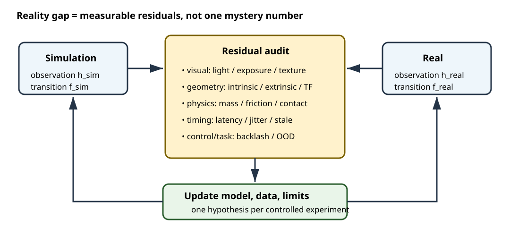
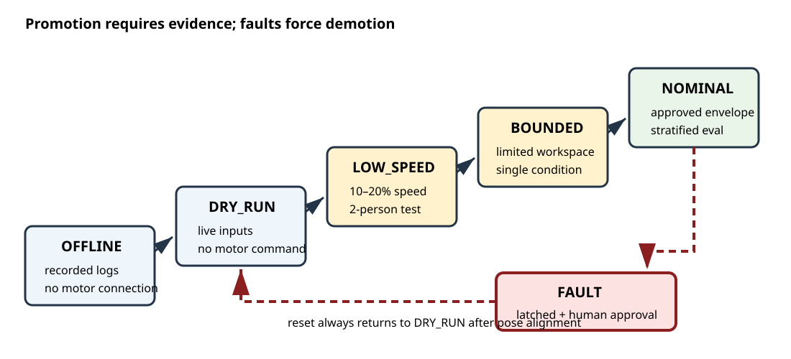
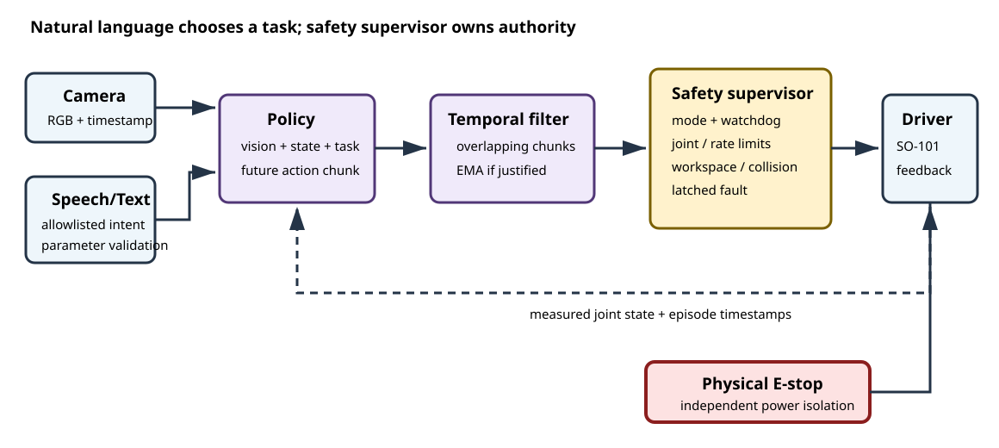
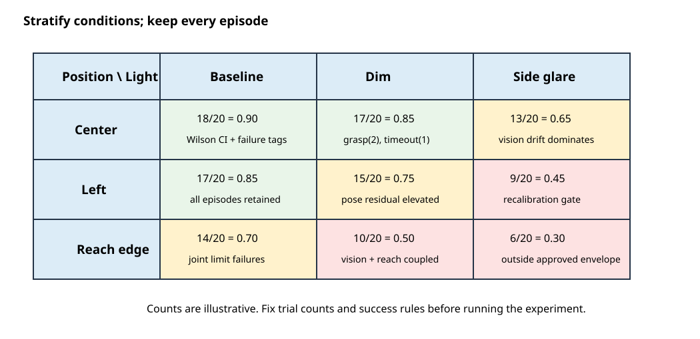

# 제6장 Sim2Real 배포 최적화와 최종 실증

## 장 개요

시뮬레이션에서 95% 성공한 정책이 실물에서 실패하는 원인은 “현실이 더 복잡해서”라는 한 문장으로 끝나지 않는다. 카메라 외부 파라미터 8 mm 오차, USB 통신의 60 ms 꼬리 지연, 서보 백래시, 그리퍼 마찰, 조명 반사처럼 서로 다른 오차가 관측과 행동 루프에서 합성된다. 실무의 Sim2Real은 모델을 한 번 더 학습하는 일이 아니라, 오차를 측정하고 안전하게 가설을 검증하는 시스템 엔지니어링이다.

이 장에서는 Reality Gap을 시각, 기하, 동역학, 시간, 제어, 과업 분포의 여섯 축으로 분해한다. 이어 저역통과 필터(Low-Pass Filter), 지수이동평균(Exponential Moving Average, EMA), 시간 앙상블(Temporal Ensembling)을 구분하고, 작업공간 경계와 워치독을 가진 안전 감독기를 만든다. 마지막으로 SO-101 Pick & Place 정책을 dry-run에서 정상 속도까지 단계적으로 승격하고 성공률과 신뢰구간을 보고한다.

> **안전 면책:** SO-101과 같은 저가형 교육용 로봇이라도 끼임, 충돌, 낙하, 과전류 위험이 있다. 이 장은 위험성 평가나 인증 지침이 아니다. ISO 10218-1:2025는 산업용 로봇 자체의 안전 요구를, ISO 10218-2:2025는 통합과 로봇 셀을 다룬다. 적용 범위와 현장 규정은 별도로 판단해야 한다.[ISO, 2025]



## 학습 목표

이 장을 마치면 학습자는 다음을 수행할 수 있다.

1. Reality Gap을 관측·기하·물리·시간·제어·과업 분포 오차로 분류한다.
2. 지연, jitter, 백래시, 마찰, 카메라 외부 파라미터 오차를 정량 진단한다.
3. EMA와 action chunk 시간 앙상블의 목적과 지연 비용을 설명한다.
4. 작업공간 경계, 관절/속도 제한, 워치독, 데드맨, 독립 E-stop을 계층화한다.
5. dry-run → 저속 → 제한 작업공간 → 정상 운전의 승격 게이트를 설계한다.
6. 음성/텍스트 명령을 정책 입력과 안전 권한으로 분리한다.
7. 성공률과 Wilson 신뢰구간, 조건별 실험 설계를 보고한다.
8. 재현 가능한 로보틱스 포트폴리오를 패키징한다.

## 선수 지식과 준비물

- 제3장: SO-101 기구학, 관절 제한, Leader-Follower 안전
- 제4장: 카메라 좌표계, TF2, 타임스탬프 동기화
- 제5장: LeRobot Dataset, SmolVLA/ACT 계열 정책, action chunk
- Ubuntu 24.04 LTS, ROS 2 Jazzy, Python 3.12
- 선택: SO-101 Follower, 고정 작업대, 카메라, 물리 E-stop 또는 즉시 전원 차단 수단
- 평가용 물체와 트레이, 고정된 조명 조건과 변화 조건

실물 실습자는 장비 전압, 고정 상태, 케이블 경로, 작업공간 비움, 그리퍼 payload, 비상 정지 수단을 점검한다. 한 사람이 실험을 실행하고 다른 한 사람이 E-stop을 담당하는 2인 운용을 권장한다.

## 6.1 Reality Gap의 구조

Reality Gap을 하나의 스칼라로 보지 말고 정책이 받는 관측 $o_t$, 내보내는 행동 $a_t$, 실제 시스템 상태 $x_t$의 경로로 분해한다.

$$
o_t = h_{real}(x_{t-\tau_o};\theta_{camera},\theta_{light})+\epsilon_o
$$

$$
x_{t+1}=f_{real}(x_t,a_{t-\tau_a};\theta_{mass},\theta_{friction},\theta_{backlash})+\epsilon_x.
$$

시뮬레이터의 $h_{sim}, f_{sim}$과 실제 $h_{real}, f_{real}$의 차이가 정책 입력 분포와 전이 분포를 바꾼다. 중요한 것은 각 $\theta$와 지연 $\tau$를 측정할 수 있는 실험으로 바꾸는 것이다.

::: {.learning-aid}
**이해 도움말 — Reality Gap은 하나의 점수가 아니라 원인 지도다**

실물 성공률이 낮다는 사실만으로는 무엇을 고쳐야 할지 알 수 없다. 먼저 “관측이 달라졌는가, 명령 전달이 늦었는가, 같은 명령에도 물체가 다르게 움직였는가”로 경로를 나눈다. 예를 들어 영상의 물체 위치는 맞지만 그리퍼가 늦게 닫히면 시각 랜덤화를 늘릴 문제가 아니라 지연(latency)과 구동 계층을 측정할 문제다. 한 번에 한 범주만 바꾸는 진단 실험이 원인과 처방을 연결한다.
:::

### 6.1.1 오차 분류표

| 범주 | 대표 원인 | 측정량 | 첫 조치 |
|---|---|---|---|
| 시각 | 조도, 반사, 색온도, 노출 | 히스토그램, blur, detector confidence | 카메라 고정, 노출 잠금, 조건별 데이터 |
| 기하 | intrinsic/extrinsic, 프레임 부호 | reprojection error, target pose residual | 재캘리브레이션, TF 감사 |
| 동역학 | 질량, 마찰, 관성, 유연성 | 낙하/슬라이드 시간, 접촉 성공률 | 식별 후 시뮬레이터 범위 조정 |
| 구동 | 백래시, deadband, 포화 | 방향 반전 시 히스테리시스 | 접근 방향 통일, deadband 모델 |
| 시간 | 카메라/추론/통신 지연, jitter | p50/p95/p99 latency, deadline miss | timestamp 분리, 버퍼/주기 조정 |
| 과업 | 물체 위치·색·배경 분포 | 조건별 성공률 | 층화 데이터와 평가 세트 |

### 6.1.2 도메인 랜덤화의 역할과 한계

도메인 랜덤화(Domain Randomization)는 시뮬레이터의 질감, 조명, 카메라, 물리 파라미터를 분포에서 샘플링해 실제 환경을 그 분포의 한 사례로 보게 하는 전략이다. Tobin 등은 비현실적인 질감을 포함한 시뮬레이션 영상만으로 실제 물체 위치 추정과 파지를 시연했다.[Tobin et al., 2017]

하지만 “많이 랜덤화”가 항상 좋은 것은 아니다.

- 실제 범위를 포함하지 않으면 의미가 없다.
- 너무 넓은 범위는 학습 용량을 불필요한 변동에 쓴다.
- 서로 상관된 값, 예를 들어 노출과 조도, 질량과 관성은 독립 샘플링이 비현실적 장면을 만든다.
- 검증 세트까지 같은 난수 생성기로 만들면 일반화를 과대평가한다.
- Isaac Sim Replicator의 API namespace는 버전별로 달라질 수 있으므로 설치 버전 문서를 따른다.[NVIDIA, 2026]

## 6.2 정량 진단

### 6.2.1 지연과 jitter

하나의 프레임이 행동이 되기까지 다음 타임스탬프를 기록한다.

| 기호 | 사건 |
|---|---|
| $t_c$ | 카메라 exposure 또는 캡처 완료 |
| $t_r$ | 애플리케이션 수신 |
| $t_i^0,t_i^1$ | 추론 시작/끝 |
| $t_s$ | 모터 명령 송신 |
| $t_m$ | 모터 상태에서 움직임 관측 |

핵심 지표는 평균만이 아니다.

$$T_{sense}=t_r-t_c,\quad T_{infer}=t_i^1-t_i^0,\quad T_{e2e}=t_m-t_c.$$

p50은 보통 경험, p95/p99는 드문 위험 지연을 보여준다. 다만 20개 표본의 p99는 사실상 최댓값 근처의 보간값일 뿐 tail latency를 안정적으로 추정하지 못한다. latency는 episode 수와 별개로 충분한 control tick/frame 표본을 모으고 `n`, max, deadline miss를 함께 보고한다. 작은 표본의 p95/p99는 탐색적 값으로만 취급한다. 시간원(clock domain)이 다르면 NTP/PTP 동기화 또는 동일 프로세스의 monotonic timestamp를 사용한다. 음수 지연은 로봇이 미래를 본 것이 아니라 시계가 정합되지 않았다는 신호다.

`code/sim2real_diagnostics.py`는 CSV의 latency와 성공 결과를 요약한다. 예상 CSV schema는 `episode_id,condition,success,capture_ns,receive_ns,infer_start_ns,infer_end_ns,send_ns,motion_ns`다.

### 6.2.2 백래시와 deadband

백래시는 명령 방향이 바뀐 뒤 모터축은 움직여도 출력 링크가 늦게 움직이는 구간이다. 측정 절차는 다음과 같다.

1. 안전한 중간 자세에서 한 관절만 선택한다.
2. 작은 양의 증가를 여러 번 명령하고 외부 표식 또는 엔코더로 출력 움직임을 기록한다.
3. 방향을 반대로 바꿔 출력이 실제로 반전되기까지의 명령 누적량을 측정한다.
4. 속도와 payload 조건을 반복한다.

방향 전환 지연을 각도 차이로 환산해 backlash band를 얻는다. 정책 출력에 무조건 역보상을 더하면 노이즈에서 채터링이 생길 수 있다. 동일 방향 접근, 속도 저감, 히스테리시스 모델, 접촉 전 최종 시각 보정을 우선 검토한다.

### 6.2.3 마찰과 그리퍼

시뮬레이션의 마찰 계수를 임의로 “성공할 때까지” 높이지 않는다. 동일 재질 쌍과 접촉 조건에서 다음을 기록한다.

- 경사면에서 미끄러지기 시작하는 임계각 $\theta$: $\mu_s\approx\tan\theta$
- 일정 하중에서 미끄러짐 속도
- 그리퍼 명령값과 물체 유지 성공률
- 물체 질량, 표면, 접촉 면적, 그리퍼 패드 상태

저가형 그리퍼에 힘 센서가 없다면 “명령 위치가 덜 닫혔다”는 사실은 파지력의 직접 측정이 아니다. 물체 걸림과 진짜 파지를 구분할 추가 관측이 필요하다.

### 6.2.4 카메라 외부 파라미터

Eye-to-Hand에서는 베이스와 고정 카메라 사이 변환, Eye-in-Hand에서는 엔드이펙터와 카메라 사이 변환을 추정한다. Hand-eye calibration은 보통

$$AX=XB$$

형태의 여러 pose 쌍을 푼다. Tsai와 Lenz는 카메라와 로봇의 상대 운동으로 3D hand-eye 관계를 구하는 고전적 방법을 제시했다.[Tsai and Lenz, 1989]

한 개의 reprojection error 숫자만 보지 않는다. 작업 공간 전체에 보드를 배치하고 다음을 확인한다.

- 중앙과 모서리의 reprojection residual
- 거리/방향별 pose residual
- 장착 나사를 다시 조인 뒤 반복성
- 온도와 케이블 장력 변화
- TF의 프레임 방향과 timestamp

## 6.3 출력 안정화

### 6.3.1 EMA 저역통과 필터

관절 목표 $u_t$에 EMA를 적용하면

$$
y_t=\alpha u_t+(1-\alpha)y_{t-1},\quad 0<\alpha\le1
$$

이다. 작은 $\alpha$는 노이즈를 줄이지만 phase lag를 늘린다. 안전 제한보다 필터를 먼저 적용하면 필터 내부 상태가 경계 밖 값을 저장할 수 있다. 권장 순서는 정책 출력 검증 → 단위 변환 → 시간 앙상블/필터 → 속도 제한 → 위치·작업공간 제한 → 드라이버다.

필터는 문제를 숨길 수 있다. 타임스탬프 역전, NaN, 통신 끊김은 smoothing 대상이 아니라 fault다.

### 6.3.2 Temporal Ensembling

Action chunk 정책은 매 시점 미래 행동 시퀀스를 예측한다. 시점 $t$의 행동에는 과거 여러 추론 chunk가 제안한 값이 겹친다. 이를 가중 평균하면 chunk 경계의 불연속을 줄일 수 있다.

$$
\hat a_t=\frac{\sum_{k\in K_t}w_{t,k}a_t^{(k)}}{\sum_{k\in K_t}w_{t,k}}.
$$

ACT는 action chunking과 temporal ensembling으로 모방학습의 누적 오차와 비정상적 시연 문제를 다룬다.[Zhao et al., 2023] `code/temporal_filters.py`는 EMA와 겹치는 chunk의 지수 가중 평균을 구현한다.

시간 앙상블은 안전 감독기를 대체하지 않는다. 먼저 proposal마다 schema, unit, finite, timestamp freshness, task/phase, 기본 hard limit을 확인해 stale/invalid proposal을 제거한다. 유효 후보만 합성한 뒤 최종 출력에 joint/workspace/rate/collision limit을 다시 적용한다. grasp/open/retreat처럼 mode가 바뀌거나 E-stop/reset이 발생하면 ensemble history를 비운다. 서로 다른 chunk가 모두 경계 밖 행동을 제안하면 평균도 위험하다.

## 6.4 안전 배포 감독기



### 6.4.1 승격 상태

| 단계 | 모터 | 속도 | 작업공간 | 통과 기준 예시 |
|---|---|---:|---|---|
| 0. OFFLINE | 분리 | - | 로그 재생 | NaN 0건, schema/단위 확인 |
| 1. DRY_RUN | 미명령 | 계산만 | 전체를 검사 | 경계 위반률 0, latency 예산 충족 |
| 2. LOW_SPEED | 활성 | 10~20% | 보수적 박스 | 무부하 20회, E-stop 시험 |
| 3. BOUNDED | 활성 | 30~50% | 실제 과업 일부 | 단일 물체 20회, 충돌 0 |
| 4. NOMINAL | 활성 | 승인값 | 승인 작업공간 | 조건별 평가 및 운영 승인 |

승격은 단방향 자동 증가가 아니다. 다음 사건은 즉시 HOLD 또는 FAULT로 강등한다.

- 워치독 timeout 또는 deadline 연속 위반
- NaN/Inf, 관절 이름/차원 불일치
- 작업공간/관절 한계 위반
- E-stop, 모터 오류, 카메라 입력 손실
- 정책/캘리브레이션/URDF 해시 변경

FAULT에서 자동 재개하지 않는다. 원인 기록, 작업공간 확인, 자세 재정렬, 사람 승인 후 낮은 단계부터 다시 시작한다.

### 6.4.2 작업공간 Bounding Box

베이스 프레임에서 엔드이펙터 위치 $p=(x,y,z)$가

$$p_{min}\le p\le p_{max}$$

를 만족해야 한다. 축 정렬 박스는 구현이 쉽지만 장애물과 로봇 자체 충돌을 표현하지 못한다. 따라서 최소한 다음을 결합한다.

- 관절 soft limit
- 엔드이펙터 bounding box
- 테이블 아래 $z$ 금지
- 최대 관절 변화/속도
- self-collision/환경 collision 검사
- gripper payload와 접근 방향 규칙

정책의 Cartesian target을 단순 clamp하면 방향이 바뀌거나 표면을 따라 미끄러질 수 있다. 큰 위반은 clamp보다 거부와 HOLD가 안전하다.

작업공간 검사는 반드시 **어느 좌표계의 값인지**와 함께 수행한다. `PoseStamped`의 `frame_id`가 `base_link`와 다르면 숫자만 base 좌표로 재표기해서는 안 된다. 이 장의 교육용 guard는 보수적으로 동일 `base_link` frame만 허용한다. 다른 frame을 지원하려면 TF2로 메시지 timestamp 시점의 transform을 조회하고, transform timeout/extrapolation은 latched FAULT로 처리한다.

### 6.4.3 워치독과 생명주기

워치독은 “마지막 메시지가 왔는가”뿐 아니라 current/target의 source timestamp, 수신 시각, 추론 완료, 명령 송신, Follower 상태 피드백을 각각 본다. 서로 다른 timeout 원인을 하나의 `stale`로 합치지 않는다. position뿐 아니라 quaternion의 finite와 norm도 검증한다.

ROS 2 노드는 구성되지 않은 상태, inactive, active, error를 구분하는 managed lifecycle을 사용할 수 있다. 그러나 lifecycle state 자체가 안전 기능의 인증을 뜻하지 않는다. 실제 토크 차단은 드라이버와 하드웨어 계약으로 검증해야 한다.

`code/safety_supervisor.py`는 하드웨어 비종속 상태 머신이고 `code/ros2_ws/.../workspace_guard.py`는 교육용 ROS 2 노드다.

::: {.learning-check}
**잠깐 점검 — 안전 감독기는 언제 멈춰야 하는가**

1. 목표가 작업공간 경계를 크게 벗어났을 때 경계값으로 clamp하는 것보다 HOLD가 나은 이유는 무엇인가?
2. 정책이나 캘리브레이션 파일의 hash가 바뀌면 이전 승격 상태를 그대로 유지해도 되는가?

**확인 포인트:** 큰 위반을 clamp하면 의도와 다른 경로를 만들 수 있으므로 명령을 거부하고 원인을 확인한다. 정책·캘리브레이션 변경은 검증했던 시스템 계약을 바꾸므로 낮은 단계에서 다시 승인해야 한다.
:::

## 6.5 End-to-End Pick & Place 배포



### 6.5.1 배포 전 고정해야 할 계약

- 정책 체크포인트 해시와 학습 데이터 버전
- base model/adapter/dataset exact revision과 train episode ID
- train-only normalization stats/hash (`meta/stats.json` 전역 통계와 구분)
- 카메라 serial, 해상도, FPS, exposure, mount
- 관절 이름, 순서, 단위, 캘리브레이션 ID
- camera `rename_map`, action representation, inverse-normalization 계약
- 언어 prompt grammar
- action chunk 크기, 실행 주기, temporal ensemble 파라미터
- workspace/joint/rate limit
- reset pose와 에피소드 성공/실패 정의

LeRobot의 실물 로봇 튜토리얼은 시연 기록, 데이터 시각화, 정책 학습, 평가의 전체 흐름을 제공한다. 최신 CLI는 변경될 수 있으므로 공식 문서를 기준으로 명령을 기록한다.[Hugging Face LeRobot]

최신 배포에서는 local RTC와 remote inference를 구분한다. local RTC는 rollout process의 background thread에서 동작하고, remote backend는 별 process/host의 policy server와 통신한다. `execution_horizon`, `max_observation_age_s`, action/startup timeout, starvation grace를 실측 지연과 chunk horizon에 맞춰 설정한다. buffer exhaustion이나 freshness 위반은 무기한 마지막 명령 유지가 아니라 HOLD/FAULT로 연결한다. task 변경 시 이전 instruction의 queue와 in-flight 결과를 폐기한다.[Hugging Face Policy Deployment/RTC]

### 6.5.2 권장 실행 순서

1. 녹화 영상과 관절 로그를 재생하는 offline inference
2. live camera + 모터 미명령 shadow inference
3. 시작 pose에서 단일 action chunk를 계산하고 사람이 검토
4. 저속, 빈 그리퍼, 넓은 장애물 여유
5. 제한 workspace에서 단일 색/단일 위치
6. 위치 변화, 조명 변화, distractor를 한 축씩 추가
7. 승인된 분포에서 정상 속도 평가

모든 단계에서 원시 관측, 정책 출력, 필터 출력, 최종 명령, 관절 피드백, 상태 전이, 사람 개입을 같은 episode ID로 기록한다.

### 6.5.3 음성/텍스트 명령 경계

자연어는 과업 선택 입력이지 안전 권한이 아니다. 음성 인식 결과를 shell, ROS topic 이름, 파일 경로, arbitrary prompt template에 직접 삽입하지 않는다.

안전한 경계는 다음과 같다.

```text
speech/text → normalization → allowlisted intent → parameter validation
            → human confirmation(if required) → fixed task template → policy
```

예를 들어 허용 intent를 `PICK_RED_TO_BLUE`, `PICK_BLUE_TO_RED`, `STOP`으로 제한한다. “더 빨리”, “안전 제한 해제”, “테이블 밖 물체 집기”는 정책 prompt가 아니라 거부 대상이다. ASR confidence가 낮거나 색/대상이 모호하면 움직이지 않고 재질문한다. `STOP`은 자연어 모델을 거치지 않는 별도 저지연 경로로 처리하되 물리 E-stop을 대체하지 않는다.

## 6.6 평가 설계

### 6.6.1 성공 정의

Pick & Place의 성공을 “그럴듯한 영상”으로 평가하지 않는다. 에피소드 시작 전에 판정 규칙을 고정한다.

- 목표 물체가 지정 tray 내부에 완전히 놓임
- 제한 시간 내 완료
- 비목표 물체 이동 임계값 이하
- workspace/joint limit 위반 없음
- 사람 개입, E-stop, 물체 낙하는 실패

부분 성공은 별도 지표로 기록하지만 주 성공률의 정의를 사후 변경하지 않는다.

### 6.6.2 성공률과 Wilson 신뢰구간

$n$회 중 $s$회 성공이면 $\hat p=s/n$이다. 작은 표본에서 단순 Wald 구간 $\hat p\pm1.96\sqrt{\hat p(1-\hat p)/n}$은 0%나 100% 근처에서 나쁘다. 95% Wilson 구간은

$$
\frac{\hat p+z^2/(2n)\pm z\sqrt{\hat p(1-\hat p)/n+z^2/(4n^2)}}{1+z^2/n},\quad z=1.96
$$

를 사용한다. NIST는 이항 비율 구간에서 Wilson 방법을 소개하고 관련 성능 문헌을 연결한다.[NIST]

예를 들어 10회 중 9회 성공은 점추정 90%지만 불확실성이 크다. 조건당 최소 20회 이상을 시작점으로 삼되 필요한 표본 수는 허용 오차와 위험에 따라 사전에 정한다. 성공률의 episode 표본과 latency의 control tick/frame 표본을 같은 `n`으로 오해하지 않는다. LeRobot의 정책 기여 안내도 실물 전용 정책 결과에 재현 명령과 하드웨어, 10회 이상의 성공률 보고를 요구한다.[Hugging Face]

### 6.6.3 층화 실험

| 요인 | 수준 예시 |
|---|---|
| 물체 위치 | 중앙, 좌, 우, near reach limit |
| 조명 | 기준, 어두움, 측면 반사 |
| 물체 색/재질 | 학습 내, 학습 경계, 미관측 |
| 카메라 | 기준, ±5 mm, ±2° perturbation |
| 지연 | 기준, +20 ms, +50 ms |

한 번에 여러 조건을 바꾸면 원인을 분리하기 어렵다. 순서를 무작위화하고 reset 절차를 동일하게 유지한다. 실패 영상만 골라 보여주는 survivorship bias와, 성공할 때까지 반복한 뒤 마지막 시도만 세는 선택 편향을 피한다.



## 6.7 트러블슈팅 매트릭스

| 현상 | 가설 | 확인할 로그/시험 | 조치 |
|---|---|---|---|
| 관절 떨림 | chunk 경계 불연속, 높은 gain | raw/ensemble/final action 비교 | temporal ensemble, rate limit, gain 조정 |
| 목표를 지나침 | latency, EMA lag, backlash 보상 과다 | p95 e2e, 방향 반전 응답 | 속도 하향, latency 보정, 보상 축소 |
| 파지 후 미끄러짐 | 마찰/토크/payload | 물체별 유지 시간, 패드 상태 | 패드·접근 개선, payload 축소 |
| 카메라 중앙만 성공 | extrinsic/intrinsic 잔차 | 위치별 reprojection residual | 작업공간 전체 재캘리브레이션 |
| 특정 조명에서 실패 | exposure/반사 OOD | histogram, confidence, raw frame | 노출 고정, 조건 데이터/랜덤화 |
| 첫 동작이 큼 | reset pose/첫 chunk 불일치 | 첫 관측과 명령 차이 | 정렬 slew, 첫 프레임 승인 |
| 가끔 오래 멈춤 | 추론 p99, GPU contention | stage timestamps | deadline, 모델 경량화, newest-only queue |
| 물체 대신 배경 파지 | shortcut learning | occlusion/배경 교체 실험 | 데이터 균형, distractor, 시각화 |
| 음성 오인식 후 오동작 | open-ended prompt | ASR/intent 로그 | allowlist, 확인, 모호성 거부 |
| E-stop 후 즉시 재동작 | 자동 복구 | 상태 전이 로그 | latched FAULT, 수동 reset/재정렬 |

## 6.8 포트폴리오 패키징

좋은 포트폴리오는 최고 성공 영상 하나가 아니라 재현 가능한 엔지니어링 주장이다.

### 필수 구조

```text
project/
├── README.md                 # 문제, 결과, 안전 범위, 빠른 시작
├── docs/architecture.svg
├── configs/                 # limit, camera, policy version
├── src/                     # inference, supervisor, bridge
├── launch/
├── experiments/
│   ├── protocol.md
│   ├── results.csv
│   └── failure_taxonomy.md
├── media/                   # 성공뿐 아니라 대표 실패 영상
├── model_card.md
├── dataset_card.md
└── LICENSES/
```

README에는 Ubuntu/ROS 2/GPU/카메라/로봇 버전, 설치 명령, 실행 명령, 기대 출력, 알려진 한계, 안전 경고를 둔다. 비밀키, Hub token, 사람 얼굴/음성, 사유 공간 영상은 제거한다. 외부 모델, CAD, 이미지, 폰트의 라이선스를 기록한다.

### 보고할 결과

- 전체와 조건별 성공률 + Wilson 95% CI
- latency p50/p95/p99와 deadline miss
- failure taxonomy와 대표 실패 사례
- 필터/안전 감독기 전후 비교
- sim-only, shadow, low-speed, nominal 단계별 증거
- 재현 가능한 checkpoint/dataset/config hash

## 6.9 단계별 실습

### 실습 1: 로그 진단과 신뢰구간

[실습 6-1: Sim2Real 로그 진단](#lab-6-1)을 따른다.

```bash
python code/sim2real_diagnostics.py --demo
```

**예상 출력 예시**

```text
episodes=20 success=15 rate=0.750 wilson95=[0.531, 0.888]
infer_ms  n=20 p50=31.1 p95=41.5 p99=n/a(n<100) max=42.3
e2e_ms    n=20 p50=82.4 p95=105.3 p99=n/a(n<100) max=107.0
condition=baseline     n=10 success= 8 rate=0.800 ci95=[0.490, 0.943]
condition=side_light   n=10 success= 7 rate=0.700 ci95=[0.397, 0.892]
```

### 실습 2: 필터와 안전 승격

[실습 6-2: Temporal Filter와 안전 승격 감독기](#lab-6-2)를 따른다.

```bash
python code/temporal_filters.py
python code/safety_supervisor.py
```

**예상 출력 예시**

```text
mode=DRY_RUN accepted=True send_to_hardware=False
promotion DRY_RUN -> LOW_SPEED: approved
workspace violation: latched FAULT
reset denied: human approval and pose alignment required
```

### 실습 3: ROS 2 Workspace Guard

[실습 6-3: ROS 2 Cartesian Workspace Guard](#lab-6-3)를 따른다.

```bash
cd code/ros2_ws
source /opt/ros/jazzy/setup.bash
colcon build --symlink-install
source install/setup.bash
ros2 run sim2real_safety workspace_guard
```

## 6.10 요약

- Reality Gap은 시각, 기하, 동역학, 구동, 시간, 과업 분포의 측정 가능한 오차다.
- 평균 지연보다 충분한 표본의 p95/p99, `n`/max, clock domain, deadline miss가 안전 배포에 중요하다.
- 도메인 랜덤화는 실제 범위를 포함하는 분포 설계이며 무제한 변동이 아니다.
- EMA와 temporal ensemble은 출력 불연속을 줄이지만 지연과 안전 한계 문제를 해결하지 않는다.
- 배포는 offline/dry-run/저속/제한 작업공간/정상 운전의 승격 게이트를 거친다.
- 자연어는 과업 입력이며 권한 상승이나 안전 제한 해제 수단이 아니다.
- 성공률은 사전 정의한 판정과 조건별 시행 수, Wilson 신뢰구간과 함께 보고한다.
- 포트폴리오는 성공 영상뿐 아니라 실패, 버전, 안전 범위, 재현 명령을 포함한다.

## 6.11 확인문제

1. Reality Gap을 하나의 수치로만 관리하면 어떤 원인 분리가 어려운가?
2. p50 latency만 보고 배포 여부를 결정하면 안 되는 이유는 무엇인가?
3. 백래시 보상을 크게 설정했을 때 채터링이 생기는 이유를 설명하라.
4. EMA의 $\alpha$를 작게 하면 노이즈와 지연은 각각 어떻게 변하는가?
5. temporal ensemble 뒤에도 rate/workspace limit이 필요한 이유는 무엇인가?
6. Cartesian target의 큰 workspace 위반을 clamp보다 거부해야 하는 이유를 제시하라.
7. E-stop 해제 후 자동으로 NOMINAL 상태로 돌아가면 안 되는 이유는 무엇인가?
8. 음성 명령에서 allowlist intent가 필요한 이유는 무엇인가?
9. 10회 중 9회 성공이라는 결과가 “성공률 90%가 확실하다”를 뜻하지 않는 이유는 무엇인가?
10. 성공 사례만 담은 포트폴리오가 시스템 역량을 과대평가하는 이유를 설명하라.

해설은 [제6장 확인문제 해설](#chapter-6-solutions)에 있다.

## 6.12 최종 프로젝트

### 안전한 SO-101 Pick & Place 실증

다음 산출물을 만든다.

1. 고정된 task contract와 성공/실패 판정
2. offline 20 episode replay와 latency 분석
3. dry-run/shadow inference 보고서
4. 저속·제한 workspace 실물 시험
5. 최소 3개 조건, 조건당 20 episode 평가
6. 성공률, Wilson 95% CI, failure taxonomy
7. E-stop/timeout/workspace violation 시험 증거
8. 재현 가능한 저장소와 3분 기술 설명 영상

평가 기준은 [최종 프로젝트 평가 기준](#chapter-6-project-rubric)에 있다.

## 6.13 실습·평가·참고자료

이 절 아래에 장별 참고문헌, 단계별 실습, 확인문제 해설과 최종 프로젝트 평가 기준을 한데 모았다.

### 6.13.1 참고문헌

1. Hugging Face, [Getting Started with Real-World Robots](https://huggingface.co/docs/lerobot/main/getting_started_real_world_robot), 2026년 접근.
2. Hugging Face, [Adding a Policy](https://huggingface.co/docs/lerobot/bring_your_own_policies), 실물 평가 결과 보고 지침, 2026년 접근.
3. NVIDIA, [Isaac Sim Randomization Snippets](https://docs.isaacsim.omniverse.nvidia.com/latest/replicator_tutorials/tutorial_replicator_isaac_randomizers.html), 2026년 접근.
4. NVIDIA, [Replicator Domain Randomization Migration](https://docs.isaacsim.omniverse.nvidia.com/latest/migration_guides/isaac_sim_6_0/replicator_domain_randomization_to_experimental.html), 2026년 접근.
5. J. Tobin et al., “Domain Randomization for Transferring Deep Neural Networks from Simulation to the Real World,” IROS 2017, [arXiv:1703.06907](https://arxiv.org/abs/1703.06907).
6. T. Z. Zhao et al., “Learning Fine-Grained Bimanual Manipulation with Low-Cost Hardware,” RSS 2023, [arXiv:2304.13705](https://arxiv.org/abs/2304.13705).
7. R. Y. Tsai and R. K. Lenz, “A New Technique for Fully Autonomous and Efficient 3D Robotics Hand/Eye Calibration,” *IEEE Transactions on Robotics and Automation*, 5(3), 1989, [DOI:10.1109/70.34770](https://doi.org/10.1109/70.34770).
8. NIST/SEMATECH, [Confidence Intervals for a Binomial Proportion](https://www.itl.nist.gov/div898/handbook/prc/section2/prc241.htm), 2026년 접근.
9. L. D. Brown, T. T. Cai, A. DasGupta, “Interval Estimation for a Binomial Proportion,” *Statistical Science*, 16(2), 2001, [DOI:10.1214/ss/1009213286](https://doi.org/10.1214/ss/1009213286).
10. ISO, [ISO 10218-1:2025 Robotics — Safety requirements — Part 1](https://www.iso.org/standard/73933.html), 2025.
11. ISO, [ISO 10218-2:2025 Robotics — Safety requirements — Part 2](https://www.iso.org/standard/73934.html), 2025.
12. ROS 2, [Managed Nodes](https://design.ros2.org/articles/node_lifecycle.html), lifecycle 설계 문서.
13. ROS 2 Jazzy, [Quality of Service Settings](https://docs.ros.org/en/jazzy/Concepts/Intermediate/About-Quality-of-Service-Settings.html), deadline/liveliness/QoS.
14. ROS 2 Jazzy, [Using stamped datatypes with tf2_ros::MessageFilter](https://docs.ros.org/en/jazzy/Tutorials/Intermediate/Tf2/Using-Stamped-Datatypes-With-Tf2-Ros-MessageFilter.html), timestamp와 frame 기반 변환.
15. Hugging Face, [Policy Deployment](https://huggingface.co/docs/lerobot/main/inference), local RTC freshness/timeout 계약, 2026년 접근.
16. Hugging Face, [Real-Time Chunking](https://huggingface.co/docs/lerobot/main/rtc), 2026년 접근.
17. Hugging Face, [Remote Inference](https://huggingface.co/docs/lerobot/main/remote_inference), 2026년 접근.

