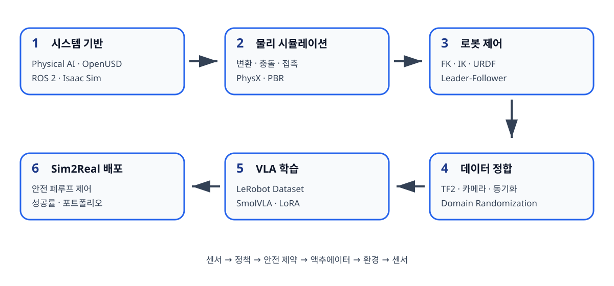

# 이 책의 사용법

## 학습 경로

기존 여섯 장은 로봇팔·시뮬레이션·센서·VLA·배포를 잇는 하나의 응용 프로젝트다. 확장된 통합 과정은 M00~M33의34모듈로 구성되며, 처음에는 [E1의 M00~M03 기초](/curriculum/#area-foundations)를 읽고 목표·진단 결과에 맞는 응용 경로를 고른다. 모든 모듈의 신규 본문이 완성된 것은 아니므로 완료 항목은 별도 상태 배지를 붙이지 않고 미완료 항목만 `준비중`으로 표시한다. 기존 여섯 장과 새 기초의 본문을 독립된 전체 과정 두 개로 이중 이수할 필요는 없다.

E1 기초 다음에는 [M05 ROS 2](/modules/M05/), [M06 기구학](/modules/M06/), [M07 동역학·제어](/modules/M07/), [M08 로봇 모델](/modules/M08/)의 E2를 응용 장의 필요한 부분과 이어 읽는다. 새 설명은 로그·계산·모형 활동으로 개념을 먼저 익히는 경로이며, 기존 실제 ROS·시뮬레이터·장비 실습의 실행을 대신 입증하지 않는다. 권장 선수와 목표를 확인해 부족한 부분부터 보충한다.

{#fig-learning-path}

1. Physical AI 시스템의 전체 구조와 ROS 2·OpenUSD 기초를 익힌다.
2. Isaac Sim에서 물리적으로 일관된 작업 환경을 만든다.
3. SO-101의 기구학과 Leader-Follower 제어를 구현한다.
4. 카메라와 관절 데이터를 동일한 좌표·시간 기준으로 정합한다.
5. 시연 데이터를 LeRobot 형식으로 구성하고 SmolVLA를 학습한다.
6. 학습 정책을 안전한 폐루프 제어기로 배포하고 Sim2Real 성능을 평가한다.

E3는 [M10 시뮬레이션 기초](/modules/M10/), [M11 ML/PyTorch](/modules/M11/), [M12 카메라 비전](/modules/M12/)과 M14의 [보정](/study/unit-m14-01-a/)·[시간 정합](/study/unit-m14-03-a/)·[오차 기록](/study/unit-m14-06-a/)을 연결한다. M14 전체를 완료한 과정은 아니며 센서별 정합·EKF·다중모달3D융합은 E6에서 이어진다. 설명과 합성 입력/작은CPU 예제를 먼저 읽고 실제 시뮬레이터·학습·검출 실행은 준비 환경과 검증 범위를 확인한 뒤 선택한다.

E4는 [M19 로봇팔](/modules/M19/)·[M20 데이터](/modules/M20/)·[M21 모방학습](/modules/M21/)·[M22 접지된 실행](/modules/M22/)·[M27 엣지](/modules/M27/)·[M30 배포·평가](/modules/M30/)·[M32 캡스톤](/modules/M32/)을 기존 여섯 장과 이어 읽는 42개 단위다. 각 기본 과제는 제공 기록과 설명으로 선수 개념을 보충한다. 모바일 경로는 아래 E5로 연결하며 보행 등 미집필 내용의 학습을 전제하지 않는다. 실제 장비·정책 실행은 환경을 갖춘 뒤 별도로 검증한다. 캡스톤 교재의 공개와 학습자의 프로젝트 완료는 다르다.

E5의 모바일 경로는 [M09 Gazebo·센서 시뮬레이션](/modules/M09/) → [M15 SLAM·지도·위치추정](/modules/M15/) → [M17 경로·궤적](/modules/M17/) → [M18 Nav2·미션](/modules/M18/) 순서다. E2의 ROS·기구학·제어·모델과 M14의 시간·보정 기초를 먼저 확인한다. 각 단위는 제공된 수치·합성 로그로 기본 활동을 수행할 수 있으며 Gazebo·Nav2를 실제로 실행한 결과와 구분한다. 이후 [M32.01 모바일 캡스톤](/study/unit-m32-01-a/)의 요구사항·실험표를 구체화한다. 아래 여섯 장의 로봇팔 응용 예제를 모바일 주행 시스템의 완성본으로 해석하지 않는다.

## 코드 표기

- `$`로 시작하는 줄은 일반 사용자 셸 명령이다.
- 예제 셸 코드 블록에서 줄 앞에 놓인 `#`는 주석을 시작한다. 따옴표 안의 `#`는 문자열일 수 있으므로 구분한다. 터미널 프롬프트의 `#`로 root 권한을 표시하는 관례와 구분하며, 주석을 관리자 명령으로 실행하지 않는다.
- Python 코드는 Python 3.12와 타입 힌트를 기준으로 한다.
- ROS 2 C++ 코드는 C++17과 `rclcpp`를 기준으로 한다.
- 코드 블록 위에는 가능한 경우 대응 파일 경로를 적는다.

## 명령 실행 위치

장별 명령은 별도 안내가 없으면 **해당 장의 루트 폴더**에서 실행한다. 예를 들어 제4장 명령의 기준 위치는 다음과 같다.

```bash
cd ebook/book/04_sensor_data_pipeline
```

각 실습 파일도 첫 명령에서 장 루트로 이동한 뒤 `code/...` 경로를 사용한다. EPUB/PDF만 읽는 경우에는 배포된 예제 저장소의 루트에서 같은 경로를 적용한다.

## 실물 장비와 시뮬레이션

각 실습은 다음 표식을 사용한다. `[SIM]`은 실물 로봇이 필요 없다는 뜻이며 모든 시뮬레이터가 브라우저만으로 실행된다는 뜻은 아니다. Isaac Sim 실행에는 해당 GPU·소프트웨어 환경이 필요하다. [M00.06](/study/unit-m00-06-a/)에서 브라우저 근사·수치 계산·고정 로그 재생·실제 시뮬레이터·실물 폐루프를 구분하고, 보고서에 수행한 경로를 명시한다.

- **[SIM]** 실물 장비 없이 수행 가능한 시뮬레이션 실습
- **[HW]** SO-101 또는 동등한 로봇팔이 필요한 실습
- **[SIM→HW]** 시뮬레이션에서 검증한 뒤 실물로 이식하는 실습
- **[SAFETY]** 사람과 장비 보호를 위해 반드시 확인할 항목

여러 표식이 함께 붙을 수 있다. `[HW] [SAFETY]` 실습은 안전 수칙을 확인하고 물리적 전원 차단 수단을 준비하기 전에는 시작하지 않는다.

## 예상 출력

책에 수록된 터미널 출력, 그래프 값, 학습 손실, 성공률은 실행 환경을 설명하기 위한 예시다. 숫자 자체보다 출력의 형태와 판단 기준을 학습하는 데 사용한다.

