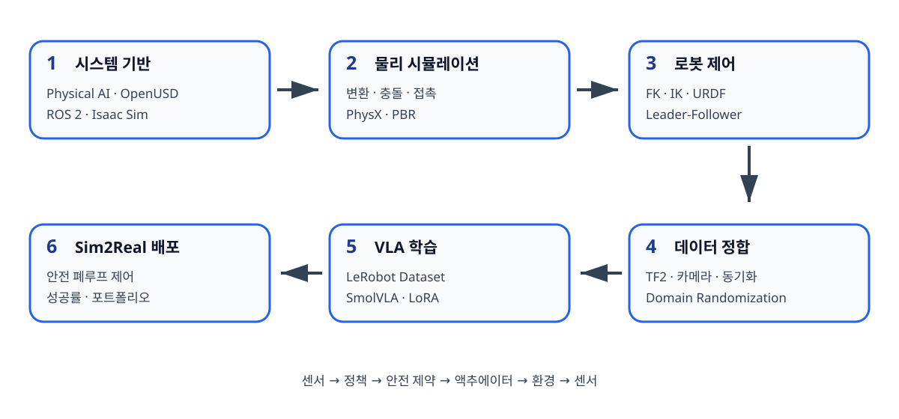

# 이 책의 사용법

## 학습 경로

책은 여섯 장이 하나의 프로젝트로 이어지도록 구성되어 있다.

{#fig-learning-path}

1. Physical AI 시스템의 전체 구조와 ROS 2·OpenUSD 기초를 익힌다.
2. Isaac Sim에서 물리적으로 일관된 작업 환경을 만든다.
3. SO-101의 기구학과 Leader-Follower 제어를 구현한다.
4. 카메라와 관절 데이터를 동일한 좌표·시간 기준으로 정합한다.
5. 시연 데이터를 LeRobot 형식으로 구성하고 SmolVLA를 학습한다.
6. 학습 정책을 안전한 폐루프 제어기로 배포하고 Sim2Real 성능을 평가한다.

## 코드 표기

- `$`로 시작하는 줄은 일반 사용자 셸 명령이다.
- `#`로 시작하는 셸 명령은 관리자 권한이 필요한 예시일 수 있다.
- Python 코드는 Python 3.12와 타입 힌트를 기준으로 한다.
- ROS 2 C++ 코드는 C++17과 `rclcpp`를 기준으로 한다.
- 코드 블록 위에는 가능한 경우 대응 파일 경로를 적는다.

## 명령 실행 위치

장별 명령은 별도 안내가 없으면 **해당 장의 루트 폴더**에서 실행한다. 예를 들어 제4장 명령의 기준 위치는 다음과 같다.

```bash
cd ebook/book/04_sensor_data_pipeline
```

각 실습 파일도 첫 명령에서 장 루트로 이동한 뒤 `code/...` 경로를 사용한다. EPUB/PDF만 읽는 경우에는 배포된 예제 저장소의 루트에서 같은 경로를 적용한다.

## 실물 장비와 시뮬레이션

각 실습은 다음 표식을 사용한다.

- **[SIM]** 실물 장비 없이 수행 가능한 시뮬레이션 실습
- **[HW]** SO-101 또는 동등한 로봇팔이 필요한 실습
- **[SIM→HW]** 시뮬레이션에서 검증한 뒤 실물로 이식하는 실습
- **[SAFETY]** 사람과 장비 보호를 위해 반드시 확인할 항목

여러 표식이 함께 붙을 수 있다. `[HW] [SAFETY]` 실습은 안전 수칙을 확인하고 물리적 전원 차단 수단을 준비하기 전에는 시작하지 않는다.

## 예상 출력

책에 수록된 터미널 출력, 그래프 값, 학습 손실, 성공률은 실행 환경을 설명하기 위한 예시다. 숫자 자체보다 출력의 형태와 판단 기준을 학습하는 데 사용한다.

